import { Callout } from "fumadocs-ui/components/callout";
import { Tabs, Tab } from "fumadocs-ui/components/tabs";
import { Steps, Step } from "fumadocs-ui/components/steps";
import { Cards, Card } from "fumadocs-ui/components/card";
import {
  Concepts,
  LessonIntro,
  AnalogyCard,
  Explain,
  LessonNote,
  TryIt,
  Takeaway,
} from "@/components/cs101/lesson-blocks";

<Concepts
  items={[
    "Direct Addressing vs Hashing",
    "Hash Function Construction (Division, Multiplication, Mid-Square, Folding)",
    "Pigeonhole Principle & Birthday Paradox",
    "Separate Chaining & Java 8 Treeification",
    "Open Addressing (Linear, Quadratic, Double Hashing)",
    "Primary vs Secondary Clustering",
    "Load Factor & Rehashing",
    "Tombstone Deletion Marker",
    "Swiss Tables & SIMD Control Bytes",
    "HashDoS & SipHash Defense",
  ]}
/>

<LessonIntro>

Imagine you manage inventory for an online superstore stocking **500,000 distinct products**, each identified by a 12-character barcode string like `"SONY-WH1000-XM5"`.

When a customer orders an item, how does your database locate its warehouse shelf?

- If you use **Linear Search ($O(N)$)**, an employee walks aisle-by-aisle inspecting up to 500,000 bins. Lookups take 45 minutes.
- If you use **Direct Addressing**, you build an array with an index for every possible 12-character alphanumeric string ($36^{12} \approx 4.7 \times 10^{18}$ slots). Lookups take $O(1)$, but storing that array requires **18 exabytes of RAM**—more than the combined storage of Google and Amazon!

**Hash Tables** are the ultimate software compromise. By passing an arbitrary key through a mathematical **Hash Function**, we project an immense or infinite key space into a compact array in **constant $O(1)$ time**.

Yet this power introduces computer science's most celebrated puzzle: **What happens when two completely different keys map to the exact same array slot?**

</LessonIntro>

---

## 01 — Everyday Physical Analogies: The Coat Check & Direct Lockers

To build an unshakable mental model before writing a single line of math, compare how physical services store and retrieve items:

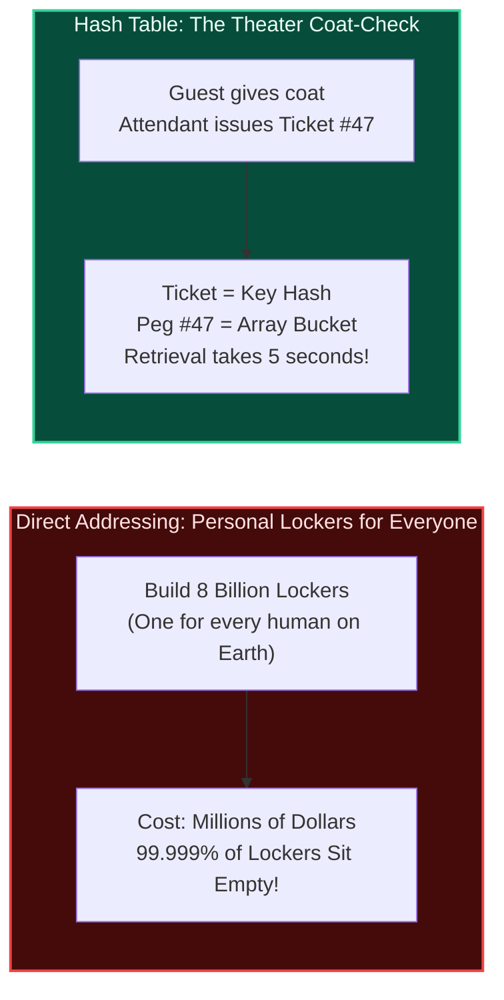

<AnalogyCard name="The Direct Locker System vs. The Coat Check">
  <div>
    <strong>Direct Addressing (Dedicated Lockers)</strong>
    <p>
      Imagine a concert venue that assigns a permanent, dedicated locker to
      every citizen in the state. If ticket holder #42,891 arrives, they walk
      straight to Locker #42,891 in $O(1)$ time. But on a night with only 300
      attendees, hundreds of thousands of lockers sit completely empty. It
      provides guaranteed instant access at the expense of ruinous, bankrupting
      real estate waste.
    </p>
  </div>
  <div>
    <strong>The Hash Table (The Claim Ticket)</strong>
    <p>
      Instead of building millions of lockers, the venue builds a single rack
      with <strong>500 hooks</strong>. When you hand over your coat, the
      attendant issues you a claim ticket with a number between 0 and 499
      derived from your ticket code. When you return, the attendant turns
      directly to that specific hook in $O(1)$ time. Compact space, instant
      retrieval.
    </p>
  </div>
</AnalogyCard>

### What Happens When Two Coats Need the Same Peg?

If a ticketing glitch or crowded room assigns two guests to **Peg #47**, the attendant must resolve the collision:

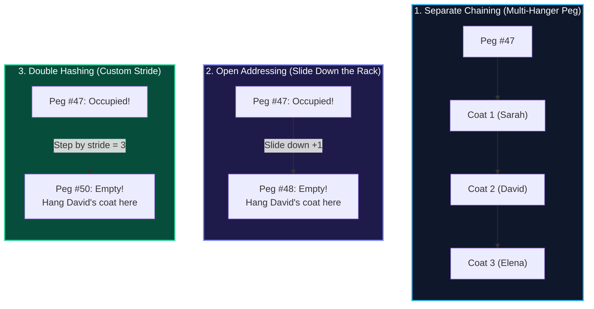

1. **Separate Chaining (The Multi-Hanger Loop)**: Hang multiple coat hangers from the exact same peg, forming a chain. When ticket #47 is presented, the attendant flips through the 2–3 coats hanging on that peg.
2. **Open Addressing / Linear Probing (Slide Down the Rack)**: If Peg #47 is occupied, walk down to the next adjacent open peg (#48) and place the coat there.
3. **Double Hashing (Custom Stride)**: If Peg #47 is occupied, compute a second personal stride (e.g., shoe size) and leap forward by that amount instead of stepping sequentially.

---

## 02 — Foundations: Direct Addressing vs. Hashing

### The Direct Address Table (DAT) Limitation

Suppose your keys are integers drawn from a known universe $U = \{0, 1, \dots, |U|-1\}$. If no two elements share the same key, we can implement a **Direct Address Table**:


- **Search, Insert, Delete**: All run in guaranteed worst-case **$O(1)$** time.
- **Space Requirement**: $\Theta(|U|)$ memory slots.

<LessonNote
  variant="warning"
  title="Why Direct Addressing Fails in Production Systems"
>
  1. **The 9-Digit US Social Security Number**: The universe size is $|U| =
  10^9$. Storing an array of 64-bit pointers requires **8 Gigabytes** of
  contiguous RAM. If your startup only employs 150 people, **99.999985%** of
  that allocated memory is completely empty! 2. **64-bit User IDs / Alphanumeric
  Handles**: With 64-bit keys, $|U| = 2^{64} \approx 1.84 \times 10^{19}$ slots,
  requiring **147 Exabytes** of memory. Direct addressing is physically
  impossible.
</LessonNote>

### The Hash Table Architecture

A **Hash Table** bridges this gap by reducing the storage requirement from $\Theta(|U|)$ to $\Theta(m)$, where $m$ is proportional to the number of actual keys $n$ we expect to store ($m \approx \Theta(n)$).

A mathematical **Hash Function** $h(k)$ maps the universe $U$ of keys into the range $[0, m-1]$:

$$\text{Index} = h(k) \pmod m$$

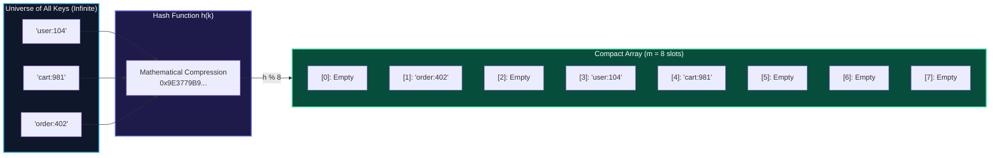

### The Four Non-Negotiable Properties of a Good Hash Function

<Steps>
### 1. Determinism
The identical key $k$ must evaluate to the exact same hash code $h(k)$ every single time throughout the lifetime of the program. If $h(\text{"apple"})$ returned 4 at 10:00 AM and 7 at 10:05 AM, the entry would be permanently lost.

### 2. Uniform Distribution (Simple Uniform Hashing)

Keys must spread evenly across all $m$ slots with equal probability:
$$P(h(k) = i) = \frac{1}{m} \quad \text{for every slot } 0 \le i < m$$
A function that maps all keys to even-numbered slots wastes 50% of the table and doubles the collision rate.

### 3. Fast $O(1)$ Computation

The hash function must execute in a few nanoseconds using cheap CPU operations (bitwise XOR `^`, shifts `<<`, `>>`, and unsigned multiplications). If computing the hash takes 200 microseconds, $O(1)$ asymptotic complexity is meaningless in practice.

### 4. High Avalanche Effect

Flipping a single bit in the input key (e.g. `"file_01"` vs `"file_02"`) should randomize roughly **50% of the bits** in the output hash. This prevents structured inputs from clustering into the same buckets.

</Steps>

---

## 03 — Common Hash Function Construction Methods

In university exams and systems design interviews, you are expected to know how hash functions are mathematically constructed and why certain parameters are chosen:

<Explain
  title="1. The Division Method"
  what="Maps a key k into one of m slots by taking the remainder of k divided by m: h(k) = k mod m."
>
**The Golden Rule: Table size $m$ must be a prime number not close to powers of 2 or 10.**

Why? Consider what happens if $m = 2^p$ (a power of 2, like $m = 2^8 = 256$):

- In binary arithmetic, $k \pmod{2^p}$ simply strips off and inspects the lowest $p$ bits of $k$!
- All high-order bits of the key are completely ignored. If keys are memory pointers (which are 8-byte aligned and always end in `000`), or IDs incremented by even strides, all keys collide in a tiny subset of slots!
- If $m$ is a prime number not close to any power of 2, all bits of $k$ participate in determining the remainder, yielding an even, scattered distribution.
  </Explain>

<Explain
  title="2. The Multiplication Method (Knuth's Method)"
  what="Multiplies key k by a constant fraction A (where 0 < A < 1), extracts the fractional part, and scales it by table size m."
>
The formal formula is:

$$h(k) = \lfloor m \cdot (k \cdot A \pmod 1) \rfloor$$

Where $k \cdot A \pmod 1$ means the fractional part of $k \cdot A$, equal to $k \cdot A - \lfloor k \cdot A \rfloor$.

- **The Golden Ratio Constant:** Donald Knuth famously recommended $A = \frac{\sqrt{5}-1}{2} \approx 0.6180339887...$
- **The Huge Advantage:** Unlike the division method, **$m$ does not need to be prime**! In fact, $m$ is typically chosen as a power of 2 ($m = 2^p$). On a $w$-bit computer architecture, the multiplication and fractional extraction can be computed in just **2 CPU instructions** using integer word multiplication and bit shifts without any slow division instructions!
  </Explain>

<Explain
  title="3. The Mid-Square Method"
  what="Squares the key (k²), and then extracts the middle r digits or bits to form a table address of size m = 2ʳ."
>
Steps to compute:
1. Square the numeric key: Compute $k^2$.
2. Extract the middle $r$ bits (or middle decimal digits).

**Why it works:** In base arithmetic, the middle digits of a square product are influenced by almost _every single digit_ of the original key. The leading and trailing digits are biased, but the center bits exhibit maximum entropy and uniform dispersion.

_Example:_ For key $k = 4321$, $k^2 = 18{,}671{,}041$. Extracting the middle 3 digits gives $671$, so $h(k) = 671$.

</Explain>

<Explain
  title="4. The Folding Method"
  what="Divides the key into multiple equal-sized chunks matching the address width, combines them using arithmetic addition or XOR, and reduces modulo m."
>
Commonly applied to long numeric keys, credit card numbers, or IP addresses:

- **Shift Folding:** Partition the key and add parts directly. For example, key `723-456-891` with 3-digit table addresses:
  $$\text{Sum} = 723 + 456 + 891 = 2070 \implies h(k) = 2070 \pmod{1000} = 70$$
- **Boundary Folding:** Reverse every other chunk (like folding a sheet of paper back and forth) before adding:
  $$\text{Sum} = 723 + \mathbf{654} + 891 = 2268 \implies h(k) = 2268 \pmod{1000} = 268$$
  </Explain>

---

## 04 — The Collision Phenomenon: Pigeonholes & Birthdays

### 1. The Pigeonhole Principle

If you have $n$ pigeonholes and $n + 1$ pigeons fly into them, at least one pigeonhole must contain two or more pigeons.

Because the key universe $|U|$ (e.g. all possible customer strings or 64-bit numbers) is orders of magnitude larger than table capacity $m$ ($|U| \gg m$), **hash collisions are mathematically guaranteed**:

$$h(k_1) = h(k_2) \quad \text{where } k_1 \ne k_2$$

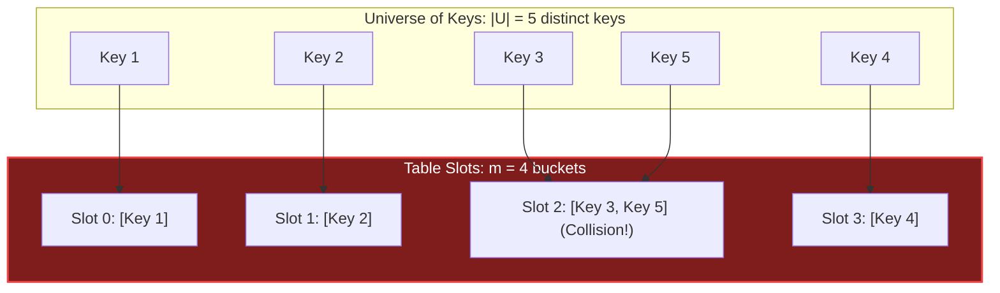

### 2. The Birthday Paradox

How many random people must enter a room before there is a **$\ge 50\%$ chance** that two people share the exact same birthday?

- Most people intuitively guess $\frac{365}{2} \approx 183$ people.
- The actual mathematical answer is **just 23 people**!

In hash tables, we aren't asking _"will key $X$ collide with key $Y$?"_ We are asking _"will **any** key collide with **any other** key?"_

The expected number of random insertions before your **first collision** occurs is approximately:

$$E[\text{first collision}] \approx \sqrt{\frac{\pi \cdot m}{2}} \approx 1.25 \sqrt{m}$$

| Table Capacity ($m$)      | Insertions Until $\ge 50\%$ Collision Risk | Table Occupancy at First Collision |
| :------------------------ | :----------------------------------------- | :--------------------------------- |
| **$365$ slots**           | **$23$ items**                             | **$6.3\%$ full**                   |
| **$10{,}000$ slots**      | **$125$ items**                            | **$1.25\%$ full**                  |
| **$1{,}000{,}000$ slots** | **$1{,}253$ items**                        | **$0.12\%$ full**                  |

<LessonNote
  variant="myth"
  title="Common Student Misconception: Collisions Mean a Broken Hash Function"
>
  Students often believe that if collisions occur at a 10% load factor, their
  hash function is defective. **The Birthday Paradox proves otherwise:**
  collisions begin occurring almost immediately in any hash table. A collision
  is not a bug; it is an invariant of mathematics. The true quality of a hash
  table is determined by **how efficiently it resolves collisions**.
</LessonNote>

---

## 05 — Interactive Lab: The Hash Lookup Simulator

Test how arbitrary keys project onto bucket indices and watch collision chains form in real time:

<Steps>
  <Step>
    **Insert Sequential Keys**: Enter keys such as `"user:1"`, `"user:2"`, and
    `"user:3"`. Watch them scatter across the table.
  </Step>
  <Step>
    **Trigger an Intentional Collision**: Insert keys that compute to identical
    modulo buckets. Observe how the bucket accommodates colliding items.
  </Step>
  <Step>
    **Observe Lookup Steps**: Query an existing key and follow the pointer
    traversal or probe step sequence required to locate it.
  </Step>
</Steps>

<HashLookupSimulator />

---

## 06 — Collision Resolution Strategies

All collision resolution techniques fall into two fundamental architectural philosophies:

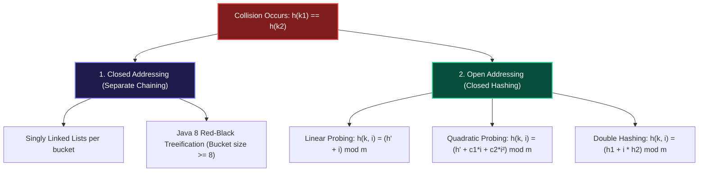

### Strategy 1: Closed Addressing (Separate Chaining)

In **Separate Chaining**, the table array does not hold entries directly. Each slot in the array is a pointer/reference to an independent linked list (or dynamic bucket) of colliding entries.

- **Insertion**: Compute $h(k) \pmod m$. Prepend the new key-value pair to the linked list in **$O(1)$** time.
- **Search**: Compute $h(k) \pmod m$. Walk the linked list comparing keys with `equals()`. Average time is $O(1 + \alpha)$, where $\alpha = n / m$ is the load factor.
- **Deletion**: Find the node in the linked list and rewire pointers ($O(1)$ node unlink).

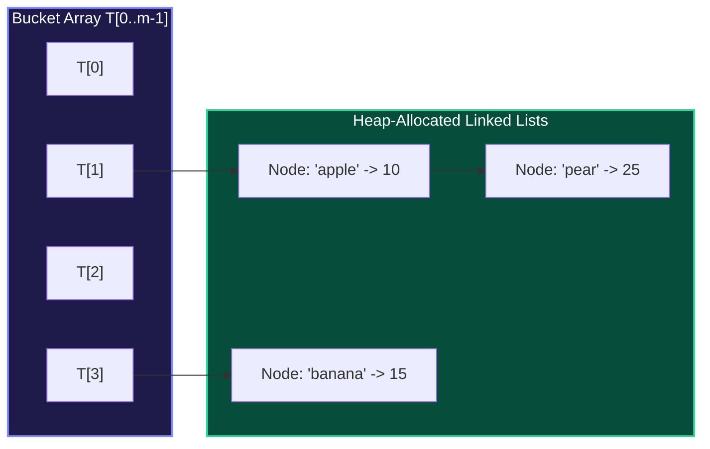

#### Advantages of Separate Chaining

1. **Graceful Degradation**: The table never gets "full". Even if load factor $\alpha > 1.0$ (e.g. 500 items in a 100-slot table, $\alpha = 5.0$), operations continue to function; lists simply average 5 items.
2. **Simple Deletions**: Deleting an item never disrupts other items' lookup paths.

#### Disadvantages of Separate Chaining

1. **Pointer Memory Overhead**: On 64-bit systems, each linked list node requires 8 bytes for key pointer, 8 bytes for value pointer, and 8 bytes for `next` pointer (plus 16 bytes of malloc object header overhead). You often spend more RAM on pointers than on your actual data!
2. **Cache Unfriendliness ("Pointer Chasing")**: Linked list nodes are allocated randomly across heap memory. Traversing a linked list causes the CPU to stall on L1/L2 cache misses while waiting 60–100 nanoseconds for main RAM.

#### The Java 8 HashMap Treeification Optimization

In Java 8, Oracle addressed the vulnerability where malicious inputs (or bad hash codes) degraded a chained hash table into an $O(N)$ linked list:

- If a single bucket reaches **$\ge 8$ elements** (`TREEIFY_THRESHOLD`) AND total capacity is $\ge 64$, Java automatically converts that bucket from a linked list into a self-balancing **Red-Black Tree**.
- Worst-case search drops from **$O(N)$ to $O(\log N)$**.
- If deletions cause the bucket size to shrink to **$\le 6$ elements** (`UNTREEIFY_THRESHOLD`), the tree is unpacked back into a simple linked list to save memory.

---

### Strategy 2: Open Addressing (Closed Hashing)

In **Open Addressing**, there are no linked lists and no external heap nodes. **All elements are stored directly inside the table array itself.**

Because every slot can hold at most one element, the number of stored keys $n$ can never exceed table capacity $m$. The load factor must always satisfy **$\alpha \le 1.0$**.

When an insertion encounters an occupied slot, it systematic probes alternative slots according to a deterministic **Probe Sequence**:

$$h(k, i) \quad \text{where } i = 0, 1, 2, \dots, m-1$$

#### 1. Linear Probing

The simplest probe sequence advances sequentially by 1 slot:

$$h(k, i) = (h'(k) + i) \pmod m$$

Where $h'(k)$ is the primary hash function.


<LessonNote variant="warning" title="The Curse of Primary Clustering">
  Linear probing suffers from **Primary Clustering**: long runs of adjacent
  occupied slots build up in the table. - When an occupied cluster of length $L$
  forms, any new key that hashes to *any* slot within that cluster—or
  immediately preceding or following it—will probe to the end of the cluster and
  extend its length to $L + 1$. - The probability of a cluster growing is
  proportional to $(L + 1) / m$. - Clusters merge with adjacent clusters into
  giant traffic jams, causing lookup and insertion times to catastrophically
  spike as $\alpha$ exceeds 0.70.
</LessonNote>

#### 2. Quadratic Probing

To prevent contiguous clusters from forming, **Quadratic Probing** spaces probe intervals quadratically with probe count $i$:

$$h(k, i) = (h'(k) + c_1 \cdot i + c_2 \cdot i^2) \pmod m$$

A standard simple formula is $h(k, i) = (h'(k) + i^2) \pmod m$.

- Probe 0: $h'(k)$
- Probe 1: $h'(k) + 1^2 = h'(k) + 1$
- Probe 2: $h'(k) + 2^2 = h'(k) + 4$
- Probe 3: $h'(k) + 3^2 = h'(k) + 9$

Quadratic probing successfully hops over contiguous primary clusters. However, it introduces **Secondary Clustering**:

> **Secondary Clustering:** If two distinct keys $k_1$ and $k_2$ have the exact same initial hash ($h'(k_1) = h'(k_2)$), they will generate the identical quadratic probe sequence.

#### 3. Double Hashing

**Double Hashing** is the gold standard of open addressing. It uses two independent hash functions, $h_1(k)$ and $h_2(k)$:

$$h(k, i) = (h_1(k) + i \cdot h_2(k)) \pmod m$$

- The first hash $h_1(k)$ determines the **initial home bucket**.
- The second hash $h_2(k)$ determines the **probe step size (stride)** for that specific key.

Even if two keys produce the same initial slot ($h_1(k_1) = h_1(k_2)$), their secondary hashes $h_2(k_1)$ and $h_2(k_2)$ produce completely different stride lengths! Their probe sequences diverge immediately, eliminating both primary and secondary clustering.

<LessonNote variant="why" title="Exam Invariant: Two Crucial Mathematical Rules for h₂(k)">
1. **$h_2(k)$ must NEVER evaluate to 0**: If $h_2(k) = 0$, then $i \cdot 0 = 0$, causing the probe formula to check slot $h_1(k)$ over and over in an infinite loop!
2. **$h_2(k)$ must be relatively prime (co-prime) to table size $m$**: $\gcd(h_2(k), m) = 1$. If $h_2(k)$ and $m$ shared a common factor $d > 1$, the probe sequence could only visit $m/d$ slots before cycling back, leaving $(m - m/d)$ slots permanently unreachable even if empty!
- **Standard Construction**: Choose a prime $m$, set $h_1(k) = k \pmod m$, and set $h_2(k) = 1 + (k \pmod{m - 1})$ or $h_2(k) = R - (k \pmod R)$ where $R < m$ is prime.
</LessonNote>

---

## 07 — Comprehensive Numerical Trace: Step-by-Step Walkthrough

This exact numerical exercise appears frequently in university computer science exams and top-tier technical interviews. Let us trace every probe step by step:

### The Problem Setup

- **Table Size ($m$)**: $10$ slots (Indices `0, 1, 2, 3, 4, 5, 6, 7, 8, 9`)
- **Primary Hash Function**: $h'(k) = k \pmod{10}$
- **Keys to Insert in Order**: `23, 13, 31, 27, 44, 26, 20`

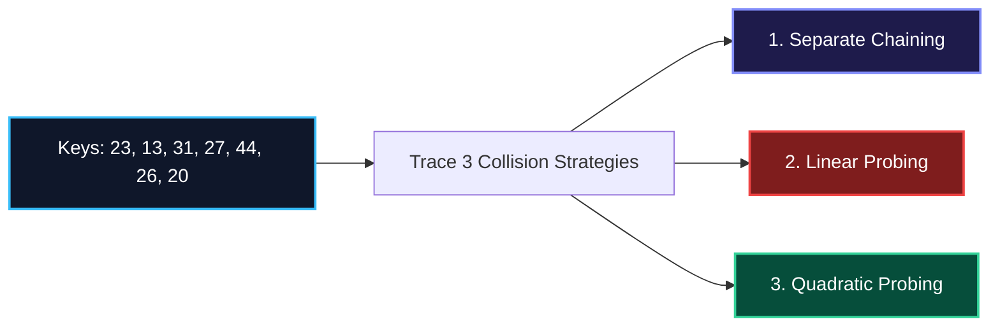

---

### Strategy A: Separate Chaining Trace

| Key    | Hash $h'(k) = k \bmod 10$ | Collision?        | Action & Bucket State                    |
| :----- | :------------------------ | :---------------- | :--------------------------------------- |
| **23** | $23 \bmod 10 = 3$         | No                | Bucket 3: `[23]`                         |
| **13** | $13 \bmod 10 = 3$         | **Yes (with 23)** | Prepend/Append to Bucket 3: `[23 -> 13]` |
| **31** | $31 \bmod 10 = 1$         | No                | Bucket 1: `[31]`                         |
| **27** | $27 \bmod 10 = 7$         | No                | Bucket 7: `[27]`                         |
| **44** | $44 \bmod 10 = 4$         | No                | Bucket 4: `[44]`                         |
| **26** | $26 \bmod 10 = 6$         | No                | Bucket 6: `[26]`                         |
| **20** | $20 \bmod 10 = 0$         | No                | Bucket 0: `[20]`                         |

**Final Separate Chaining Table:**

- Slot `0`: `[20]`
- Slot `1`: `[31]`
- Slot `2`: `Empty`
- Slot `3`: `[23 -> 13]`
- Slot `4`: `[44]`
- Slot `5`: `Empty`
- Slot `6`: `[26]`
- Slot `7`: `[27]`
- Slot `8`: `Empty`
- Slot `9`: `Empty`

---

### Strategy B: Linear Probing Trace ($h(k, i) = (h'(k) + i) \bmod 10$)

| Key    | $h'(k)$ | Probes Checked                    | Placed Slot | Probes Required | Note                                     |
| :----- | :------ | :-------------------------------- | :---------- | :-------------- | :--------------------------------------- |
| **23** | $3$     | `3` (empty)                       | **Slot 3**  | **1 probe**     | Initial occupant of slot 3               |
| **13** | $3$     | `3` (occ by 23) $\to$ `4` (empty) | **Slot 4**  | **2 probes**    | Probed forward by +1                     |
| **31** | $1$     | `1` (empty)                       | **Slot 1**  | **1 probe**     | Placed directly                          |
| **27** | $7$     | `7` (empty)                       | **Slot 7**  | **1 probe**     | Placed directly                          |
| **44** | $4$     | `4` (occ by 13) $\to$ `5` (empty) | **Slot 5**  | **2 probes**    | Collided with 13! Primary cluster forms! |
| **26** | $6$     | `6` (empty)                       | **Slot 6**  | **1 probe**     | Placed directly                          |
| **20** | $0$     | `0` (empty)                       | **Slot 0**  | **1 probe**     | Placed directly                          |

**Total Probes for 7 Insertions**: $1 + 2 + 1 + 1 + 2 + 1 + 1 = \mathbf{9\text{ probes}}$.

**Final Linear Probing Array:**

```
Index:  [0]  [1]   [2]    [3]  [4]  [5]  [6]  [7]   [8]    [9]
Value:  20   31   EMPTY   23   13   44   26   27   EMPTY  EMPTY
                          ^---------------^
                        Primary Cluster [3..7]
```

---

### Strategy C: Quadratic Probing Trace ($h(k, i) = (h'(k) + i^2) \bmod 10$)

| Key    | $h'(k)$ | Probes Calculation                                                    | Placed Slot | Probes Required |
| :----- | :------ | :-------------------------------------------------------------------- | :---------- | :-------------- |
| **23** | $3$     | $i=0$: Slot 3 (empty)                                                 | **Slot 3**  | **1 probe**     |
| **13** | $3$     | $i=0$: Slot 3 (occ by 23)<br/>$i=1$: $(3 + 1^2) \bmod 10 = 4$ (empty) | **Slot 4**  | **2 probes**    |
| **31** | $1$     | $i=0$: Slot 1 (empty)                                                 | **Slot 1**  | **1 probe**     |
| **27** | $7$     | $i=0$: Slot 7 (empty)                                                 | **Slot 7**  | **1 probe**     |
| **44** | $4$     | $i=0$: Slot 4 (occ by 13)<br/>$i=1$: $(4 + 1^2) \bmod 10 = 5$ (empty) | **Slot 5**  | **2 probes**    |
| **26** | $6$     | $i=0$: Slot 6 (empty)                                                 | **Slot 6**  | **1 probe**     |
| **20** | $0$     | $i=0$: Slot 0 (empty)                                                 | **Slot 0**  | **1 probe**     |

#### The Revealing Contrast: What Happens When Key `33` Arrives?

Now observe the profound difference between Linear and Quadratic probing when an eighth key, **`33`** ($h'(33) = 3$), arrives:

- **Under Linear Probing**:
  - $i=0$: Slot 3 (occupied by 23)
  - $i=1$: Slot 4 (occupied by 13)
  - $i=2$: Slot 5 (occupied by 44)
  - $i=3$: Slot 6 (occupied by 26)
  - $i=4$: Slot 7 (occupied by 27)
  - $i=5$: Slot 8 (EMPTY! Inserted here).
  - **Result: 6 full probes!** Linear probing was dragged down the entire length of the primary cluster.

- **Under Quadratic Probing**:
  - $i=0$: Slot 3 (occupied by 23)
  - $i=1$: $(3 + 1^2) \bmod 10 = 4$ (occupied by 13)
  - $i=2$: $(3 + 2^2) \bmod 10 = (3 + 4) \bmod 10 = 7$ (occupied by 27)
  - $i=3$: $(3 + 3^2) \bmod 10 = (3 + 9) \bmod 10 = 12 \bmod 10 = \mathbf{2}$ (Slot 2 is EMPTY! Inserted here).
  - **Result: Only 4 probes!** Quadratic probing leapt directly over the cluster into the untouched low-index empty slot!

---

## 08 — Load Factor ($\alpha$), Rehashing & The Tombstone Deletion Dilemma

### The Load Factor ($\alpha$)

The **Load Factor** measures how densely packed the hash table has become:

$$\alpha = \frac{n}{m} = \frac{\text{Number of elements stored}}{\text{Total table capacity}}$$

- In **Separate Chaining**, $\alpha$ can grow arbitrarily large ($\alpha > 1$). Average lookup time scales linearly with $\Theta(1 + \alpha)$.
- In **Open Addressing**, $\alpha$ can never exceed $1.0$. The theoretical average number of probes for an unsuccessful search under uniform hashing is:
  $$E[\text{Probes}] = \frac{1}{1 - \alpha}$$

| Load Factor ($\alpha$)         | Expected Probes ($\frac{1}{1 - \alpha}$) | Efficiency Status                 |
| :----------------------------- | :--------------------------------------- | :-------------------------------- |
| **$\alpha = 0.50$ (50% full)** | **$2.0$ probes**                         | Near-instantaneous lookup         |
| **$\alpha = 0.70$ (70% full)** | **$3.3$ probes**                         | Optimal balance of memory & speed |
| **$\alpha = 0.90$ (90% full)** | **$10.0$ probes**                        | Severe degradation                |
| **$\alpha = 0.99$ (99% full)** | **$100.0$ probes**                       | Catastrophic slowdown             |

Most industrial libraries (Java `HashMap`, Python `dict`, C++ `std::unordered_map`) set the maximum load factor threshold at **$\alpha_{\text{threshold}} \approx 0.70 - 0.75$**. Once exceeded, the table automatically allocates a new array of double the size ($2m$) and rehashes all elements.

---

### The Deletion Problem: Why You Cannot Erase Slots to NULL

In an open addressing table, a naive deletion that sets an array slot back to `NULL` / `None` creates a **broken probe chain**:

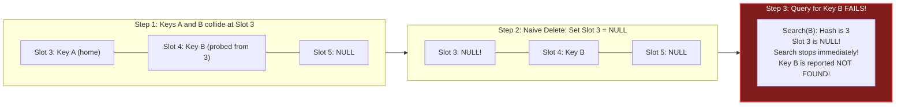

When you search for `Key B`:

1. The algorithm computes $h(\text{Key B}) = 3$.
2. It inspects Slot 3 and sees `NULL`.
3. The open-addressing lookup invariant states: _"If you encounter a `NULL` slot, the element was never inserted in the table; terminate search."_
4. Search terminates and returns **Not Found**, even though `Key B` is sitting right next door in Slot 4!

#### The Solution: The Tombstone (`DELETED`) Marker

To fix this without rehashing the entire table on every delete, replace deleted entries with a special sentinel marker: `TOMBSTONE` (or `DELETED`).

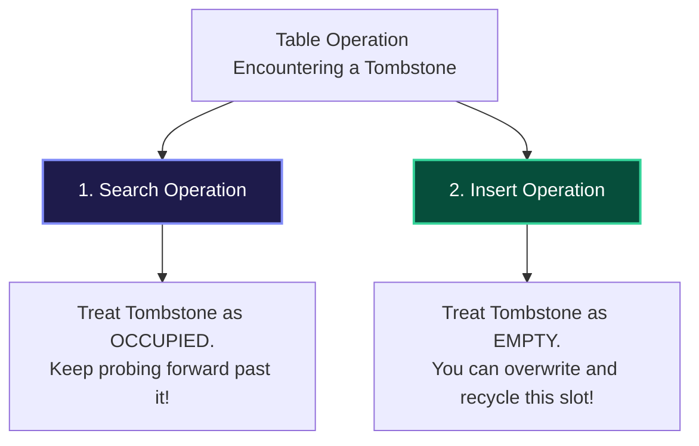

- **During Search**: The probe loop skips over tombstones and continues forward as if the slot were occupied.
- **During Insert**: If an unused tombstone slot was traversed, the new element can claim and overwrite that slot once the search confirms the key does not already exist further down the probe chain.
- **During Rehash**: When the table resizes, all tombstones are purged, leaving the new table completely clean.

---

## 09 — Silicon Reality: Why Modern Systems Prefer Open Addressing & SIMD

For decades, computer science textbooks taught that Separate Chaining was superior to Open Addressing because chaining handles high load factors gracefully without primary clustering.

**On modern hardware, this classic advice has been turned completely upside-down.**

### The CPU Memory Hierarchy Reality

```
L1 Cache Hit:     ~1 nanosecond   (4 CPU cycles)
L2 Cache Hit:     ~4 nanoseconds  (14 CPU cycles)
L3 Cache Hit:     ~12 nanoseconds (40 CPU cycles)
Main RAM Access:  ~70 nanoseconds (250 CPU cycles - STALL!)
```

In Separate Chaining, every node in a bucket is an isolated heap allocation. Traversing a linked list requires dereferencing pointers scattered randomly across physical RAM. Each link traversal results in a **CPU Cache Miss**, forcing the execution core to stall for hundreds of cycles.

In contrast, Open Addressing stores entries contiguously in a flat array. When the CPU reads Slot $i$, the hardware memory controller automatically fetches the entire 64-byte **Cache Line**, loading adjacent slots ($i+1, i+2, \dots$) into L1 cache for **zero-cost probing**.

---

### Google Swiss Tables & 16-Way SIMD Probing

In 2018, Google open-sourced **Abseil `flat_hash_map`** (popularly known as **Swiss Tables**), which was immediately adopted by the **Rust standard library** (`hashbrown`) and modern C++ runtimes.

Swiss Tables achieve world-class throughput by separating **1-byte control metadata** from the actual key-value payloads:

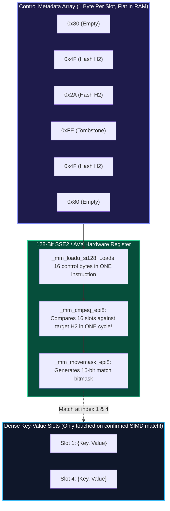

#### How Swiss Tables Work

1. **Hash Splitting**: Given a 64-bit hash code $H$:
   - $H_1 = H \gg 7$ (Top 57 bits): Selects the 16-slot group.
   - $H_2 = H \ \& \ 0x7F$ (Bottom 7 bits): A 7-bit fingerprint stored in the control byte.
2. **1-Byte Control Markers**:
   - `0x80` = Empty slot.
   - `0xFE` = Deleted (tombstone) slot.
   - `0x00..0x7F` = Occupied slot carrying the 7-bit $H_2$ fingerprint.
3. **16-Way Parallel Inspection**:
   Using SIMD vector instructions, the CPU inspects **16 slots simultaneously in a single clock cycle**.
4. **Zero-Waste Memory Bandwidth**:
   Large key and value objects in RAM are **only dereferenced if the 7-bit SIMD fingerprint matches**. Over 99% of probe comparisons happen exclusively within the ultra-fast L1 cache control bytes, eliminating 80%+ of memory bus latency.

---

## 10 — Security Engineering: The HashDoS Attack & SipHash

In 2011, security researchers demonstrated that almost all major web platforms (Node.js, Python, Ruby, PHP, Java Tomcat) were vulnerable to a remote denial-of-service attack known as **HashDoS**.

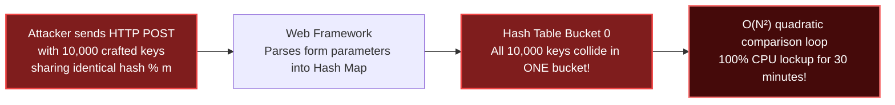

### The Mechanism of HashDoS

Deterministic hash functions (like MurmurHash or standard polynomial string hashes $\sum s[i] \cdot 31^{n-1-i}$) are completely predictable:

1. Attackers pre-computed thousands of strings engineered to yield the exact same bucket modulo $m$.
2. They submitted these strings in a tiny 100 KB HTTP POST request.
3. As the web server inserted each key into its internal parameter map, every single insertion collided into Bucket 0.
4. Each insert required scanning the entire existing collision chain ($O(N)$ comparisons).
5. Construction time exploded from $O(N)$ to **$O(N^2)$**, locking a multi-core cloud server at 100% CPU for **over 30 minutes** with a single request.

### The Defense: SipHash-2-4

Modern programming languages (Python 3.4+, Rust, Ruby, Linux Kernel) defeated HashDoS by adopting **SipHash-2-4**:

- SipHash is a **keyed, cryptographically secure Pseudo-Random Function (PRF)**.
- When an application process starts up, the operating system generates a cryptographically random **128-bit secret seed key**.
- Because the secret key is unique to that specific process instance, attackers cannot predict hash values or engineer colliding keys remotely.

---

## 11 — Production Polyglot Implementations

Here is a complete, production-grade implementation of an **Open-Addressing Hash Table with Linear Probing, Tombstone Markers, and Automatic Geometric Resizing** in Python, TypeScript, and C++.

<Tabs items={['Python', 'TypeScript', 'C++']}>
<Tab value="Python">
```python
from typing import Optional, Any, List

class HashEntry:
def **init**(self, key: str, value: Any):
self.key = key
self.value = value
self.is_deleted = False

class OpenAddressingHashMap:
"""
Open-addressing hash table with linear probing and tombstone recycling.
Automatically maintains load factor below 0.70 with 2x geometric resizing.
"""
def **init**(self, initial_capacity: int = 8):
self.\_capacity = initial_capacity
self.\_size = 0
self.\_table: List[Optional[HashEntry]] = [None] \* self.\_capacity

    def _hash(self, key: str) -> int:
        # FNV-1a 32-bit hash algorithm for uniform dispersion
        h = 2166136261
        for char in key.encode('utf-8'):
            h ^= char
            h = (h * 16777619) & 0xFFFFFFFF
        return h % self._capacity

    def put(self, key: str, value: Any) -> None:
        # Trigger resize when load factor exceeds 70%
        if (self._size + 1) / self._capacity > 0.70:
            self._resize(self._capacity * 2)

        idx = self._hash(key)
        first_tombstone_idx = None

        while self._table[idx] is not None:
            entry = self._table[idx]
            if entry.is_deleted:
                # Remember first reusable tombstone slot passed
                if first_tombstone_idx is None:
                    first_tombstone_idx = idx
            elif entry.key == key:
                # Key already exists: update value in place
                entry.value = value
                return
            idx = (idx + 1) % self._capacity

        # Reuse tombstone slot if one was passed; otherwise use terminal empty slot
        target_idx = first_tombstone_idx if first_tombstone_idx is not None else idx
        self._table[target_idx] = HashEntry(key, value)
        self._size += 1

    def get(self, key: str) -> Optional[Any]:
        idx = self._hash(key)
        start_idx = idx

        while self._table[idx] is not None:
            entry = self._table[idx]
            if not entry.is_deleted and entry.key == key:
                return entry.value
            idx = (idx + 1) % self._capacity
            if idx == start_idx:
                break
        return None

    def delete(self, key: str) -> bool:
        idx = self._hash(key)
        start_idx = idx

        while self._table[idx] is not None:
            entry = self._table[idx]
            if not entry.is_deleted and entry.key == key:
                # Mark tombstone; do not clear to None!
                entry.is_deleted = True
                self._size -= 1
                return True
            idx = (idx + 1) % self._capacity
            if idx == start_idx:
                break
        return False

    def _resize(self, new_capacity: int) -> None:
        old_table = self._table
        self._capacity = new_capacity
        self._table = [None] * new_capacity
        self._size = 0

        # Re-hash all active entries into expanded table
        for entry in old_table:
            if entry and not entry.is_deleted:
                self.put(entry.key, entry.value)

if **name** == "**main**":
ht = OpenAddressingHashMap(4)
ht.put("apple", 100)
ht.put("banana", 200)
ht.put("orange", 300)
print("Get 'banana':", ht.get("banana")) # 200
ht.delete("banana")
print("Get 'banana' after delete:", ht.get("banana")) # None
print("Get 'orange':", ht.get("orange")) # 300 (probes correctly past tombstone!)

````
</Tab>

<Tab value="TypeScript">
```typescript
class Entry<V> {
  constructor(
    public key: string,
    public value: V,
    public isDeleted: boolean = false
  ) {}
}

export class LinearProbingMap<V> {
  private table: (Entry<V> | null)[];
  private currentSize: number = 0;
  private capacity: number;

  constructor(initialCapacity: number = 16) {
    this.capacity = initialCapacity;
    this.table = new Array(this.capacity).fill(null);
  }

  private hash(key: string): number {
    // djb2 hash algorithm
    let hashVal = 5381;
    for (let i = 0; i < key.length; i++) {
      hashVal = (hashVal * 33) ^ key.charCodeAt(i);
    }
    return Math.abs(hashVal) % this.capacity;
  }

  public set(key: string, value: V): void {
    if ((this.currentSize + 1) / this.capacity > 0.70) {
      this.resize(this.capacity * 2);
    }

    let idx = this.hash(key);
    let tombstoneIdx: number | null = null;

    while (this.table[idx] !== null) {
      const entry = this.table[idx]!;
      if (entry.isDeleted) {
        if (tombstoneIdx === null) tombstoneIdx = idx;
      } else if (entry.key === key) {
        entry.value = value;
        return;
      }
      idx = (idx + 1) % this.capacity;
    }

    const targetIdx = tombstoneIdx !== null ? tombstoneIdx : idx;
    this.table[targetIdx] = new Entry(key, value);
    this.currentSize++;
  }

  public get(key: string): V | undefined {
    let idx = this.hash(key);
    const start = idx;

    while (this.table[idx] !== null) {
      const entry = this.table[idx]!;
      if (!entry.isDeleted && entry.key === key) {
        return entry.value;
      }
      idx = (idx + 1) % this.capacity;
      if (idx === start) break;
    }
    return undefined;
  }

  public delete(key: string): boolean {
    let idx = this.hash(key);
    const start = idx;

    while (this.table[idx] !== null) {
      const entry = this.table[idx]!;
      if (!entry.isDeleted && entry.key === key) {
        entry.isDeleted = true;
        this.currentSize--;
        return true;
      }
      idx = (idx + 1) % this.capacity;
      if (idx === start) break;
    }
    return false;
  }

  private resize(newCapacity: number): void {
    const oldTable = this.table;
    this.capacity = newCapacity;
    this.table = new Array(newCapacity).fill(null);
    this.currentSize = 0;

    for (const entry of oldTable) {
      if (entry && !entry.isDeleted) {
        this.set(entry.key, entry.value);
      }
    }
  }
}

// Verification
const map = new LinearProbingMap<number>(4);
map.set("SKU-101", 49);
map.set("SKU-202", 99);
console.log("SKU-101 price:", map.get("SKU-101")); // 49
````

</Tab>

<Tab value="C++">
```cpp
#include <iostream>
#include <vector>
#include <string>
#include <optional>
#include <functional>

template <typename K, typename V>
class FlatHashMap {
private:
enum class State { EMPTY, OCCUPIED, DELETED };

    struct Slot {
        K key;
        V value;
        State state{State::EMPTY};
    };

    std::vector<Slot> slots_;
    size_t size_{0};
    size_t capacity_{16};

    size_t hash_key(const K& key) const {
        return std::hash<K>{}(key) % capacity_;
    }

    void rehash(size_t new_capacity) {
        std::vector<Slot> old_slots = std::move(slots_);
        capacity_ = new_capacity;
        slots_ = std::vector<Slot>(capacity_);
        size_ = 0;

        for (auto& slot : old_slots) {
            if (slot.state == State::OCCUPIED) {
                insert(slot.key, slot.value);
            }
        }
    }

public:
explicit FlatHashMap(size*t cap = 16) : capacity*(cap), slots\_(cap) {}

    void insert(const K& key, const V& val) {
        if (static_cast<double>(size_ + 1) / capacity_ > 0.70) {
            rehash(capacity_ * 2);
        }

        size_t idx = hash_key(key);
        ssize_t tombstone_idx = -1;

        while (slots_[idx].state != State::EMPTY) {
            if (slots_[idx].state == State::DELETED) {
                if (tombstone_idx == -1) tombstone_idx = static_cast<ssize_t>(idx);
            } else if (slots_[idx].key == key) {
                slots_[idx].value = val;
                return;
            }
            idx = (idx + 1) % capacity_;
        }

        size_t target_idx = (tombstone_idx != -1) ? static_cast<size_t>(tombstone_idx) : idx;
        slots_[target_idx].key = key;
        slots_[target_idx].value = val;
        slots_[target_idx].state = State::OCCUPIED;
        ++size_;
    }

    std::optional<V> find(const K& key) const {
        size_t idx = hash_key(key);
        size_t start = idx;

        while (slots_[idx].state != State::EMPTY) {
            if (slots_[idx].state == State::OCCUPIED && slots_[idx].key == key) {
                return slots_[idx].value;
            }
            idx = (idx + 1) % capacity_;
            if (idx == start) break;
        }
        return std::nullopt;
    }

};

int main() {
FlatHashMap<std::string, int> map;
map.insert("Aisle14", 82);
auto val = map.find("Aisle14");
if (val) std::cout << "Found shelf: " << \*val << "\n";
return 0;
}

````
</Tab>
</Tabs>

---

## 12 — Case Study: Python 3.6+ Compact Dictionary

Prior to Python 3.6, Python's `dict` used a sparse array of 24-byte entries (`hash`, `key*`, `value*`). A dictionary with capacity 8 used $8 \times 24 = 192$ bytes, leaving large sparse gaps of empty memory.

Raymond Hettinger redesigned Python's dict using a **dense array + sparse indices table**:

```mermaid
flowchart TD
    subgraph SparseIndices["Sparse Indices Array (1 byte per bucket: int8_t)"]
        Idx0["[0]: -1"]
        Idx1["[1]: 0"]
        Idx2["[2]: -1"]
        Idx3["[3]: 1"]
        Idx4["[4]: -1"]
    end

    subgraph DenseEntries["Dense Entries Array (Packed tightly in chronological insertion order)"]
        E0["Entry 0: {hash: 0x9F, key: 'apple', val: 100}"]
        E1["Entry 1: {hash: 0x2B, key: 'orange', val: 200}"]
    end

    Idx1 --> E0
    Idx3 --> E1

    style SparseIndices fill:#1e1b4b,stroke:#818cf8,stroke-width:2px,color:#fff
    style DenseEntries fill:#064e3b,stroke:#34d399,stroke-width:2px,color:#fff
````

### Advantages of the Compact Dict

1. **30% to 95% Memory Reduction**: Empty sparse slots only store a 1-byte integer (`int8_t` or `int16_t`) rather than full 24-byte structs.
2. **Deterministic Insertion Order**: Because items are appended to the `entries` array sequentially, iterating over a Python dict is guaranteed to yield keys in chronological insertion order!
3. **Sequential Cache Streaming**: Iterating over keys or values streams through a contiguous memory buffer with near 100% L1 cache hits.

---

## 13 — Technical Interview Invariants & Traps

<Callout type="warn" title="Key Mutation & Identity Traps">
1. **The JavaScript Object Key Coercion Trap**:
   In JavaScript, using an object as a key in a standard plain object `{}` calls `.toString()`, converting the key to `"[object Object]"`. If you insert multiple distinct objects, they all overwrite the exact same key! Always use `Map` for non-string keys:
   ```javascript
   const badMap = {};
   badMap[{ id: 1 }] = "Alpha";
   badMap[{ id: 2 }] = "Beta";
   console.log(badMap[{ id: 1 }]); // "Beta"! Overwritten because key coerced to "[object Object]"
   ```
2. **The Java & Python Hash Contract**:
   If two objects are equal according to `equals()` or `__eq__()`, they **MUST** produce identical hash codes:
   $$a == b \implies h(a) == h(b)$$
   If you override equality without overriding the hash function, identical objects will hash to different buckets, making retrieval impossible.
3. **Never Mutate a Key In-Place**:
   If an object is stored as a key in a hash table and you modify one of its fields such that its hash changes, the hash map does not know! When you subsequently query for it, the map computes the new hash, searches the new bucket, finds nothing, and returns null—creating a permanent **memory leak**.
</Callout>

---

## 14 — Interactive Retrieval Practice

Test your mastery with these four core conceptual scenarios:

<TryIt
  question="Why must the table size m in the division method h(k) = k mod m be a prime number rather than a power of 2 (m = 2^p)?"
  options={[
    "Prime table sizes double the capacity of CPU L1 data cache lines automatically.",
    "A power of two only evaluates the lowest p bits of k, ignoring all higher-order bits.",
    "Compilers cannot execute modulo arithmetic instructions unless the divisor is prime.",
    "Prime divisors guarantee that no two inputs can ever compute identical hash remainders.",
  ]}
  answer="Option B: A power of two only evaluates the lowest p bits of k, ignoring all higher-order bits."
  why="When dividing by 2^p, modulo arithmetic simply truncates the binary number and keeps the p least significant bits. Any patterns in the upper bits are discarded, causing severe clumping."
/>

<TryIt
  question="What is the fundamental difference between Primary Clustering and Secondary Clustering in open-addressing hash tables?"
  options={[
    "Primary clustering occurs in separate chaining; secondary clustering occurs in open addressing.",
    "Primary clustering affects string keys; secondary clustering affects numeric and pointer keys.",
    "Primary clustering forms contiguous blocks; secondary clustering occurs when identical initial hashes trace the same path.",
    "Primary clustering is caused by double hashing; secondary clustering is caused by tombstone accumulation.",
  ]}
  answer="Option C: Primary clustering forms contiguous blocks; secondary clustering occurs when identical initial hashes trace the same path."
  why="Linear probing creates long contiguous runs of occupied slots (primary clustering). Quadratic probing avoids contiguous blocks, but any two keys with the exact same initial hash h'(k) follow the identical probe sequence (secondary clustering)."
/>

<TryIt
  question="Why can deleted slots in open addressing not simply be reset to NULL or empty pointers?"
  options={[
    "Resetting slots to NULL alters the array capacity, requiring an immediate full-table rehash.",
    "The CPU cache controller cannot read memory words containing uninitialized zero bytes.",
    "A NULL slot terminates active probe searches, falsely causing subsequent colliding keys to report Not Found.",
    "Garbage collectors permanently deallocate the entire hash table if any internal slot contains NULL.",
  ]}
  answer="Option C: A NULL slot terminates active probe searches, falsely causing subsequent colliding keys to report Not Found."
  why="Open addressing searches terminate upon encountering the first empty slot. Setting a slot to NULL creates a hole that breaks the probe chain for any elements that probed past that slot during insertion."
/>

<TryIt
  question="In Double Hashing h(k, i) = (h1(k) + i * h2(k)) mod m, what condition must the secondary hash function h2(k) satisfy relative to m?"
  options={[
    "h2(k) must equal m / 2 so that each probe stride exactly halves the remaining table search space.",
    "h2(k) must never be zero, and gcd(h2(k), m) must equal 1 so the probe visits every single slot in the table.",
    "h2(k) must always return an even integer so that probes avoid all odd-numbered array indices.",
    "h2(k) must evaluate strictly to prime numbers greater than m to prevent integer overflow.",
  ]}
  answer="Option B: h2(k) must never be zero, and gcd(h2(k), m) must equal 1 so the probe visits every single slot in the table."
  why="If h2(k) is 0, the probe is trapped in an infinite loop. If h2(k) and m share a common factor d > 1, the probe sequence can only visit m/d slots before cycling, leaving the rest of the table unreachable."
/>

---

## 15 — Hands-On Verification Challenges

<Cards>
  <Card title="Challenge 1: Manual Double Hashing Trace" href="#">
    Given table size $m = 11$, primary hash $h_1(k) = k \pmod{11}$, and
    secondary hash $h_2(k) = 1 + (k \pmod{10})$. Manually trace inserting keys
    `12, 23, 34, 45`. Record the exact slot for each key and verify that
    $h_2(k)$ never evaluates to zero.
  </Card>
  <Card title="Challenge 2: The Tombstone Resilience Test" href="#">
    Using your linear probing implementation, insert keys `A` and `B` that
    collide at index 3 (`A` lands at 3, `B` lands at 4). Delete `A`. Run a query
    for `B` and verify that your implementation probes past the tombstone and
    successfully returns `B`.
  </Card>
</Cards>

---

<Takeaway>
  Hash tables fulfill the promise of constant-time $O(1)$ operations not by
  eliminating collisions, but by combining a fast mathematical projection ($h(k)
  \pmod m$) with cache-conscious collision resolution (tombstone-safe open
  addressing or treeified chaining) while strictly capping the load factor
  $\alpha \le 0.70$.
</Takeaway>
