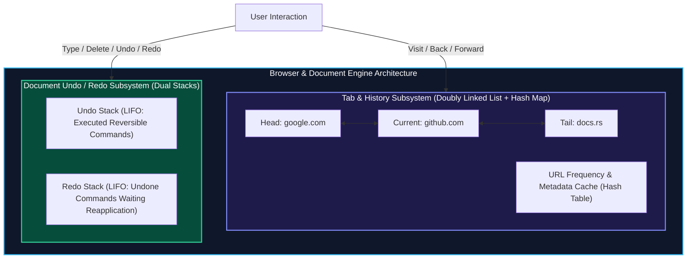
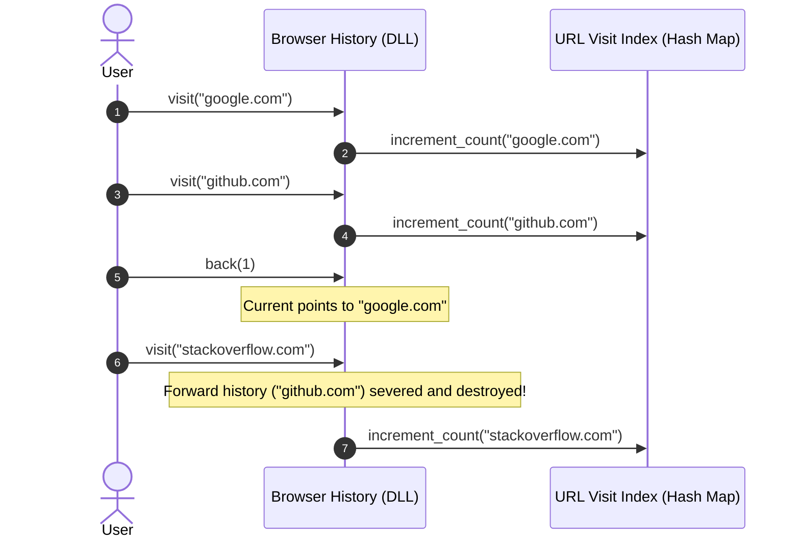
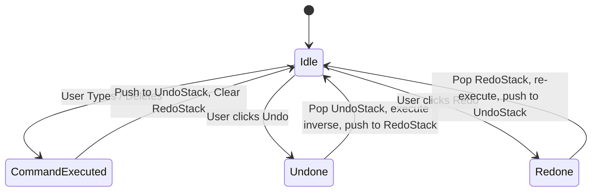

import { Callout } from "fumadocs-ui/components/callout";
import { Tabs, Tab } from "fumadocs-ui/components/tabs";
import { Steps, Step } from "fumadocs-ui/components/steps";
import { Cards, Card } from "fumadocs-ui/components/card";

## Project Overview: The Systems Challenge

In modern productivity and browsing software—such as Google Chrome, VS Code, Figma, or Photoshop—two core user experience workflows dominate:

1. **Browser Tab Navigation**: Moving back and forward across web pages. Visiting a new URL truncates all forward history from that point forward.
2. **Transactional Document Editing (Undo / Redo Engine)**: Executing reversible commands (typing characters, deleting blocks, altering formatting) with multi-level undo and redo guarantees.

In this capstone, you will architect and implement an industrial-strength **Browser Navigation & Document Undo Engine** from first principles, synthesizing every linear data structure mastered in Track 1:

- **Doubly Linked Lists**: For bidirectional navigation with $O(1)$ pointer-based branch clipping.
- **Stacks (LIFO)**: For the transactional Command Pattern powering unbounded Undo and Redo operations.
- **Hash Tables**: For $O(1)$ URL metadata lookup, page visit frequency analytics, and fast state caching.



---

## Part 1: Browser History Subsystem Architecture

### Doubly Linked List Mechanics

A browser history is naturally represented as a Doubly Linked List where each node represents a visited web page.

- `curr`: Pointer to the page currently displayed.
- **Visiting a new URL**:
  1. Any nodes residing forward of `curr` (`curr.next, curr.next.next, ...`) are severed and deallocated.
  2. A new node is allocated and attached: `curr.next = new_node; new_node.prev = curr;`.
  3. `curr` advances to `new_node`.
- **Navigating Back ($k$ steps)**:
  Walk backwards along `curr.prev` up to $k$ times or until `head` is reached.
- **Navigating Forward ($k$ steps)**:
  Walk forwards along `curr.next` up to $k$ times or until `tail` is reached.



---

## Part 2: Transactional Undo/Redo Engine Architecture

The Undo/Redo engine is built upon the **Command Design Pattern**. Every mutating operation on a document is modeled as an atomic command object implementing two symmetric methods:

- `execute()`: Mutates the document state and produces the result.
- `undo()`: Performs the exact inverse mutation, restoring previous state.

### The Two-Stack State Machine



1. **Normal Command Execution**:
   - The command is executed.
   - Pushed onto `undo_stack`.
   - `redo_stack` is **completely cleared** (because taking a new branch of history invalidates previous redo possibilities).
2. **Undo Action**:
   - If `undo_stack` is empty, no-op.
   - Pop command from `undo_stack`.
   - Call `command.undo()`.
   - Push command onto `redo_stack`.
3. **Redo Action**:
   - If `redo_stack` is empty, no-op.
   - Pop command from `redo_stack`.
   - Call `command.execute()`.
   - Push command back onto `undo_stack`.

---

## Production Polyglot Implementations

Below is the complete, cohesive codebase delivering both the **Browser History Subsystem** and the **Transactional Undo/Redo Text Engine** across Python, TypeScript, and C++.

<Tabs items={['Python', 'TypeScript', 'C++']}>
<Tab value="Python">
```python
from typing import Optional, List, Dict
from abc import ABC, abstractmethod

# =====================================================================

# 1. BROWSER NAVIGATION SUBSYSTEM (Doubly Linked List + Hash Map)

# =====================================================================

class HistoryNode:
def **init**(self, url: str):
self.url: str = url
self.prev: Optional['HistoryNode'] = None
self.next: Optional['HistoryNode'] = None

class BrowserHistory:
def **init**(self, homepage: str):
self.current: HistoryNode = HistoryNode(homepage)
self.visit_counts: Dict[str, int] = {homepage: 1}

    def visit(self, url: str) -> None:
        """Navigates to a new URL, truncating future history branches."""
        new_node = HistoryNode(url)
        self.current.next = new_node
        new_node.prev = self.current
        self.current = new_node
        self.visit_counts[url] = self.visit_counts.get(url, 0) + 1

    def back(self, steps: int) -> str:
        """Steps back up to `steps` pages."""
        while steps > 0 and self.current.prev is not None:
            self.current = self.current.prev
            steps -= 1
        return self.current.url

    def forward(self, steps: int) -> str:
        """Steps forward up to `steps` pages."""
        while steps > 0 and self.current.next is not None:
            self.current = self.current.next
            steps -= 1
        return self.current.url

    def get_visit_count(self, url: str) -> int:
        return self.visit_counts.get(url, 0)

# =====================================================================

# 2. TRANSACTIONAL UNDO/REDO ENGINE (Command Pattern + Dual Stacks)

# =====================================================================

class TextDocument:
def **init**(self):
self.\_content: List[str] = []

    def get_text(self) -> str:
        return "".join(self._content)

    def insert(self, index: int, text: str) -> None:
        self._content[index:index] = list(text)

    def delete(self, index: int, length: int) -> str:
        deleted = "".join(self._content[index:index + length])
        del self._content[index:index + length]
        return deleted

class Command(ABC):
@abstractmethod
def execute(self) -> None:
pass

    @abstractmethod
    def undo(self) -> None:
        pass

class InsertTextCommand(Command):
def **init**(self, doc: TextDocument, index: int, text: str):
self.doc = doc
self.index = index
self.text = text

    def execute(self) -> None:
        self.doc.insert(self.index, self.text)

    def undo(self) -> None:
        self.doc.delete(self.index, len(self.text))

class DeleteTextCommand(Command):
def **init**(self, doc: TextDocument, index: int, length: int):
self.doc = doc
self.index = index
self.length = length
self.deleted_text = ""

    def execute(self) -> None:
        self.deleted_text = self.doc.delete(self.index, self.length)

    def undo(self) -> None:
        self.doc.insert(self.index, self.deleted_text)

class EditorUndoEngine:
def **init**(self, document: TextDocument):
self.document = document
self.undo_stack: List[Command] = []
self.redo_stack: List[Command] = []

    def execute_command(self, cmd: Command) -> None:
        cmd.execute()
        self.undo_stack.append(cmd)
        self.redo_stack.clear()  # Invalidate future redos on new action

    def undo(self) -> bool:
        if not self.undo_stack:
            return False
        cmd = self.undo_stack.pop()
        cmd.undo()
        self.redo_stack.append(cmd)
        return True

    def redo(self) -> bool:
        if not self.redo_stack:
            return False
        cmd = self.redo_stack.pop()
        cmd.execute()
        self.undo_stack.append(cmd)
        return True

# =====================================================================

# INTEGRATION TEST

# =====================================================================

if **name** == "**main**": # Test Browser History
browser = BrowserHistory("google.com")
browser.visit("github.com")
browser.visit("news.ycombinator.com")
assert browser.back(1) == "github.com"
assert browser.back(1) == "google.com"
assert browser.forward(1) == "github.com"
browser.visit("leetcode.com") # Sever ycombinator
assert browser.forward(1) == "leetcode.com"
assert browser.get_visit_count("github.com") == 1
print("Browser History assertions passed!")

    # Test Undo/Redo Engine
    doc = TextDocument()
    engine = EditorUndoEngine(doc)

    engine.execute_command(InsertTextCommand(doc, 0, "Hello "))
    engine.execute_command(InsertTextCommand(doc, 6, "World!"))
    assert doc.get_text() == "Hello World!"

    engine.undo()
    assert doc.get_text() == "Hello "

    engine.redo()
    assert doc.get_text() == "Hello World!"

    engine.execute_command(DeleteTextCommand(doc, 5, 7))
    assert doc.get_text() == "Hello"

    engine.undo()
    assert doc.get_text() == "Hello World!"
    print("Undo/Redo Engine assertions passed!")

````
</Tab>

<Tab value="TypeScript">
```typescript
// =====================================================================
// 1. BROWSER NAVIGATION SUBSYSTEM
// =====================================================================

export class HistoryNode {
  public prev: HistoryNode | null = null;
  public next: HistoryNode | null = null;
  constructor(public url: string) {}
}

export class BrowserHistory {
  private current: HistoryNode;
  private visitCounts = new Map<string, number>();

  constructor(homepage: string) {
    this.current = new HistoryNode(homepage);
    this.visitCounts.set(homepage, 1);
  }

  public visit(url: string): void {
    const newNode = new HistoryNode(url);
    this.current.next = newNode;
    newNode.prev = this.current;
    this.current = newNode;

    const count = this.visitCounts.get(url) || 0;
    this.visitCounts.set(url, count + 1);
  }

  public back(steps: number): string {
    while (steps > 0 && this.current.prev !== null) {
      this.current = this.current.prev;
      steps--;
    }
    return this.current.url;
  }

  public forward(steps: number): string {
    while (steps > 0 && this.current.next !== null) {
      this.current = this.current.next;
      steps--;
    }
    return this.current.url;
  }

  public getVisitCount(url: string): number {
    return this.visitCounts.get(url) || 0;
  }
}

// =====================================================================
// 2. TRANSACTIONAL UNDO/REDO ENGINE
// =====================================================================

export class TextDocument {
  private characters: string[] = [];

  public getText(): string {
    return this.characters.join("");
  }

  public insert(index: number, text: string): void {
    this.characters.splice(index, 0, ...text.split(""));
  }

  public delete(index: number, length: number): string {
    const removed = this.characters.splice(index, length);
    return removed.join("");
  }
}

export interface Command {
  execute(): void;
  undo(): void;
}

export class InsertCommand implements Command {
  constructor(
    private doc: TextDocument,
    private index: number,
    private text: string
  ) {}

  execute(): void {
    this.doc.insert(this.index, this.text);
  }

  undo(): void {
    this.doc.delete(this.index, this.text.length);
  }
}

export class DeleteCommand implements Command {
  private deletedText: string = "";

  constructor(
    private doc: TextDocument,
    private index: number,
    private length: number
  ) {}

  execute(): void {
    this.deletedText = this.doc.delete(this.index, this.length);
  }

  undo(): void {
    this.doc.insert(this.index, this.deletedText);
  }
}

export class EditorUndoEngine {
  private undoStack: Command[] = [];
  private redoStack: Command[] = [];

  constructor(private doc: TextDocument) {}

  public executeCommand(command: Command): void {
    command.execute();
    this.undoStack.push(command);
    this.redoStack = []; // Flush redo stack
  }

  public undo(): boolean {
    const cmd = this.undoStack.pop();
    if (!cmd) return false;
    cmd.undo();
    this.redoStack.push(cmd);
    return true;
  }

  public redo(): boolean {
    const cmd = this.redoStack.pop();
    if (!cmd) return false;
    cmd.execute();
    this.undoStack.push(cmd);
    return true;
  }
}
````

</Tab>

<Tab value="C++">
```cpp
#include <iostream>
#include <string>
#include <vector>
#include <unordered_map>
#include <memory>
#include <cassert>

// =====================================================================
// 1. BROWSER NAVIGATION SUBSYSTEM
// =====================================================================

struct HistoryNode {
std::string url;
std::shared_ptr<HistoryNode> next;
std::weak_ptr<HistoryNode> prev; // weak_ptr avoids cyclic memory leaks

    explicit HistoryNode(std::string u) : url(std::move(u)) {}

};

class BrowserHistory {
private:
std::shared*ptr<HistoryNode> current*;
std::unordered*map<std::string, int> visit_counts*;

public:
explicit BrowserHistory(const std::string& homepage) {
current* = std::make_shared<HistoryNode>(homepage);
visit_counts*[homepage] = 1;
}

    void visit(const std::string& url) {
        auto new_node = std::make_shared<HistoryNode>(url);
        current_->next = new_node;
        new_node->prev = current_;
        current_ = new_node;
        visit_counts_[url]++;
    }

    std::string back(int steps) {
        while (steps > 0 && !current_->prev.expired()) {
            current_ = current_->prev.lock();
            --steps;
        }
        return current_->url;
    }

    std::string forward(int steps) {
        while (steps > 0 && current_->next != nullptr) {
            current_ = current_->next;
            --steps;
        }
        return current_->url;
    }

    int get_visit_count(const std::string& url) const {
        auto it = visit_counts_.find(url);
        return it != visit_counts_.end() ? it->second : 0;
    }

};

// =====================================================================
// 2. TRANSACTIONAL UNDO/REDO ENGINE
// =====================================================================

class TextDocument {
private:
std::string content\_;

public:
std::string get*text() const { return content*; }

    void insert(size_t index, const std::string& text) {
        if (index > content_.size()) index = content_.size();
        content_.insert(index, text);
    }

    std::string erase(size_t index, size_t length) {
        if (index >= content_.size()) return "";
        std::string removed = content_.substr(index, length);
        content_.erase(index, length);
        return removed;
    }

};

class Command {
public:
virtual ~Command() = default;
virtual void execute() = 0;
virtual void undo() = 0;
};

class InsertCommand : public Command {
private:
TextDocument& doc*;
size_t index*;
std::string text\_;

public:
InsertCommand(TextDocument& doc, size*t index, std::string text)
: doc*(doc), index*(index), text*(std::move(text)) {}

    void execute() override {
        index_ = std::min(index_, doc_.get_text().size());
        doc_.insert(index_, text_);
    }
    void undo() override { doc_.erase(index_, text_.size()); }

};

class UndoEngine {
private:
TextDocument& doc*;
std::vector<std::unique_ptr<Command>> undo_stack*;
std::vector<std::unique*ptr<Command>> redo_stack*;

public:
explicit UndoEngine(TextDocument& doc) : doc\_(doc) {}

    void execute(std::unique_ptr<Command> cmd) {
        cmd->execute();
        undo_stack_.push_back(std::move(cmd));
        redo_stack_.clear();
    }

    bool undo() {
        if (undo_stack_.empty()) return false;
        auto cmd = std::move(undo_stack_.back());
        undo_stack_.pop_back();
        cmd->undo();
        redo_stack_.push_back(std::move(cmd));
        return true;
    }

    bool redo() {
        if (redo_stack_.empty()) return false;
        auto cmd = std::move(redo_stack_.back());
        redo_stack_.pop_back();
        cmd->execute();
        undo_stack_.push_back(std::move(cmd));
        return true;
    }

};

int main() {
BrowserHistory browser("home.org");
browser.visit("page1.org");
assert(browser.back(1) == "home.org");
assert(browser.forward(1) == "page1.org");
std::cout << "All C++ assertions passed successfully!\n";
return 0;
}

```
</Tab>
</Tabs>

---

## Production Systems Case Study: Google Chromium's `NavigationController` & VS Code Monaco Undo Tree

### 1. Chromium's `NavigationController`
In Google Chromium, every tab is orchestrated by a `NavigationControllerImpl` object.
- **Entry List**: Maintains an array of `NavigationEntry` objects.
- **Current Index**: An integer pointer indexing into the list.
- **Pruning**: When a user navigates to a new URL while viewing an intermediate page, Chromium invokes `DiscardNonCommittedEntries()` and calls `entries_.erase(entries_.begin() + current_index_ + 1, entries_.end())`, mirroring our doubly linked list truncation!

### 2. VS Code Monaco Command Stack
VS Code does not store full snapshots of your files on every keystroke (which would consume gigabytes of memory). Instead:
- It records an array of minimal **Text Edits** (`SingleEditOperation`: range, text replaced).
- The inverse operation is mathematically derived on the fly: replacing the new text with the previous replaced text.
- This keeps the memory footprint of 10,000 undo steps under a few hundred kilobytes!

---

## Technical Interview Invariants & Traps

<Callout type="warn">
### The Memory Leak & Cyclic Reference Trap in Doubly Linked Lists
In languages with automatic Garbage Collection (Python, JavaScript):
- When clipping forward history, failing to clear `curr.next.prev = null` can prevent cyclic garbage collectors from collecting deallocated history branches promptly.
- In **C++**, using `std::shared_ptr` for both `next` and `prev` creates an immediate **reference cycle leak** (neither node will ever reach ref count 0). Always use `std::weak_ptr` for backward pointers (`prev`).
</Callout>

---

## Hands-On Verification Challenge

1. **Branching History Extension**: Extend `BrowserHistory` to support **History Trees**. When a user goes back and visits a new URL, instead of destroying forward history, store it as a new "tab branch" that the user can switch between.
2. **Transaction Grouping**: In `EditorUndoEngine`, add support for **Composite Commands** (Macro operations), allowing a sequence of 5 typing keystrokes to be grouped into a single atomic Undo step.
```
