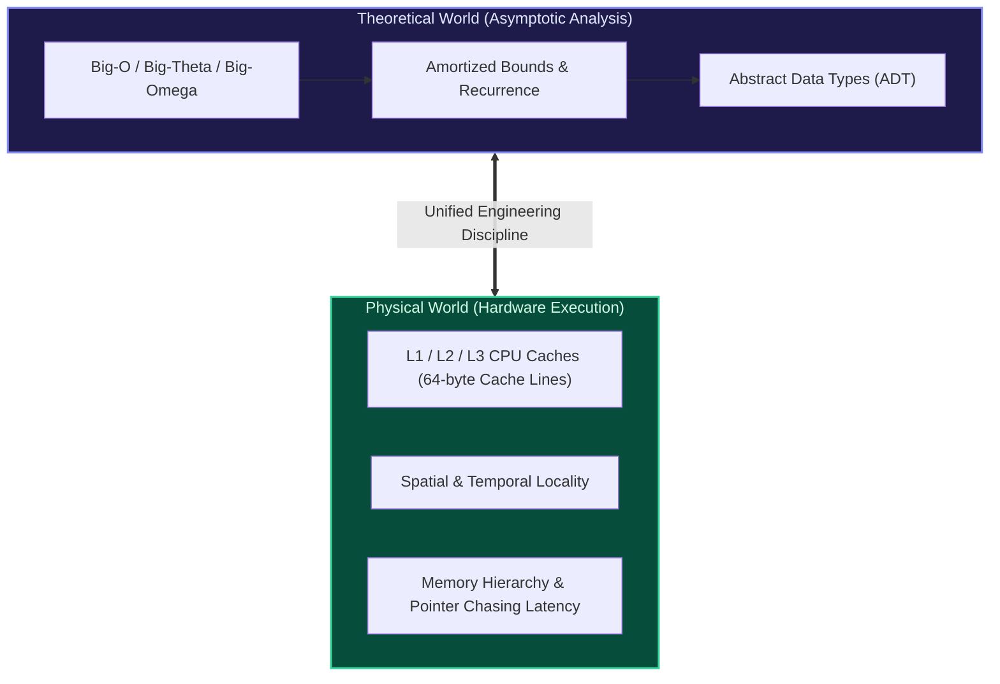

import { Callout } from "fumadocs-ui/components/callout";
import { Tabs, Tab } from "fumadocs-ui/components/tabs";
import { Steps, Step } from "fumadocs-ui/components/steps";
import { Cards, Card } from "fumadocs-ui/components/card";

## The ByteKart Scaling Story: Silicon Reality Behind Abstract Data

Imagine the year is 2020. You and two friends have just launched **ByteKart**, an online electronics store.

On launch day, you stock **50 products** in a Python dictionary. Every customer search runs in under 0.001 milliseconds. The site is blazing fast, your servers are idling at 1% CPU, and you assume data structures are just academic trivia for whiteboard interviews.

Fast forward three years to Black Friday:

- Your catalog now holds **1,000,000 items**.
- **100,000 concurrent shoppers** are flooding your checkout lines.
- Suddenly, the search engine freezes, memory usage explodes into gigabytes of trash, server CPUs spike to 100%, and the website crashes.

```mermaid
flowchart TD
    subgraph Growth["The 6 Scaling Hurdles of ByteKart"]
        direction TB
        L1["1. Search crashes: O(N²) nested loop takes 16 minutes per click → Big-O saves the day"]
        L2["2. Catalog expands: Shelves fill up; moving items to 2x larger warehouse → Dynamic Arrays"]
        L3["3. Autocomplete freezes: Concatenating strings eats 4GB of RAM → String Immutability & SSO"]
        L4["4. Custom bundles: Inserting items without moving an entire warehouse → Linked Lists"]
        L5["5. Flash sale rush: Shopping Cart Undo & Checkout Line traffic → Stacks, Queues & Ring Buffers"]
        L6["6. 1-second lookup: Finding any item among 1M SKUs instantly → Hash Tables & SipHash"]

        L1 --> L2 --> L3 --> L4 --> L5 --> L6
    end

    style Growth fill:#020617,stroke:#38bdf8,stroke-width:2px
```

Every single bottleneck ByteKart faced was solved not by buying bigger servers, but by choosing the **correct physical data structure**.

---

## Silicon Reality: Math Meets Physics

Every algorithm executed in software eventually manifests as electrical signals flowing through physical silicon. While traditional computer science curricula introduce data structures purely as theoretical mathematical objects—nodes floating in a vacuum, infinite arrays, and costless pointer dereferences—modern high-performance software engineering demands a unified perspective: **algorithmic time complexity coupled with physical hardware mechanics**.

A theoretical $O(N)$ traversal of a linked list can run **10x to 50x slower** than an $O(N)$ traversal of a contiguous dynamic array of identical size. Why? Because traversing an array exploits the CPU hardware prefetcher streaming 64-byte cache lines into 1-cycle L1 cache, whereas pointer-chasing in linked lists induces constant DRAM cache misses costing upwards of 100 to 200 CPU cycles each.

This track equips you with both intuitive mental models and low-level mechanical sympathy.

---

## Track Curriculum Map

<Cards>
  <Card
    title="01. Complexity & Big-O Notation"
    href="/docs/dsa/01-foundations-and-linear-structures/01-complexity-and-big-o-notation"
    description="Intuitive asymptotic scaling, the Big-O hierarchy ladder, 3-step code audits, and time vs. space complexity trade-offs."
  />
  <Card
    title="02. Arrays & Dynamic Arrays"
    href="/docs/dsa/01-foundations-and-linear-structures/02-arrays-and-dynamic-arrays"
    description="Types of arrays (1D, 2D, jagged, circular, sparse), Row/Column-Major address formulas, geometric expansion (1.5x vs 2x), and prefix sums."
  />
  <Card
    title="03. Strings & String Manipulation"
    href="/docs/dsa/01-foundations-and-linear-structures/03-strings-and-string-manipulation"
    description="Memory layouts, string immutability physics, ASCII vs UTF-8, substring combinatorics, and KMP LPS pattern matching."
  />
  <Card
    title="04. Linked Lists"
    href="/docs/dsa/01-foundations-and-linear-structures/04-linked-lists"
    description="Singly, doubly, circular, and skip lists; sentinel dummy nodes; pointer safety; and Floyd's Cycle Detection proof."
  />
  <Card
    title="05. Stacks & Queues"
    href="/docs/dsa/01-foundations-and-linear-structures/05-stacks-and-queues"
    description="LIFO and FIFO mechanics, infix-to-postfix conversions, circular queues with modulo arithmetic, and monotonic stacks."
  />
  <Card
    title="06. Hash Tables & Hashing"
    href="/docs/dsa/01-foundations-and-linear-structures/06-hash-tables-and-hashing"
    description="Hash function construction (division, multiplication), collision resolution (chaining vs open addressing), load factor, and Swiss tables."
  />
  <Card
    title="Capstone: Browser History & Undo Engine"
    href="/docs/dsa/01-foundations-and-linear-structures/capstone-browser-history-and-undo-engine"
    description="Production-grade tab navigation and command pattern undo/redo engine combining DLLs, stacks, and hash tables."
  />
  <Card
    title="Quick Reference & Cheat Sheet"
    href="/docs/dsa/01-foundations-and-linear-structures/quick-reference"
    description="Complete Big-O cheat sheet, complexity decision trees, pointer invariants, and interview trap checklists."
  />
</Cards>

---

## Pedagogical Pillars of Track 1

<Steps>
  <Step>
    #### 1. Rigorous Mathematical Foundations
    You will not just memorize Big-O cheat sheets. You will derive asymptotic proofs, formulate potential functions ($\Phi$) for amortized cost accounting, apply the Master Theorem to divide-and-conquer recurrences, and mathematically prove Floyd's Cycle Detection ($2(F + a) = F + a + kC$).
  </Step>

<Step>
  #### 2. Physical Memory & Cache Locality Every data structure is examined
  through the lens of modern CPU architecture: 64-byte cache lines, spatial vs.
  temporal locality, translation lookaside buffers (TLB), memory alignment, and
  cache-oblivious efficiency.
</Step>

<Step>
  #### 3. Polyglot Production Implementations Explore and write production-grade
  code across three distinct language paradigms: - **Python**: High-level
  syntax, reference-counting mechanics, PyObject overhead. - **TypeScript /
  V8**: Typed contracts, Hidden Classes (Shapes), SMI (Small Integers) vs heap
  objects. - **C++**: Deterministic memory layout, direct pointers, cache line
  alignment, and RAII safety.
</Step>

  <Step>
    #### 4. Real-World Production Systems
    See how the world's most critical open-source systems deploy these primitives:
    - How **Redis** implements ziplists and quicklists to avoid pointer bloat.
    - How **Google Chrome V8** optimizes small strings and contiguous elements.
    - How **Abseil & Rust** revolutionized hash maps with 16-way SIMD control bytes (Swiss Tables).
    - How the **Linux kernel** structures double linked lists using intrusive `struct list_head`.
  </Step>
</Steps>

---

## Key Hardware Latencies Reference

To understand why data structure selection matters in the real world, keep this classic latency hierarchy in mind throughout this track:

| Operation                        | Typical Latency               | Scaled Human Equivalent (1 cycle = 1 sec) |
| :------------------------------- | :---------------------------- | :---------------------------------------- |
| **1 CPU Cycle**                  | 0.3 ns                        | 1 second                                  |
| **L1 Cache Reference**           | 1 ns                          | 3 seconds                                 |
| **L2 Cache Reference**           | 4 ns                          | 12 seconds                                |
| **L3 Cache Reference**           | 12 - 40 ns                    | ~1 minute                                 |
| **Main Memory (DRAM) Reference** | 60 - 100 ns                   | ~4 minutes                                |
| **SSD NVMe Random Read**         | 10,000 - 50,000 ns (10-50 µs) | ~1.5 days                                 |
| **HDD Spin / Seek**              | 5,000,000 ns (5 ms)           | ~5 months                                 |
| **Internet Packet (SF to NYC)**  | 40,000,000 ns (40 ms)         | ~4 years                                  |

<Callout type="info">
  Notice the cliff between an **L1 Cache access (1 ns)** and a **Main Memory
  DRAM access (60–100 ns)**. An algorithm that makes contiguous memory accesses
  will hit L1/L2 caches up to 99% of the time, easily outperforming an algorithm
  with better theoretical constant factors that jumps randomly around heap
  memory.
</Callout>
