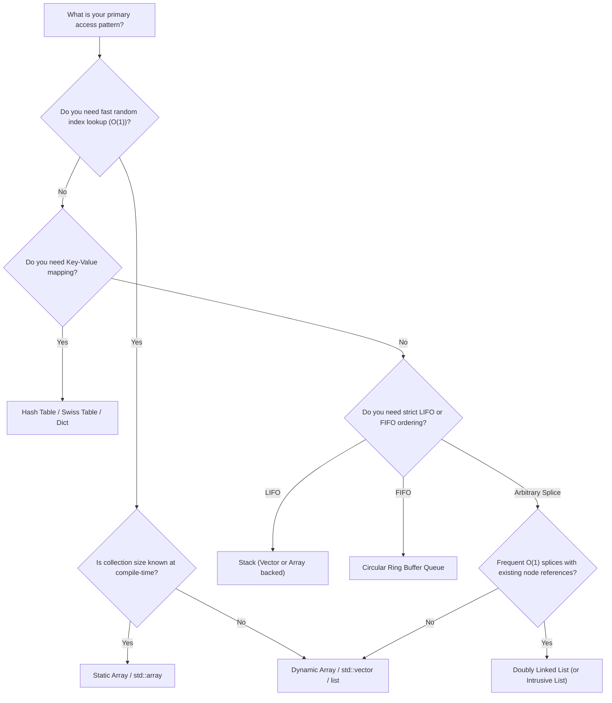

import { Callout } from "fumadocs-ui/components/callout";
import { Tabs, Tab } from "fumadocs-ui/components/tabs";
import { Steps, Step } from "fumadocs-ui/components/steps";
import { Cards, Card } from "fumadocs-ui/components/card";

## Linear Data Structures Complexity Matrix

| Data Structure             | Access (`[i]`) | Search / Lookup | Insert (Head)     | Insert (Tail)        | Insert (Arbitrary)  | Delete (Head) | Delete (Tail)     | Delete (Arbitrary)  | Auxiliary Space |
| :------------------------- | :------------- | :-------------- | :---------------- | :------------------- | :------------------ | :------------ | :---------------- | :------------------ | :-------------- |
| **Static Array**           | $\Theta(1)$    | $\Theta(N)$     | N/A               | N/A                  | N/A                 | N/A           | N/A               | N/A                 | $O(1)$          |
| **Dynamic Array (Vector)** | $\Theta(1)$    | $\Theta(N)$     | $\Theta(N)$       | $\Theta(1)^*$        | $\Theta(N)$         | $\Theta(N)$   | $\Theta(1)$       | $\Theta(N)$         | $O(N)$          |
| **Singly Linked List**     | $\Theta(N)$    | $\Theta(N)$     | $\Theta(1)$       | $\Theta(1)^\dagger$  | $\Theta(N)$         | $\Theta(1)$   | $\Theta(N)$       | $\Theta(N)$         | $O(N)$          |
| **Doubly Linked List**     | $\Theta(N)$    | $\Theta(N)$     | $\Theta(1)$       | $\Theta(1)$          | $\Theta(N)$         | $\Theta(1)$   | $\Theta(1)$       | $\Theta(N)$         | $O(N)$          |
| **Stack (Array-backed)**   | $\Theta(N)$    | $\Theta(N)$     | N/A               | $\Theta(1)^*$ (Push) | N/A                 | N/A           | $\Theta(1)$ (Pop) | N/A                 | $O(N)$          |
| **Queue (Ring Buffer)**    | N/A            | $\Theta(N)$     | $\Theta(1)$ (Deq) | $\Theta(1)$ (Enq)    | N/A                 | $\Theta(1)$   | N/A               | N/A                 | $O(N)$          |
| **Hash Table (Open Addr)** | N/A            | $\Theta(1)^*$   | N/A               | N/A                  | $\Theta(1)^*$ (Put) | N/A           | N/A               | $\Theta(1)^*$ (Del) | $O(N)$          |

$^*$ _Denotes amortized time complexity._  
$^\dagger$ _Assuming tail pointer is maintained._

---

## Architectural Decision Tree: Which Data Structure To Choose?



---

## Pointer & Memory Safety Rules of Thumb

<Steps>
  <Step>
    #### 1. Beware of Iterator / Pointer Invalidation
    In dynamic arrays (`std::vector`, Python lists), inserting or appending an element can trigger reallocation. When this occurs, **all previous raw pointers, references, and iterators to elements in that vector become dangling pointers**.
    ```cpp
    std::vector<int> v = {1, 2, 3};
    int* ptr = &v[0];
    v.push_back(4); // May reallocate vector buffer!
    // *ptr is now a DANGLING POINTER -> Undefined Behavior!
    ```
  </Step>

<Step>
  #### 2. Guard Against Reference Cycles in Doubly Linked Lists In
  reference-counted environments (Python, C++ `std::shared_ptr`): - `NodeA.next
  = NodeB` - `NodeB.prev = NodeA` - If you discard references to both nodes,
  their reference count never drops to zero! - **Remedy**: In C++, use
  `std::weak_ptr` for `prev`. In Python, rely on `weakref` or ensure explicit
  teardown methods.
</Step>

<Step>
  #### 3. Sentinel Dummies for All Linked List Mutations Always allocate a dummy
  head: ```python dummy = ListNode(0) dummy.next = head # Perform operations on
  dummy.next return dummy.next ``` This eliminates head edge cases, null checks,
  and empty list branch logic.
</Step>

  <Step>
    #### 4. Never Modify a Collection While Iterating
    Modifying the size of an array or hash map during traversal invalidates index offsets and hash bucket iterators.
    - **For Arrays**: Use the two-pointer read/write overwrite pattern.
    - **For Hash Maps**: Collect keys to delete in a temporary list, then delete in a second pass.
  </Step>
</Steps>

---

## Technical Interview Patterns Quick Reference

<Tabs items={['Two Pointers', 'Sliding Window', 'Monotonic Stack', 'Prefix Sum']}>
<Tab value="Two Pointers">
```python
def two_sum_sorted(nums: list[int], target: int) -> list[int]:
    """Opposite-direction two pointers on sorted array."""
    left, right = 0, len(nums) - 1
    while left < right:
        curr_sum = nums[left] + nums[right]
        if curr_sum == target:
            return [left, right]
        elif curr_sum < target:
            left += 1
        else:
            right -= 1
    return []
```
</Tab>

<Tab value="Sliding Window">
```python
def min_sub_array_len(target: int, nums: list[int]) -> int:
    """Dynamic-size sliding window (O(N) time, O(1) space)."""
    left = 0
    curr_sum = 0
    min_len = float('inf')

    for right in range(len(nums)):
        curr_sum += nums[right]
        while curr_sum >= target:
            min_len = min(min_len, right - left + 1)
            curr_sum -= nums[left]
            left += 1

    return min_len if min_len != float('inf') else 0

````
</Tab>

<Tab value="Monotonic Stack">
```python
def next_greater_element(nums: list[int]) -> list[int]:
    """Next greater element on the right (O(N) time)."""
    n = len(nums)
    res = [-1] * n
    stack = []  # Decreasing monotonic stack of indices

    for i in range(n):
        while stack and nums[stack[-1]] < nums[i]:
            idx = stack.pop()
            res[idx] = nums[i]
        stack.append(i)

    return res
````

</Tab>

<Tab value="Prefix Sum">
```python
class NumArray:
    """1-indexed prefix sums for O(1) range sum queries."""
    def __init__(self, nums: list[int]):
        self.prefix = [0] * (len(nums) + 1)
        for i, val in enumerate(nums):
            self.prefix[i + 1] = self.prefix[i] + val

    def sum_range(self, left: int, right: int) -> int:
        return self.prefix[right + 1] - self.prefix[left]

```
</Tab>
</Tabs>

---

## High-Frequency Interview Trap Checklist

<Callout type="warn">
### Before Submitting Any Linear Structure Solution, Verify:
- [ ] **Empty input / Single element**: Does your code crash on `len == 0` or `len == 1`?
- [ ] **Off-by-one errors**: Did you use `<` vs `<=` or `size` vs `size - 1`?
- [ ] **All duplicates**: Does your two-pointer or monotonic stack loop correctly handle `[5, 5, 5, 5]`?
- [ ] **Integer overflow**: In C++, does `(left + right) / 2` overflow `INT_MAX`? (Use `left + (right - left) / 2`).
- [ ] **String concatenation**: Are you accumulating strings via `+=` inside an $O(N)$ loop, accidentally inducing $O(N^2)$ behavior?
- [ ] **Key immutability**: Are keys inserted into a hash map mutated later in the algorithm?
</Callout>
```
