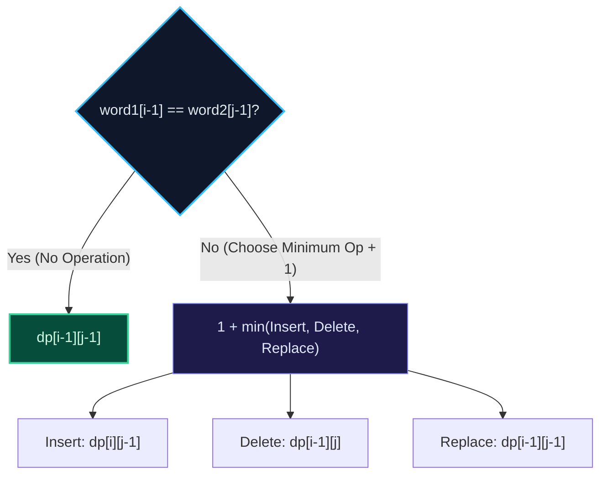

import { Callout } from "fumadocs-ui/components/callout";
import { Tabs, Tab } from "fumadocs-ui/components/tabs";
import { Steps, Step } from "fumadocs-ui/components/steps";
import { Cards, Card } from "fumadocs-ui/components/card";

## The Levenshtein Distance Definition

Given two strings `word1` and `word2`, find the **minimum number of operations** required to convert `word1` to `word2`.
Permitted operations:

1. **Insert** a character.
2. **Delete** a character.
3. **Replace** a character.



---

## The Dynamic Programming Recurrence

Let $DP[i][j]$ be the minimum operations to transform `word1[0..i-1]` into `word2[0..j-1]`:

If characters match ($word_1[i-1] == word_2[j-1]$):
$$DP[i][j] = DP[i-1][j-1]$$
If characters differ:
$$DP[i][j] = 1 + \min \begin{cases} DP[i][j-1] & (\text{Insert}) \\ DP[i-1][j] & (\text{Delete}) \\ DP[i-1][j-1] & (\text{Replace}) \end{cases}$$

Base cases:

- $DP[i][0] = i$ (Delete all $i$ characters)
- $DP[0][j] = j$ (Insert all $j$ characters)

---

## Multi-Language Implementations

<Tabs items={["Python", "TypeScript", "C++"]}>
<Tab value="Python">
```python
def min_distance(word1: str, word2: str) -> int:
    """Calculates Levenshtein distance in O(M*N) time and O(N) space."""
    m, n = len(word1), len(word2)
    dp = list(range(n + 1))

    for i in range(1, m + 1):
        prev_diag = dp[0]
        dp[0] = i
        for j in range(1, n + 1):
            temp = dp[j]
            if word1[i - 1] == word2[j - 1]:
                dp[j] = prev_diag
            else:
                dp[j] = 1 + min(dp[j - 1], dp[j], prev_diag)
            prev_diag = temp

    return dp[n]

````
</Tab>
<Tab value="TypeScript">
```typescript
export function minDistance(word1: string, word2: string): number {
  const m = word1.length;
  const n = word2.length;
  let dp: number[] = Array.from({ length: n + 1 }, (_, idx) => idx);

  for (let i = 1; i <= m; i++) {
    let prevDiag = dp[0];
    dp[0] = i;
    for (let j = 1; j <= n; j++) {
      const temp = dp[j];
      if (word1[i - 1] === word2[j - 1]) {
        dp[j] = prevDiag;
      } else {
        dp[j] = 1 + Math.min(dp[j - 1], dp[j], prevDiag);
      }
      prevDiag = temp;
    }
  }

  return dp[n];
}
````

</Tab>
<Tab value="C++">
```cpp
#include <string>
#include <vector>
#include <algorithm>
#include <numeric>

int minDistance(const std::string& word1, const std::string& word2) {
int m = word1.length();
int n = word2.length();
std::vector<int> dp(n + 1);
std::iota(dp.begin(), dp.end(), 0);

    for (int i = 1; i <= m; ++i) {
        int prevDiag = dp[0];
        dp[0] = i;
        for (int j = 1; j <= n; ++j) {
            int temp = dp[j];
            if (word1[i - 1] == word2[j - 1]) {
                dp[j] = prevDiag;
            } else {
                dp[j] = 1 + std::min({dp[j - 1], dp[j], prevDiag});
            }
            prevDiag = temp;
        }
    }

    return dp[n];

}

```
</Tab>
</Tabs>
```
