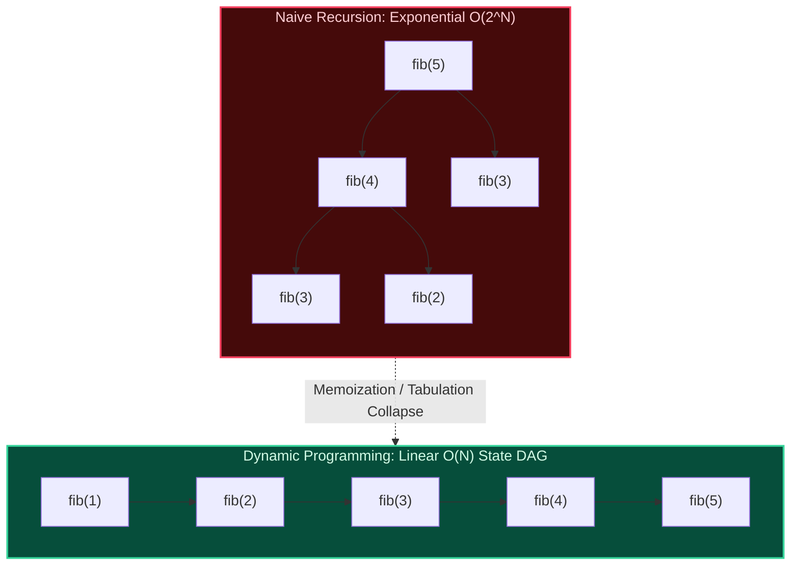

import { Callout } from "fumadocs-ui/components/callout";
import { Tabs, Tab } from "fumadocs-ui/components/tabs";
import { Steps, Step } from "fumadocs-ui/components/steps";
import { Cards, Card } from "fumadocs-ui/components/card";

## The Architectural Core of Dynamic Programming

Dynamic Programming (DP), formalized by Richard Bellman in the 1950s, solves complex optimization problems by breaking them down into simpler, overlapping subproblems.

A problem admits a dynamic programming solution if and only if it exhibits two fundamental properties:

1. **Optimal Substructure**: An optimal solution to the problem contains within it optimal solutions to its subproblems.
2. **Overlapping Subproblems**: The recursive decomposition visits the exact same subproblems repeatedly, transforming what would be an exponential tree into a compact Directed Acyclic Graph (DAG) of states.

---

## The 11 Core Domains of Foundational DP

<Cards>
  <Card
    title="2.5.1. Top-Down Memoization"
    href="/docs/dsa/02-intermediate/foundational-dynamic-programming/top-down-memoization"
  >
    Recursive formulation with cache tables, subproblem DAG exploration, and
    call stack bounds.
  </Card>
  <Card
    title="2.5.2. Bottom-Up Tabulation"
    href="/docs/dsa/02-intermediate/foundational-dynamic-programming/bottom-up-tabulation"
  >
    Iterative table filling following topological subproblem evaluation order
    without stack overhead.
  </Card>
  <Card
    title="2.5.3. Space-Optimized DP"
    href="/docs/dsa/02-intermediate/foundational-dynamic-programming/space-optimized-dynamic-programming"
  >
    Rolling arrays and state variable reduction to drop spatial complexity from
    O(N) to O(1).
  </Card>
  <Card
    title="2.5.4. 1D Dynamic Programming"
    href="/docs/dsa/02-intermediate/foundational-dynamic-programming/one-dimensional-dynamic-programming"
  >
    Linear recurrences: Climbing Stairs, House Robber I & II, and Coin Change
    minimum paths.
  </Card>
  <Card
    title="2.5.5. Multi-Dimensional Grid DP"
    href="/docs/dsa/02-intermediate/foundational-dynamic-programming/multi-dimensional-grid-dynamic-programming"
  >
    Path counting on grids, minimum cost paths, obstacle avoidance, and maximal
    squares.
  </Card>
  <Card
    title="2.5.6. Zero-One Knapsack"
    href="/docs/dsa/02-intermediate/foundational-dynamic-programming/zero-one-knapsack"
  >
    Bounded item selection, reverse inner loop iteration, and 1D buffer
    compression.
  </Card>
  <Card
    title="2.5.7. Unbounded Knapsack"
    href="/docs/dsa/02-intermediate/foundational-dynamic-programming/unbounded-knapsack"
  >
    Infinite item replacement, forward loop iteration, and Coin Change II
    combinations.
  </Card>
  <Card
    title="2.5.8. Subset Sum"
    href="/docs/dsa/02-intermediate/foundational-dynamic-programming/subset-sum"
  >
    Partition equal subset sum, boolean reachable state transitions, and bitset
    optimizations.
  </Card>
  <Card
    title="2.5.9. Longest Increasing Subsequence"
    href="/docs/dsa/02-intermediate/foundational-dynamic-programming/longest-increasing-subsequence"
  >
    O(N^2) DP recurrence and O(N log N) patience sorting with binary search.
  </Card>
  <Card
    title="2.5.10. Longest Common Subsequence"
    href="/docs/dsa/02-intermediate/foundational-dynamic-programming/longest-common-subsequence"
  >
    2D matching matrix recurrence, string reconstruction via back-pointers, and
    diff engines.
  </Card>
  <Card
    title="2.5.11. Edit Distance"
    href="/docs/dsa/02-intermediate/foundational-dynamic-programming/edit-distance"
  >
    Levenshtein distance, insert/delete/replace matrix transitions, and search
    typo correction.
  </Card>
</Cards>
