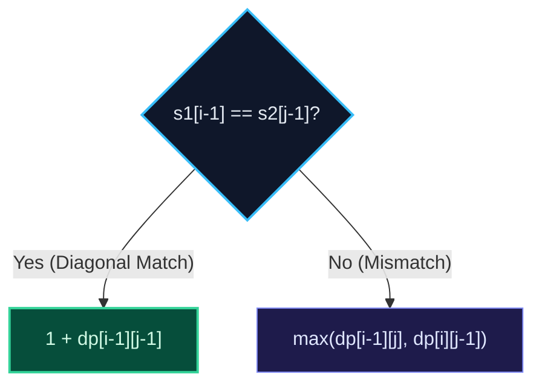

import { Callout } from "fumadocs-ui/components/callout";
import { Tabs, Tab } from "fumadocs-ui/components/tabs";
import { Steps, Step } from "fumadocs-ui/components/steps";
import { Cards, Card } from "fumadocs-ui/components/card";

## The Subsequence Alignment Matrix

Given two strings $s_1$ and $s_2$, find the length of their longest common subsequence.
LCS forms the foundational theory behind `git diff`, Unix `diff`, and DNA sequence alignment.



---

## The Dynamic Programming Recurrence

Let $DP[i][j]$ be the LCS length of prefixes $s_1[0..i-1]$ and $s_2[0..j-1]$:
$$DP[i][j] = \begin{cases} 1 + DP[i-1][j-1] & \text{if } s_1[i-1] == s_2[j-1] \\ \max(DP[i-1][j], DP[i][j-1]) & \text{otherwise} \end{cases}$$

Base cases: $DP[0][j] = 0$ and $DP[i][0] = 0$.

---

## Multi-Language Implementations

<Tabs items={["Python", "TypeScript", "C++"]}>
<Tab value="Python">
```python
def longest_common_subsequence(s1: str, s2: str) -> int:
    """Calculates LCS in O(M*N) time and O(N) space."""
    m, n = len(s1), len(s2)
    # Space-optimized rolling array
    dp = [0] * (n + 1)

    for i in range(1, m + 1):
        prev_diag = 0  # Represents dp[i-1][j-1]
        for j in range(1, n + 1):
            temp = dp[j]
            if s1[i - 1] == s2[j - 1]:
                dp[j] = 1 + prev_diag
            else:
                dp[j] = max(dp[j], dp[j - 1])
            prev_diag = temp

    return dp[n]

````
</Tab>
<Tab value="TypeScript">
```typescript
export function longestCommonSubsequence(s1: string, s2: string): number {
  const m = s1.length;
  const n = s2.length;
  const dp: number[] = new Array(n + 1).fill(0);

  for (let i = 1; i <= m; i++) {
    let prevDiag = 0;
    for (let j = 1; j <= n; j++) {
      const temp = dp[j];
      if (s1[i - 1] === s2[j - 1]) {
        dp[j] = 1 + prevDiag;
      } else {
        dp[j] = Math.max(dp[j], dp[j - 1]);
      }
      prevDiag = temp;
    }
  }

  return dp[n];
}
````

</Tab>
<Tab value="C++">
```cpp
#include <string>
#include <vector>
#include <algorithm>

int longestCommonSubsequence(const std::string& s1, const std::string& s2) {
int m = s1.length();
int n = s2.length();
std::vector<int> dp(n + 1, 0);

    for (int i = 1; i <= m; ++i) {
        int prevDiag = 0;
        for (int j = 1; j <= n; ++j) {
            int temp = dp[j];
            if (s1[i - 1] == s2[j - 1]) {
                dp[j] = 1 + prevDiag;
            } else {
                dp[j] = std::max(dp[j], dp[j - 1]);
            }
            prevDiag = temp;
        }
    }

    return dp[n];

}

```
</Tab>
</Tabs>
```
