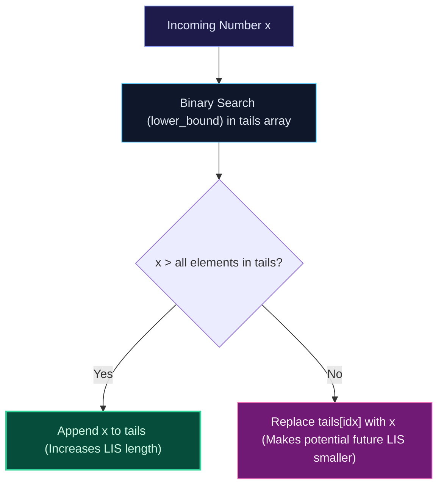

import { Callout } from "fumadocs-ui/components/callout";
import { Tabs, Tab } from "fumadocs-ui/components/tabs";
import { Steps, Step } from "fumadocs-ui/components/steps";
import { Cards, Card } from "fumadocs-ui/components/card";

## The Subsequence Problem

A **Subsequence** is derived by deleting zero or more elements from an array without changing the relative order of remaining elements. The **Longest Increasing Subsequence (LIS)** seeks the maximum length of a strictly increasing subsequence.

For example, in `[10, 9, 2, 5, 3, 7, 101, 18]`, an optimal LIS is `[2, 3, 7, 101]` with length $4$.

---

## Method 1: Classical $\mathcal{O}(N^2)$ Dynamic Programming

Let $DP[i]$ be the length of the longest increasing subsequence that ends strictly at index $i$:
$$DP[i] = 1 + \max_{\{j < i \mid A[j] < A[i]\}} DP[j]$$
Base case: $DP[i] = 1$ for all $i$.


---

## Method 2: Patience Sorting & Binary Search in $\mathcal{O}(N \log N)$

To achieve $\mathcal{O}(N \log N)$, maintain an array `tails`, where `tails[len]` stores the **smallest ending element** of all increasing subsequences of length `len + 1` found so far.



At any point, `tails` is guaranteed to be strictly sorted. For each number $x$:

1. Binary search (`lower_bound` / `bisect_left`) for the first element in `tails` $\ge x$.
2. If no such element exists, append $x$ to `tails`.
3. If an element exists at index `idx`, replace `tails[idx] = x`.
4. The final length of `tails` is the exact LIS length!

---

## Multi-Language Implementations

<Tabs items={["Python", "TypeScript", "C++"]}>
<Tab value="Python">
```python
from bisect import bisect_left
from typing import List

def length_of_lis(nums: List[int]) -> int:
"""Patience Sorting LIS in O(N log N) time and O(N) space."""
if not nums:
return 0

    tails = []
    for x in nums:
        idx = bisect_left(tails, x)
        if idx == len(tails):
            tails.append(x)
        else:
            tails[idx] = x

    return len(tails)

````
</Tab>
<Tab value="TypeScript">
```typescript
export function lengthOfLIS(nums: number[]): number {
  const tails: number[] = [];

  for (const x of nums) {
    let l = 0;
    let r = tails.length;

    while (l < r) {
      const mid = l + Math.floor((r - l) / 2);
      if (tails[mid] < x) {
        l = mid + 1;
      } else {
        r = mid;
      }
    }

    if (l === tails.length) {
      tails.push(x);
    } else {
      tails[l] = x;
    }
  }

  return tails.length;
}
````

</Tab>
<Tab value="C++">
```cpp
#include <vector>
#include <algorithm>

int lengthOfLIS(const std::vector<int>& nums) {
std::vector<int> tails;

    for (int x : nums) {
        auto it = std::lower_bound(tails.begin(), tails.end(), x);
        if (it == tails.end()) {
            tails.push_back(x);
        } else {
            *it = x;
        }
    }

    return tails.size();

}

```
</Tab>
</Tabs>
```
