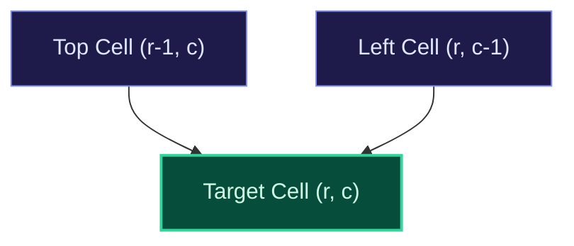

import { Callout } from "fumadocs-ui/components/callout";
import { Tabs, Tab } from "fumadocs-ui/components/tabs";
import { Steps, Step } from "fumadocs-ui/components/steps";
import { Cards, Card } from "fumadocs-ui/components/card";

## The Grid as a Directed Acyclic Graph (DAG)

In grid dynamic programming, an agent navigates an $M \times N$ grid, typically constrained to moving strictly **Right** $(r, c+1)$ or **Down** $(r+1, c)$. Because moves are unidirectional, the grid forms an acyclic topological order where state $(r, c)$ depends only on its top neighbor $(r-1, c)$ and left neighbor $(r, c-1)$.



---

## Canonical Archetype: Minimum Path Sum

Given an $M \times N$ grid filled with non-negative numbers, find a path from top-left to bottom-right that minimizes the sum of all numbers along its path.

### Recurrence

$$DP[r][c] = \text{grid}[r][c] + \min(DP[r-1][c], DP[r][c-1])$$

- Top row base case: $DP[0][c] = DP[0][c-1] + \text{grid}[0][c]$
- Left column base case: $DP[r][0] = DP[r-1][0] + \text{grid}[r][0]$

---

## Multi-Language Implementations

<Tabs items={["Python", "TypeScript", "C++"]}>
<Tab value="Python">
```python
from typing import List

def min_path_sum(grid: List[List[int]]) -> int:
"""Calculates Minimum Path Sum in O(M*N) time and O(N) space."""
m, n = len(grid), len(grid[0])
dp = [0] * n

    # Initialize top-left cell
    dp[0] = grid[0][0]
    for c in range(1, n):
        dp[c] = dp[c - 1] + grid[0][c]

    for r in range(1, m):
        dp[0] += grid[r][0]  # First column can only come from above
        for c in range(1, n):
            dp[c] = grid[r][c] + min(dp[c], dp[c - 1])

    return dp[-1]

````
</Tab>
<Tab value="TypeScript">
```typescript
export function minPathSum(grid: number[][]): number {
  const m = grid.length;
  const n = grid[0].length;
  const dp: number[] = new Array(n).fill(0);

  dp[0] = grid[0][0];
  for (let c = 1; c < n; c++) {
    dp[c] = dp[c - 1] + grid[0][c];
  }

  for (let r = 1; r < m; r++) {
    dp[0] += grid[r][0];
    for (let c = 1; c < n; c++) {
      dp[c] = grid[r][c] + Math.min(dp[c], dp[c - 1]);
    }
  }

  return dp[n - 1];
}
````

</Tab>
<Tab value="C++">
```cpp
#include <vector>
#include <algorithm>

int minPathSum(std::vector<std::vector<int>>& grid) {
int m = grid.size();
int n = grid[0].size();
std::vector<int> dp(n, 0);

    dp[0] = grid[0][0];
    for (int c = 1; c < n; ++c) {
        dp[c] = dp[c - 1] + grid[0][c];
    }

    for (int r = 1; r < m; ++r) {
        dp[0] += grid[r][0];
        for (int c = 1; c < n; ++c) {
            dp[c] = grid[r][c] + std::min(dp[c], dp[c - 1]);
        }
    }

    return dp[n - 1];

}

```
</Tab>
</Tabs>
```
