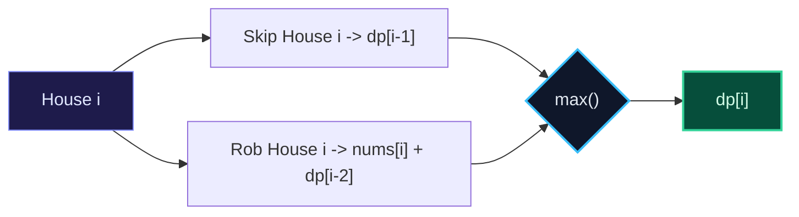

import { Callout } from "fumadocs-ui/components/callout";
import { Tabs, Tab } from "fumadocs-ui/components/tabs";
import { Steps, Step } from "fumadocs-ui/components/steps";
import { Cards, Card } from "fumadocs-ui/components/card";

## The Linear Recurrence Archetype

In **One-Dimensional Dynamic Programming**, each state represents a prefix or a single parameter (such as array index $i$, target sum $S$, or step count $k$).

---

## Canonical Problem 1: House Robber

A robber wants to loot houses along a street. Each house has cash `nums[i]`. Adjacent houses have connected alarms: you cannot rob two adjacent houses. Find the maximum money you can rob.

### State & Recurrence

Let $DP[i]$ be the maximum money robbed from the first $i$ houses:

- **Option 1 (Skip house $i$)**: Loot is $DP[i-1]$.
- **Option 2 (Rob house $i$)**: Loot is $\text{nums}[i] + DP[i-2]$.
  $$DP[i] = \max(DP[i-1], \text{nums}[i] + DP[i-2])$$



---

## Canonical Problem 2: Coin Change (Fewest Coins)

Given coin denominations and an amount $A$, find the fewest coins needed to make up amount $A$. If impossible, return $-1$.

### State & Recurrence

Let $DP[a]$ be the minimum coins to make amount $a$:
$$DP[a] = 1 + \min_{c \in \text{coins}, c \le a} DP[a - c]$$
Base case: $DP[0] = 0$. All other entries initialized to $\infty$.

---

## Multi-Language Implementations

<Tabs items={["Python", "TypeScript", "C++"]}>
<Tab value="Python">
```python
from typing import List

def rob(nums: List[int]) -> int:
"""House Robber in O(N) time and O(1) space."""
if not nums:
return 0
prev2 = 0
prev1 = 0

    for x in nums:
        curr = max(prev1, x + prev2)
        prev2 = prev1
        prev1 = curr

    return prev1

def coin*change(coins: List[int], amount: int) -> int:
"""Coin Change (minimum coins) in O(amount * len(coins)) time."""
dp = [float('inf')] \_ (amount + 1)
dp[0] = 0

    for a in range(1, amount + 1):
        for c in coins:
            if a - c >= 0:
                dp[a] = min(dp[a], 1 + dp[a - c])

    return dp[amount] if dp[amount] != float('inf') else -1

````
</Tab>
<Tab value="TypeScript">
```typescript
export function rob(nums: number[]): number {
  let prev2 = 0;
  let prev1 = 0;

  for (const x of nums) {
    const curr = Math.max(prev1, x + prev2);
    prev2 = prev1;
    prev1 = curr;
  }

  return prev1;
}

export function coinChange(coins: number[], amount: number): number {
  const dp: number[] = new Array(amount + 1).fill(Infinity);
  dp[0] = 0;

  for (let a = 1; a <= amount; a++) {
    for (const c of coins) {
      if (a - c >= 0) {
        dp[a] = Math.min(dp[a], 1 + dp[a - c]);
      }
    }
  }

  return dp[amount] === Infinity ? -1 : dp[amount];
}
````

</Tab>
<Tab value="C++">
```cpp
#include <vector>
#include <algorithm>

int rob(const std::vector<int>& nums) {
int prev2 = 0;
int prev1 = 0;

    for (int x : nums) {
        int curr = std::max(prev1, x + prev2);
        prev2 = prev1;
        prev1 = curr;
    }

    return prev1;

}

int coinChange(const std::vector<int>& coins, int amount) {
const int INF = 1e9;
std::vector<int> dp(amount + 1, INF);
dp[0] = 0;

    for (int a = 1; a <= amount; ++a) {
        for (int c : coins) {
            if (a - c >= 0) {
                dp[a] = std::min(dp[a], 1 + dp[a - c]);
            }
        }
    }

    return dp[amount] >= INF ? -1 : dp[amount];

}

```
</Tab>
</Tabs>
```
