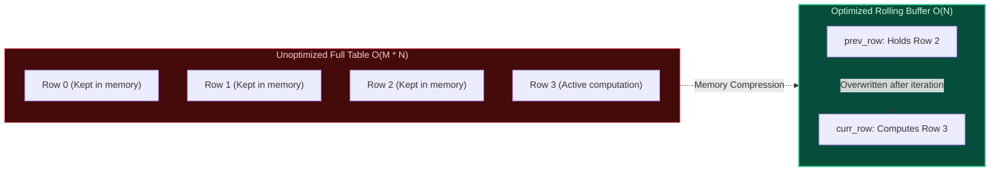

import { Callout } from "fumadocs-ui/components/callout";
import { Tabs, Tab } from "fumadocs-ui/components/tabs";
import { Steps, Step } from "fumadocs-ui/components/steps";
import { Cards, Card } from "fumadocs-ui/components/card";

## The Rolling Buffer Mental Model

In many DP recurrences, calculating state $i$ does not require the entire history of preceding states $0, 1, \dots, i-1$; it only requires a small sliding window of recent states:

- In Fibonacci, $DP[i]$ depends only on $DP[i-1]$ and $DP[i-2]$ $\implies$ **2 scalar variables**.
- In 2D Grid DP, row $i$ depends only on row $i-1$ $\implies$ **1 single rolling row array** of size $N$.



---

## State Variable Reduction: Fibonacci from $\mathcal{O}(N)$ to $\mathcal{O}(1)$

Instead of allocating `dp = [0] * (N + 1)`:

```python
prev2 = 0
prev1 = 1
for i in range(2, n + 1):
    curr = prev1 + prev2
    prev2 = prev1
    prev1 = curr
```

This drops auxiliary space from megabytes down to **zero extra heap allocations**!

---

## Multi-Language Implementations: Unique Paths Space Compression

<Tabs items={["Python", "TypeScript", "C++"]}>
<Tab value="Python">
```python
def unique_paths_optimized(m: int, n: int) -> int:
    """Calculates unique paths on an m x n grid using O(n) rolling 1D buffer."""
    # Single rolling row initialized to 1 (top row base case)
    dp = [1] * n

    for r in range(1, m):
        for c in range(1, n):
            # dp[c] is currently the value from the row above (prev_row[c])
            # dp[c - 1] is the updated value from the left in the current row
            dp[c] = dp[c] + dp[c - 1]

    return dp[-1]

````
</Tab>
<Tab value="TypeScript">
```typescript
export function uniquePathsOptimized(m: number, n: number): number {
  const dp: number[] = new Array(n).fill(1);

  for (let r = 1; r < m; r++) {
    for (let c = 1; c < n; c++) {
      dp[c] = dp[c] + dp[c - 1];
    }
  }

  return dp[n - 1];
}
````

</Tab>
<Tab value="C++">
```cpp
#include <vector>

int uniquePathsOptimized(int m, int n) {
std::vector<int> dp(n, 1);

    for (int r = 1; r < m; ++r) {
        for (int c = 1; c < n; ++c) {
            dp[c] += dp[c - 1];
        }
    }

    return dp[n - 1];

}

```
</Tab>
</Tabs>
```
