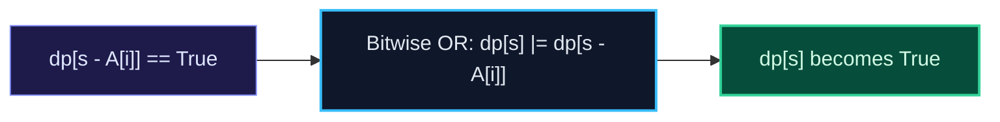

import { Callout } from "fumadocs-ui/components/callout";
import { Tabs, Tab } from "fumadocs-ui/components/tabs";
import { Steps, Step } from "fumadocs-ui/components/steps";
import { Cards, Card } from "fumadocs-ui/components/card";

## The Decision Problem: Subset Sum

Given a set of positive integers $A$ and a target sum $S$, determine if there exists a subset of $A$ whose sum equals strictly $S$.
This is a boolean variation of 0/1 Knapsack where each element has weight $A[i]$ and value $A[i]$.

Let $DP[s]$ be boolean (`True`/`False`): can sum $s$ be formed?
$$DP[s] = DP[s] \lor DP[s - A[i]]$$
Iterate in reverse from $S$ down to $A[i]$!



---

## Canonical Archetype: Partition Equal Subset Sum

Can an array be partitioned into two subsets with equal sum?

1. Calculate $\text{total\_sum} = \sum A[i]$.
2. If $\text{total\_sum}$ is odd, return `False` (cannot split odd number equally).
3. Set target $S = \text{total\_sum} / 2$.
4. Run Subset Sum with target $S$.

---

## Multi-Language Implementations

<Tabs items={["Python", "TypeScript", "C++"]}>
<Tab value="Python">
```python
from typing import List

def can_partition(nums: List[int]) -> bool:
"""Partition Equal Subset Sum in O(N \* S) time and O(S) space."""
total = sum(nums)
if total % 2 != 0:
return False

    target = total // 2
    dp = [False] * (target + 1)
    dp[0] = True

    for x in nums:
        for s in range(target, x - 1, -1):
            dp[s] = dp[s] or dp[s - x]

    return dp[target]

````
</Tab>
<Tab value="TypeScript">
```typescript
export function canPartition(nums: number[]): boolean {
  const total = nums.reduce((acc, val) => acc + val, 0);
  if (total % 2 !== 0) return false;

  const target = total / 2;
  const dp: boolean[] = new Array(target + 1).fill(false);
  dp[0] = true;

  for (const x of nums) {
    for (let s = target; s >= x; s--) {
      dp[s] = dp[s] || dp[s - x];
    }
  }

  return dp[target];
}
````

</Tab>
<Tab value="C++">
```cpp
#include <vector>
#include <numeric>
#include <bitset>

bool canPartition(const std::vector<int>& nums) {
int total = std::accumulate(nums.begin(), nums.end(), 0);
if (total % 2 != 0) return false;
int target = total / 2;

    // Bitset acceleration: processes 64 state transitions per CPU instruction!
    std::bitset<10001> dp;
    dp[0] = 1;

    for (int x : nums) {
        dp |= (dp << x);
    }

    return dp[target];

}

```
</Tab>
</Tabs>
```
