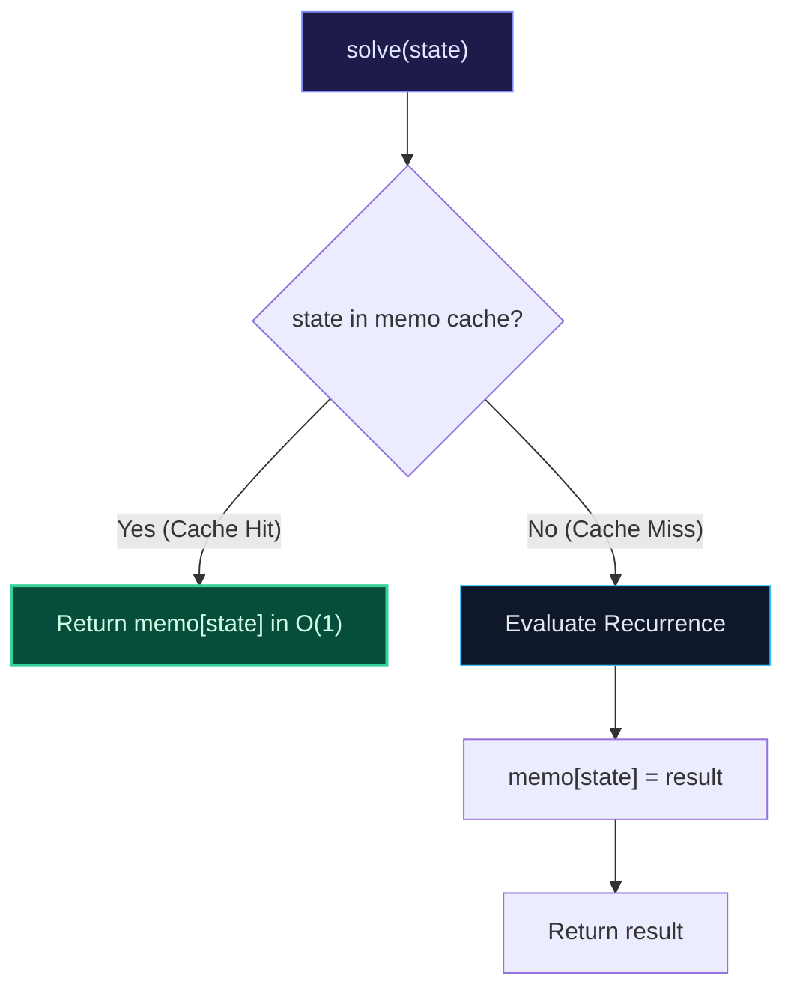

import { Callout } from "fumadocs-ui/components/callout";
import { Tabs, Tab } from "fumadocs-ui/components/tabs";
import { Steps, Step } from "fumadocs-ui/components/steps";
import { Cards, Card } from "fumadocs-ui/components/card";

## The Recursive Formulation Augmented with Caches

**Top-Down Memoization** preserves the natural, intuitive structure of a recursive solution while eliminating redundant recalculations. When an algorithm calls `solve(state)`:

1. It checks an auxiliary cache (memo table).
2. If `state` has already been computed, it returns the cached result immediately in $\mathcal{O}(1)$ time.
3. Otherwise, it executes the recurrence, saves the result into the cache, and returns it.



---

## The Advantages and Latent Hazards of Top-Down DP

### Advantages

- **Selective Subproblem Evaluation**: Only subproblems that are strictly reachable from the initial state are evaluated. In sparse state spaces, this can be orders of magnitude faster than evaluating an entire 2D table.
- **Natural Mental Mapping**: Translating a mathematical definition directly into code is straightforward and fast to prototype.

### Hazards

- **Call Stack Overhead**: Every recursive invocation incurs function call prologue/epilogue instructions, register spills, and thread stack allocation. For recursion depths exceeding $10^4$ or $10^5$, this risks an OS stack overflow (`SIGSEGV`).
- **Cache Locality**: Dynamically allocated hash tables induce unpredictable pointer chasing across disparate heap cache lines.

---

## Multi-Language Implementations

<Tabs items={["Python", "TypeScript", "C++"]}>
<Tab value="Python">
```python
from functools import lru_cache
from typing import Dict, Tuple

# Using Python's built-in LRU cache

@lru_cache(maxsize=None)
def fib_memo(n: int) -> int:
if n <= 1:
return n
return fib_memo(n - 1) + fib_memo(n - 2)

# Manual dictionary memoization for arbitrary multi-dimensional states

class MemoizedSolver:
def **init**(self):
self.memo: Dict[Tuple[int, int], int] = {}

    def solve(self, i: int, j: int) -> int:
        state = (i, j)
        if state in self.memo:
            return self.memo[state]

        # Base case
        if i == 0 or j == 0:
            return 1

        # Recursive recurrence
        res = self.solve(i - 1, j) + self.solve(i, j - 1)
        self.memo[state] = res
        return res

````
</Tab>
<Tab value="TypeScript">
```typescript
export class TopDownDP {
  private memo: Map<string, number> = new Map();

  solve(i: number, j: number): number {
    const key = `${i},${j}`;
    if (this.memo.has(key)) {
      return this.memo.get(key)!;
    }

    if (i === 0 || j === 0) return 1;

    const result = this.solve(i - 1, j) + this.solve(i, j - 1);
    this.memo.set(key, result);
    return result;
  }
}
````

</Tab>
<Tab value="C++">
```cpp
#include <vector>

class TopDownDP {
private:
std::vector<std::vector<int>> memo;

public:
int uniquePaths(int m, int n) {
memo.assign(m, std::vector<int>(n, -1));
return solve(m - 1, n - 1);
}

private:
int solve(int i, int j) {
if (i == 0 || j == 0) return 1;
if (memo[i][j] != -1) return memo[i][j];

        memo[i][j] = solve(i - 1, j) + solve(i, j - 1);
        return memo[i][j];
    }

};

```
</Tab>
</Tabs>
```
