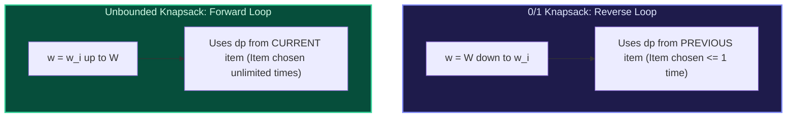

import { Callout } from "fumadocs-ui/components/callout";
import { Tabs, Tab } from "fumadocs-ui/components/tabs";
import { Steps, Step } from "fumadocs-ui/components/steps";
import { Cards, Card } from "fumadocs-ui/components/card";

## Unlimited Item Selection

In the **Unbounded Knapsack** problem, an unlimited supply of each item is available: an item can be picked $0, 1, 2, \dots, \infty$ times until the capacity is saturated.



---

## Canonical Problem: Coin Change II (Number of Combinations)

Given coins and amount, find the number of combinations that make up that amount.

- Outer loop: iterate coins $c$.
- Inner loop: iterate amount $a$ **forward** from $c$ to $A$:
  $$DP[a] = DP[a] + DP[a - c]$$
  Base case: $DP[0] = 1$.

---

## Multi-Language Implementations

<Tabs items={["Python", "TypeScript", "C++"]}>
<Tab value="Python">
```python
from typing import List

def unbounded*knapsack(weights: List[int], values: List[int], capacity: int) -> int:
"""Unbounded Knapsack in O(N * W) time and O(W) space."""
dp = [0] \_ (capacity + 1)

    for w_i, v_i in zip(weights, values):
        # Forward loop permits infinite replacement!
        for w in range(w_i, capacity + 1):
            dp[w] = max(dp[w], dp[w - w_i] + v_i)

    return dp[capacity]

def change_combinations(amount: int, coins: List[int]) -> int:
"""Coin Change II (number of combinations)."""
dp = [0] \* (amount + 1)
dp[0] = 1

    for c in coins:
        for a in range(c, amount + 1):
            dp[a] += dp[a - c]

    return dp[amount]

````
</Tab>
<Tab value="TypeScript">
```typescript
export function changeCombinations(amount: number, coins: number[]): number {
  const dp: number[] = new Array(amount + 1).fill(0);
  dp[0] = 1;

  for (const c of coins) {
    for (let a = c; a <= amount; a++) {
      dp[a] += dp[a - c];
    }
  }

  return dp[amount];
}
````

</Tab>
<Tab value="C++">
```cpp
#include <vector>

int changeCombinations(int amount, const std::vector<int>& coins) {
std::vector<int> dp(amount + 1, 0);
dp[0] = 1;

    for (int c : coins) {
        for (int a = c; a <= amount; ++a) {
            dp[a] += dp[a - c];
        }
    }

    return dp[amount];

}

```
</Tab>
</Tabs>
```
