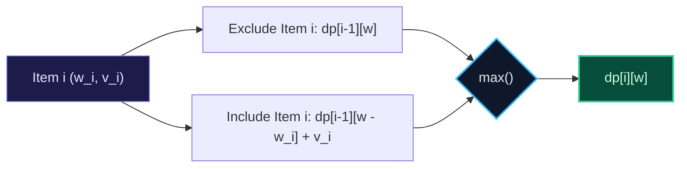

import { Callout } from "fumadocs-ui/components/callout";
import { Tabs, Tab } from "fumadocs-ui/components/tabs";
import { Steps, Step } from "fumadocs-ui/components/steps";
import { Cards, Card } from "fumadocs-ui/components/card";

## The 0/1 Knapsack Problem Formulation

Given $N$ items, each with weight $w_i$ and value $v_i$, and a knapsack with maximum weight capacity $W$. Each item can be chosen **at most once** ($0$ or $1$). Maximize total value without exceeding capacity $W$.



---

## The Reverse Loop Invariant for Space Compression

A naive 2D table consumes $\mathcal{O}(N \cdot W)$ space. When compressing to a single 1D array of size $W+1$, we **must iterate $w$ in reverse order** from $W$ down to $w_i$:

```python
for i in range(N):
    for w in range(W, weights[i] - 1, -1):
        dp[w] = max(dp[w], dp[w - weights[i]] + values[i])
```

### Why Reverse?

If we iterated forward ($w = w_i \to W$), updating `dp[w]` would use the _already updated_ `dp[w - weights[i]]` from the **current item $i$**, allowing item $i$ to be picked multiple times! Iterating in reverse ensures `dp[w - weights[i]]` still contains the value from the **previous item $i-1$**.

---

## Multi-Language Implementations

<Tabs items={["Python", "TypeScript", "C++"]}>
<Tab value="Python">
```python
from typing import List

def zero*one_knapsack(weights: List[int], values: List[int], capacity: int) -> int:
"""0/1 Knapsack in O(N * W) time and O(W) space."""
dp = [0] \_ (capacity + 1)

    for w_i, v_i in zip(weights, values):
        # Reverse loop is strictly mandatory for 0/1 Knapsack!
        for w in range(capacity, w_i - 1, -1):
            dp[w] = max(dp[w], dp[w - w_i] + v_i)

    return dp[capacity]

````
</Tab>
<Tab value="TypeScript">
```typescript
export function zeroOneKnapsack(
  weights: number[],
  values: number[],
  capacity: number
): number {
  const dp: number[] = new Array(capacity + 1).fill(0);

  for (let i = 0; i < weights.length; i++) {
    const w_i = weights[i];
    const v_i = values[i];

    for (let w = capacity; w >= w_i; w--) {
      dp[w] = Math.max(dp[w], dp[w - w_i] + v_i);
    }
  }

  return dp[capacity];
}
````

</Tab>
<Tab value="C++">
```cpp
#include <vector>
#include <algorithm>

int zeroOneKnapsack(const std::vector<int>& weights, const std::vector<int>& values, int capacity) {
std::vector<int> dp(capacity + 1, 0);

    for (size_t i = 0; i < weights.size(); ++i) {
        int w_i = weights[i];
        int v_i = values[i];

        for (int w = capacity; w >= w_i; --w) {
            dp[w] = std::max(dp[w], dp[w - w_i] + v_i);
        }
    }

    return dp[capacity];

}

```
</Tab>
</Tabs>
```
