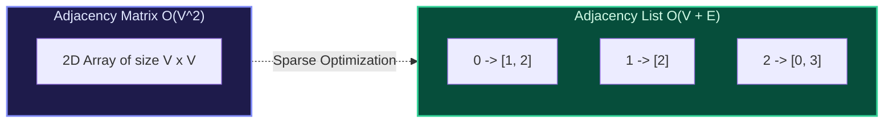
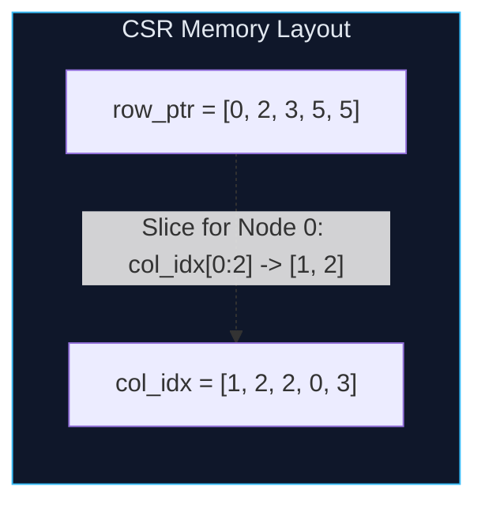

import { Callout } from "fumadocs-ui/components/callout";
import { Tabs, Tab } from "fumadocs-ui/components/tabs";
import { Steps, Step } from "fumadocs-ui/components/steps";
import { Cards, Card } from "fumadocs-ui/components/card";

## The Memory & Query Trade-Off

Choosing how to represent a graph in memory determines the runtime efficiency and spatial scaling of every subsequent graph algorithm:

1. **Adjacency Matrix**: A $V \times V$ boolean or weight matrix $A$, where $A[u][v]$ denotes whether an edge exists from $u$ to $v$.
   - **Space**: $\mathcal{O}(V^2)$ regardless of the number of edges.
   - **Edge Lookup ($u \to v$)**: $\mathcal{O}(1)$ random matrix access.
   - **Neighbor Enumeration**: $\mathcal{O}(V)$ time (must scan all columns of row $u$).
2. **Adjacency List**: An array of lists of size $V$, where `adj[u]` contains all adjacent target vertices.
   - **Space**: $\mathcal{O}(V + E)$ (optimal for sparse graphs where $E \ll V^2$).
   - **Edge Lookup ($u \to v$)**: $\mathcal{O}(\text{deg}(u))$ scan.
   - **Neighbor Enumeration**: $\mathcal{O}(\text{deg}(u))$ optimal time.



---

## Compressed Sparse Row (CSR): High-Performance In-Memory Representation

In industrial graph database engines and high-performance computing, pointer-based adjacency lists (`std::vector<std::vector<int>>`) cause cache misses due to vector-of-vector pointer fragmentation.

**Compressed Sparse Row (CSR)** packs the entire graph into two flat, contiguous arrays:

1. `col_idx`: A single contiguous array of length $E$ storing all neighbor target vertices.
2. `row_ptr`: An array of length $V + 1$, where the neighbors of vertex $u$ reside in the slice `col_idx[row_ptr[u] : row_ptr[u+1]]`.



---

## Multi-Language Implementations

<Tabs items={["Python", "TypeScript", "C++"]}>
<Tab value="Python">
```python
from typing import List

class GraphAdjList:
def **init**(self, num*vertices: int):
self.adj = [[] for * in range(num_vertices)]

    def add_edge(self, u: int, v: int, directed: bool = False) -> None:
        self.adj[u].append(v)
        if not directed:
            self.adj[v].append(u)

    def get_neighbors(self, u: int) -> List[int]:
        return self.adj[u]

````
</Tab>
<Tab value="TypeScript">
```typescript
export class GraphAdjList {
  private adj: number[][];

  constructor(numVertices: number) {
    this.adj = Array.from({ length: numVertices }, () => []);
  }

  addEdge(u: number, v: number, directed: boolean = false): void {
    this.adj[u].push(v);
    if (!directed) {
      this.adj[v].push(u);
    }
  }

  getNeighbors(u: number): number[] {
    return this.adj[u];
  }
}
````

</Tab>
<Tab value="C++">
```cpp
#include <vector>

class GraphAdjList {
private:
std::vector<std::vector<int>> adj;

public:
explicit GraphAdjList(int numVertices) : adj(numVertices) {}

    void addEdge(int u, int v, bool directed = false) {
        adj[u].push_back(v);
        if (!directed) {
            adj[v].push_back(u);
        }
    }

    const std::vector<int>& getNeighbors(int u) const {
        return adj[u];
    }

};

```
</Tab>
</Tabs>
```
