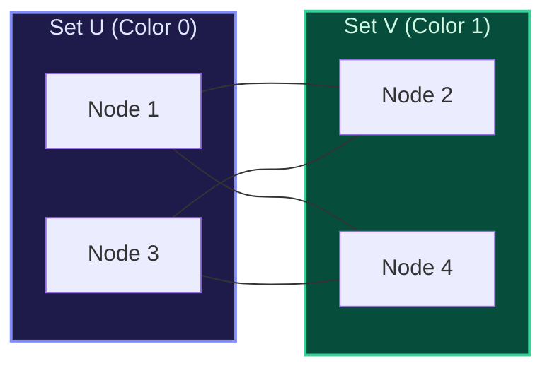

import { Callout } from "fumadocs-ui/components/callout";
import { Tabs, Tab } from "fumadocs-ui/components/tabs";
import { Steps, Step } from "fumadocs-ui/components/steps";
import { Cards, Card } from "fumadocs-ui/components/card";

## The Bipartite Definition

A graph is **Bipartite** if its vertices can be partitioned into two disjoint independent sets $U$ and $V$ such that every edge connects a vertex in $U$ to a vertex in $V$. No edge connects two vertices within the same partition.

> **Fundamental Theorem**: A graph is bipartite if and only if it contains **no odd-length cycles**.



---

## The 2-Coloring Algorithm via BFS

1. Maintain an array `color` initialized to `-1` (uncolored) for all vertices.
2. For each uncolored vertex $u$:
   - Color `color[u] = 0`.
   - Run BFS from $u$. For each neighbor $v$ of current node $curr$:
     - If `color[v] == -1`, set `color[v] = 1 - color[curr]` and push $v$.
     - If `color[v] == color[curr]`, an odd cycle is detected $\implies$ **Graph is NOT bipartite!**

---

## Multi-Language Implementations

<Tabs items={["Python", "TypeScript", "C++"]}>
<Tab value="Python">
```python
from collections import deque
from typing import List

def is_bipartite(graph: List[List[int]]) -> bool:
"""Verifies if graph is bipartite via BFS 2-coloring in O(V + E) time."""
n = len(graph)
color = [-1] \* n

    for i in range(n):
        if color[i] != -1:
            continue

        queue = deque([i])
        color[i] = 0

        while queue:
            u = queue.popleft()
            for v in graph[u]:
                if color[v] == -1:
                    color[v] = 1 - color[u]
                    queue.append(v)
                elif color[v] == color[u]:
                    return False

    return True

````
</Tab>
<Tab value="TypeScript">
```typescript
export function isBipartite(graph: number[][]): boolean {
  const n = graph.length;
  const color: number[] = new Array(n).fill(-1);

  for (let i = 0; i < n; i++) {
    if (color[i] !== -1) continue;

    const queue: number[] = [i];
    color[i] = 0;

    while (queue.length > 0) {
      const u = queue.shift()!;
      for (const v of graph[u]) {
        if (color[v] === -1) {
          color[v] = 1 - color[u];
          queue.push(v);
        } else if (color[v] === color[u]) {
          return false;
        }
      }
    }
  }

  return true;
}
````

</Tab>
<Tab value="C++">
```cpp
#include <vector>
#include <queue>

bool isBipartite(const std::vector<std::vector<int>>& graph) {
int n = graph.size();
std::vector<int> color(n, -1);

    for (int i = 0; i < n; ++i) {
        if (color[i] != -1) continue;

        std::queue<int> q;
        q.push(i);
        color[i] = 0;

        while (!q.empty()) {
            int u = q.front();
            q.pop();

            for (int v : graph[u]) {
                if (color[v] == -1) {
                    color[v] = 1 - color[u];
                    q.push(v);
                } else if (color[v] == color[u]) {
                    return false;
                }
            }
        }
    }

    return true;

}

```
</Tab>
</Tabs>
```
