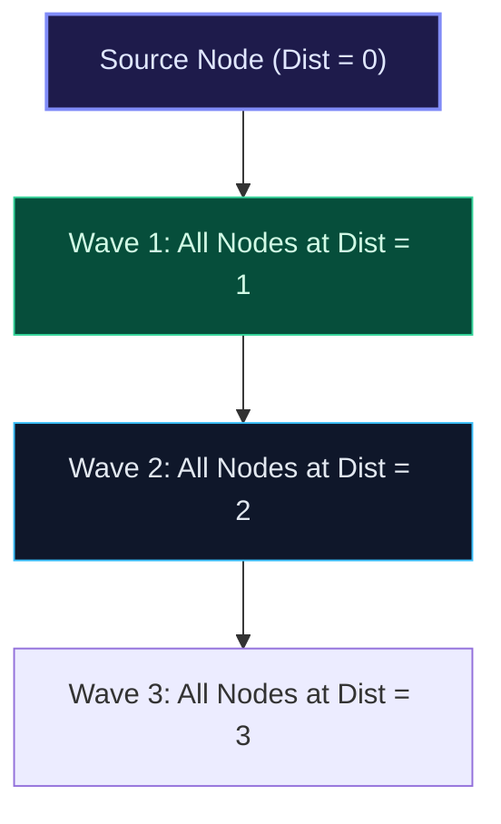

import { Callout } from "fumadocs-ui/components/callout";
import { Tabs, Tab } from "fumadocs-ui/components/tabs";
import { Steps, Step } from "fumadocs-ui/components/steps";
import { Cards, Card } from "fumadocs-ui/components/card";

## The Wavefront Expansion

**Breadth-First Search (BFS)** explores vertices in order of their exact shortest path distance from a designated source vertex.



---

## Multi-Source BFS

In problems like **Rotting Oranges** or **01 Matrix**, multiple sources simultaneously emit waves at $t = 0$.

- Standard BFS pushes a single source node into the queue at initialization.
- **Multi-Source BFS pushes ALL starting sources into the queue at initialization**.
  The algorithm then proceeds as normal; all sources expand their wavefronts concurrently in lockstep!

---

## Multi-Language Implementations

<Tabs items={["Python", "TypeScript", "C++"]}>
<Tab value="Python">
```python
from collections import deque
from typing import List

def bfs_shortest_path(adj: List[List[int]], source: int) -> List[int]:
"""Calculates shortest distance from source to all vertices in unweighted graph."""
n = len(adj)
dist = [-1] \* n
queue = deque([source])
dist[source] = 0

    while queue:
        u = queue.popleft()
        for v in adj[u]:
            if dist[v] == -1:  # Not visited
                dist[v] = dist[u] + 1
                queue.append(v)

    return dist

````
</Tab>
<Tab value="TypeScript">
```typescript
export function bfsShortestPath(adj: number[][], source: number): number[] {
  const n = adj.length;
  const dist: number[] = new Array(n).fill(-1);
  const queue: number[] = [source];
  dist[source] = 0;

  while (queue.length > 0) {
    const u = queue.shift()!;
    for (const v of adj[u]) {
      if (dist[v] === -1) {
        dist[v] = dist[u] + 1;
        queue.push(v);
      }
    }
  }

  return dist;
}
````

</Tab>
<Tab value="C++">
```cpp
#include <vector>
#include <queue>

std::vector<int> bfsShortestPath(const std::vector<std::vector<int>>& adj, int source) {
int n = adj.size();
std::vector<int> dist(n, -1);
std::queue<int> q;

    dist[source] = 0;
    q.push(source);

    while (!q.empty()) {
        int u = q.front();
        q.pop();

        for (int v : adj[u]) {
            if (dist[v] == -1) {
                dist[v] = dist[u] + 1;
                q.push(v);
            }
        }
    }

    return dist;

}

```
</Tab>
</Tabs>
```
