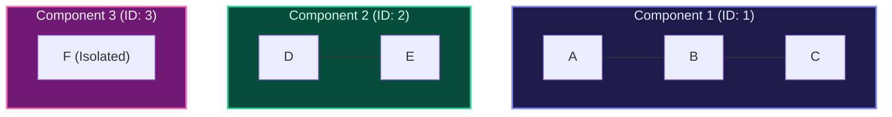

import { Callout } from "fumadocs-ui/components/callout";
import { Tabs, Tab } from "fumadocs-ui/components/tabs";
import { Steps, Step } from "fumadocs-ui/components/steps";
import { Cards, Card } from "fumadocs-ui/components/card";

## The Connected Component Invariant

In an undirected graph $G = (V, E)$, a **Connected Component** is an equivalence class of vertices induced by mutual reachability: two vertices $u$ and $v$ belong to the same component if and only if there exists a simple path between them.



---

## Component Labeling Algorithm

1. Initialize `component_id = 0` and `comp = [-1] * V`.
2. Iterate through all vertices $u \in 0..V-1$:
   - If `comp[u] == -1`:
     - Increment `component_id`.
     - Run a DFS/BFS from $u$, assigning `comp[v] = component_id` to every visited vertex $v$.
3. Total time: strictly $\mathcal{O}(V + E)$ since every vertex and edge is visited exactly once.

---

## Multi-Language Implementations

<Tabs items={["Python", "TypeScript", "C++"]}>
<Tab value="Python">
```python
from typing import List

def count*components(n: int, edges: List[List[int]]) -> int:
"""Counts and labels connected components in O(V + E) time."""
adj = [[] for * in range(n)]
for u, v in edges:
adj[u].append(v)
adj[v].append(u)

    visited = [False] * n
    component_count = 0

    def dfs(u: int) -> None:
        visited[u] = True
        for v in adj[u]:
            if not visited[v]:
                dfs(v)

    for i in range(n):
        if not visited[i]:
            component_count += 1
            dfs(i)

    return component_count

````
</Tab>
<Tab value="TypeScript">
```typescript
export function countComponents(n: number, edges: number[][]): number {
  const adj: number[][] = Array.from({ length: n }, () => []);
  for (const [u, v] of edges) {
    adj[u].push(v);
    adj[v].push(u);
  }

  const visited: boolean[] = new Array(n).fill(false);
  let count = 0;

  function dfs(u: number): void {
    visited[u] = true;
    for (const v of adj[u]) {
      if (!visited[v]) dfs(v);
    }
  }

  for (let i = 0; i < n; i++) {
    if (!visited[i]) {
      count++;
      dfs(i);
    }
  }

  return count;
}
````

</Tab>
<Tab value="C++">
```cpp
#include <vector>

void dfsComponent(int u, const std::vector<std::vector<int>>& adj, std::vector<bool>& visited) {
visited[u] = true;
for (int v : adj[u]) {
if (!visited[v]) {
dfsComponent(v, adj, visited);
}
}
}

int countComponents(int n, const std::vector<std::vector<int>>& edges) {
std::vector<std::vector<int>> adj(n);
for (const auto& e : edges) {
adj[e[0]].push_back(e[1]);
adj[e[1]].push_back(e[0]);
}

    std::vector<bool> visited(n, false);
    int count = 0;

    for (int i = 0; i < n; ++i) {
        if (!visited[i]) {
            ++count;
            dfsComponent(i, adj, visited);
        }
    }

    return count;

}

```
</Tab>
</Tabs>
```
