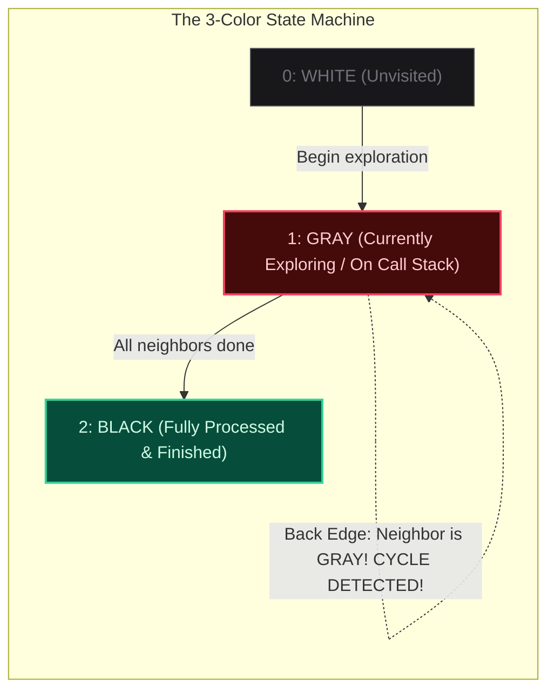

import { Callout } from "fumadocs-ui/components/callout";
import { Tabs, Tab } from "fumadocs-ui/components/tabs";
import { Steps, Step } from "fumadocs-ui/components/steps";
import { Cards, Card } from "fumadocs-ui/components/card";

## Cycle Detection Across Graph Paradigms

A **Cycle** exists if there is a path starting and ending at the same vertex with non-zero length and distinct edges. However, cycle detection rules differ fundamentally between undirected and directed graphs:

---

## 1. Undirected Graphs: Parent Tracking

In an undirected graph, traversing an edge $(u, v)$ means $v$ is also connected back to $u$. If we visit $u$'s neighbor and find $u$ already visited, that is **not** a cycle—it is simply traversing the same undirected edge backwards!

> **The Invariant**: A cycle exists in an undirected graph if and only if DFS encounters a neighbor $v$ that has **already been visited** and $v \neq \text{parent}(u)$.

---

## 2. Directed Graphs: The 3-Color Scheme

In a directed graph, encountering an already visited vertex does **not** necessarily indicate a cycle (it could be a cross edge or forward edge). A cycle occurs if and only if an edge points to an **ancestor currently active on the recursion stack** (a **Back Edge**).



---

## Multi-Language Implementations (Directed Graph 3-Color)

<Tabs items={["Python", "TypeScript", "C++"]}>
<Tab value="Python">
```python
from typing import List

def has_cycle_directed(num_nodes: int, adj: List[List[int]]) -> bool:
"""Detects cycle in directed graph using 3-color DFS: 0=White, 1=Gray, 2=Black."""
color = [0] \* num_nodes

    def dfs(u: int) -> bool:
        color[u] = 1  # Enter: Gray
        for v in adj[u]:
            if color[v] == 1:
                return True  # Found Back Edge to active ancestor!
            if color[v] == 0:
                if dfs(v):
                    return True
        color[u] = 2  # Exit: Black
        return False

    for i in range(num_nodes):
        if color[i] == 0:
            if dfs(i):
                return True

    return False

````
</Tab>
<Tab value="TypeScript">
```typescript
export function hasCycleDirected(numNodes: number, adj: number[][]): boolean {
  const color: number[] = new Array(numNodes).fill(0); // 0=White, 1=Gray, 2=Black

  function dfs(u: number): boolean {
    color[u] = 1; // Mark Gray
    for (const v of adj[u]) {
      if (color[v] === 1) return true; // Cycle detected
      if (color[v] === 0 && dfs(v)) return true;
    }
    color[u] = 2; // Mark Black
    return false;
  }

  for (let i = 0; i < numNodes; i++) {
    if (color[i] === 0 && dfs(i)) return true;
  }

  return false;
}
````

</Tab>
<Tab value="C++">
```cpp
#include <vector>

bool dfsCycle(int u, const std::vector<std::vector<int>>& adj, std::vector<int>& color) {
color[u] = 1; // Gray
for (int v : adj[u]) {
if (color[v] == 1) return true; // Back edge
if (color[v] == 0 && dfsCycle(v, adj, color)) return true;
}
color[u] = 2; // Black
return false;
}

bool hasCycleDirected(int numNodes, const std::vector<std::vector<int>>& adj) {
std::vector<int> color(numNodes, 0);

    for (int i = 0; i < numNodes; ++i) {
        if (color[i] == 0 && dfsCycle(i, adj, color)) {
            return true;
        }
    }

    return false;

}

```
</Tab>
</Tabs>
```
