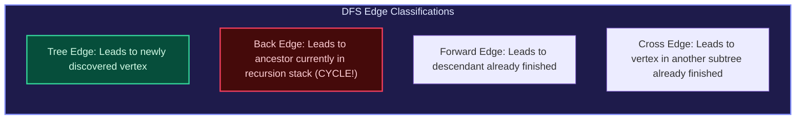

import { Callout } from "fumadocs-ui/components/callout";
import { Tabs, Tab } from "fumadocs-ui/components/tabs";
import { Steps, Step } from "fumadocs-ui/components/steps";
import { Cards, Card } from "fumadocs-ui/components/card";

## The Edge Classification of DFS

When DFS explores a directed graph $G = (V, E)$, it produces a **DFS Spanning Forest**. Every edge $(u, v) \in E$ falls into one of four mutually exclusive structural classifications:



---

## Timestamps: Discovery and Finish Times

By maintaining a global counter incremented upon entering and leaving each vertex:

- $d[u]$: Timestamp when vertex $u$ is first discovered (colored Gray).
- $f[u]$: Timestamp when exploration of all neighbors of $u$ completes (colored Black).

**The Parenthesis Theorem**: For any two vertices $u$ and $v$, the intervals $[d[u], f[u]]$ and $[d[v], f[v]]$ are either completely disjoint or one is nested entirely within the other.

---

## Multi-Language Implementations

<Tabs items={["Python", "TypeScript", "C++"]}>
<Tab value="Python">
```python
from typing import List

def dfs_traversal(adj: List[List[int]], start_node: int) -> List[int]:
"""Standard recursive DFS traversal recording visit order."""
visited = set()
order = []

    def dfs(u: int) -> None:
        visited.add(u)
        order.append(u)
        for v in adj[u]:
            if v not in visited:
                dfs(v)

    dfs(start_node)
    return order

````
</Tab>
<Tab value="TypeScript">
```typescript
export function dfsTraversal(adj: number[][], startNode: number): number[] {
  const visited = new Set<number>();
  const order: number[] = [];

  function dfs(u: number): void {
    visited.add(u);
    order.push(u);
    for (const v of adj[u]) {
      if (!visited.has(v)) {
        dfs(v);
      }
    }
  }

  dfs(startNode);
  return order;
}
````

</Tab>
<Tab value="C++">
```cpp
#include <vector>

void dfsHelper(int u, const std::vector<std::vector<int>>& adj, std::vector<bool>& visited, std::vector<int>& order) {
visited[u] = true;
order.push_back(u);

    for (int v : adj[u]) {
        if (!visited[v]) {
            dfsHelper(v, adj, visited, order);
        }
    }

}

std::vector<int> dfsTraversal(const std::vector<std::vector<int>>& adj, int startNode) {
std::vector<bool> visited(adj.size(), false);
std::vector<int> order;
dfsHelper(startNode, adj, visited, order);
return order;
}

```
</Tab>
</Tabs>
```
