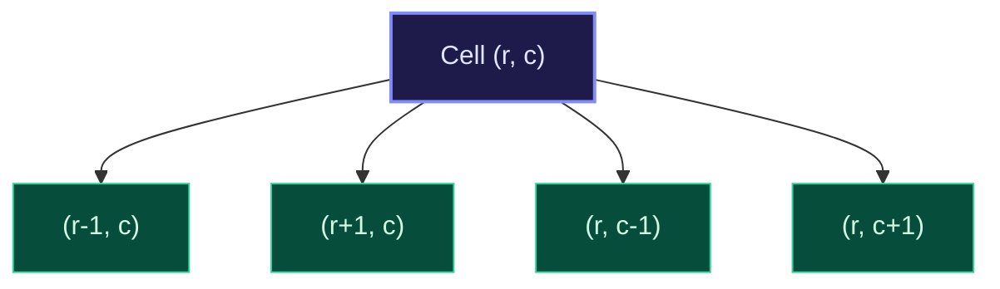

import { Callout } from "fumadocs-ui/components/callout";
import { Tabs, Tab } from "fumadocs-ui/components/tabs";
import { Steps, Step } from "fumadocs-ui/components/steps";
import { Cards, Card } from "fumadocs-ui/components/card";

## The Grid as an Implicit Graph

A 2D matrix of dimensions $R \times C$ is an **implicit graph**:

- Each cell $(r, c)$ is a vertex $V_{r, c}$.
- Edges connect cell $(r, c)$ to its valid orthogonal (4-directional) or diagonal (8-directional) adjacent neighbors within matrix bounds.
- There is no need to construct an explicit adjacency list; transitions are computed dynamically using coordinate delta offsets:
  - 4-directional: `dr = [-1, 1, 0, 0]`, `dc = [0, 0, -1, 1]`



---

## Canonical Archetype: Number of Islands

Given an $M \times N$ 2D binary grid representing a map of `'1'`s (land) and `'0'`s (water), count the number of islands. An island is surrounded by water and formed by connecting adjacent lands horizontally or vertically.

**Algorithm**:

1. Iterate over every cell $(r, c)$ in the matrix.
2. If `grid[r][c] == '1'`:
   - Increment `island_count`.
   - Initiate a DFS/BFS flood-fill from $(r, c)$ to sink all connected land cells by mutating them in-place to `'0'` (or marking them in a visited set).

---

## Multi-Language Implementations

<Tabs items={["Python", "TypeScript", "C++"]}>
<Tab value="Python">
```python
from typing import List

def num_islands(grid: List[List[str]]) -> int:
"""Counts islands via in-place DFS flood fill in O(M\*N) time."""
if not grid:
return 0

    m, n = len(grid), len(grid[0])
    count = 0

    def dfs(r: int, c: int) -> None:
        if r < 0 or r >= m or c < 0 or c >= n or grid[r][c] != '1':
            return

        # Mark visited in-place
        grid[r][c] = '0'

        # Explore 4 orthogonal neighbors
        dfs(r + 1, c)
        dfs(r - 1, c)
        dfs(r, c + 1)
        dfs(r, c - 1)

    for r in range(m):
        for c in range(n):
            if grid[r][c] == '1':
                count += 1
                dfs(r, c)

    return count

````
</Tab>
<Tab value="TypeScript">
```typescript
export function numIslands(grid: string[][]): number {
  if (grid.length === 0) return 0;

  const m = grid.length;
  const n = grid[0].length;
  let count = 0;

  const dfs = (r: number, c: number): void => {
    if (r < 0 || r >= m || c < 0 || c >= n || grid[r][c] !== "1") return;

    grid[r][c] = "0"; // Sink land
    dfs(r + 1, c);
    dfs(r - 1, c);
    dfs(r, c + 1);
    dfs(r, c - 1);
  };

  for (let r = 0; r < m; r++) {
    for (let c = 0; c < n; c++) {
      if (grid[r][c] === "1") {
        count++;
        dfs(r, c);
      }
    }
  }

  return count;
}
````

</Tab>
<Tab value="C++">
```cpp
#include <vector>

class IslandCounter {
public:
int numIslands(std::vector<std::vector<char>>& grid) {
if (grid.empty()) return 0;
int m = grid.size();
int n = grid[0].size();
int count = 0;

        for (int r = 0; r < m; ++r) {
            for (int c = 0; c < n; ++c) {
                if (grid[r][c] == '1') {
                    ++count;
                    dfs(r, c, grid, m, n);
                }
            }
        }
        return count;
    }

private:
void dfs(int r, int c, std::vector<std::vector<char>>& grid, int m, int n) {
if (r < 0 || r >= m || c < 0 || c >= n || grid[r][c] != '1') return;

        grid[r][c] = '0';
        dfs(r + 1, c, grid, m, n);
        dfs(r - 1, c, grid, m, n);
        dfs(r, c + 1, grid, m, n);
        dfs(r, c - 1, grid, m, n);
    }

};

```
</Tab>
</Tabs>
```
