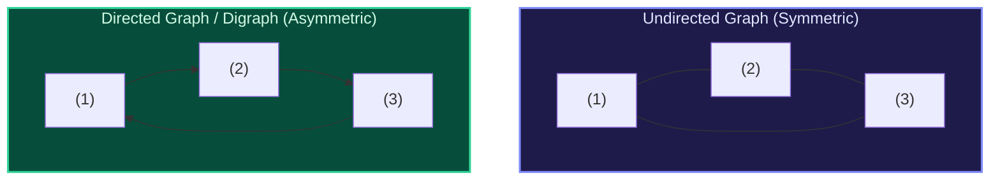

import { Callout } from "fumadocs-ui/components/callout";
import { Tabs, Tab } from "fumadocs-ui/components/tabs";
import { Steps, Step } from "fumadocs-ui/components/steps";
import { Cards, Card } from "fumadocs-ui/components/card";

## The Universal Language of Networks

A **Graph** $G = (V, E)$ consists of a set of vertices (nodes) $V$ and edges $E$ connecting pairs of vertices. Trees are simply connected, acyclic undirected graphs with exactly $|V| - 1$ edges. General graphs, however, introduce arbitrary cycles, disconnected clusters, and multiple paths between nodes.

Graphs represent virtually any relational system in modern computing:

- Social networks (followers, friendships)
- Internet routing tables (BGP, OSPF)
- Dependency graphs in build systems (Bazel, Cargo, Webpack)
- Neural networks and computational computation graphs

---

## The 8 Graph Modules

<Cards>
  <Card
    title="2.6.1. Adjacency List & Matrix"
    href="/docs/dsa/02-intermediate/graph-representations-and-traversals/adjacency-list-and-matrix"
  >
    O(V^2) vs O(V+E) memory bounds, degree enumeration, and Compressed Sparse
    Row (CSR).
  </Card>
  <Card
    title="2.6.2. Implicit Grid Graphs & Flood Fill"
    href="/docs/dsa/02-intermediate/graph-representations-and-traversals/implicit-grid-graphs-and-flood-fill"
  >
    2D matrices as graphs, 4/8-directional transitions, Number of Islands, and
    Flood Fill.
  </Card>
  <Card
    title="2.6.3. Depth-First Search (DFS)"
    href="/docs/dsa/02-intermediate/graph-representations-and-traversals/depth-first-search"
  >
    Call-stack and explicit traversals, discovery/finish times,
    tree/back/forward/cross edges.
  </Card>
  <Card
    title="2.6.4. Breadth-First Search (BFS)"
    href="/docs/dsa/02-intermediate/graph-representations-and-traversals/breadth-first-search"
  >
    FIFO wavefront expansion, unweighted shortest paths, and multi-source BFS.
  </Card>
  <Card
    title="2.6.5. Connected Components"
    href="/docs/dsa/02-intermediate/graph-representations-and-traversals/connected-components"
  >
    Discovering and labeling disjoint subgraphs via DFS/BFS, and component size
    aggregation.
  </Card>
  <Card
    title="2.6.6. Cycle Detection"
    href="/docs/dsa/02-intermediate/graph-representations-and-traversals/cycle-detection"
  >
    Parent tracking in undirected graphs; 3-color DFS state tracking in directed
    graphs.
  </Card>
  <Card
    title="2.6.7. Bipartite Checking"
    href="/docs/dsa/02-intermediate/graph-representations-and-traversals/bipartite-graph-checking"
  >
    2-coloring via BFS/DFS, verifying absence of odd-length cycles, and matching
    applications.
  </Card>
  <Card
    title="2.6.8. Shortest Paths in Unweighted Graphs"
    href="/docs/dsa/02-intermediate/graph-representations-and-traversals/shortest-paths-in-unweighted-graphs"
  >
    Single-source shortest paths in O(V+E) time, and path reconstruction via
    predecessor maps.
  </Card>
</Cards>
