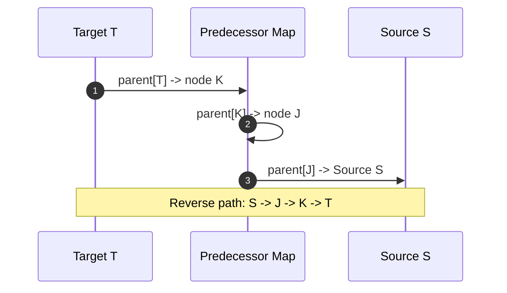

import { Callout } from "fumadocs-ui/components/callout";
import { Tabs, Tab } from "fumadocs-ui/components/tabs";
import { Steps, Step } from "fumadocs-ui/components/steps";
import { Cards, Card } from "fumadocs-ui/components/card";

## The Shortest Path Property of BFS

In a graph where every edge has unit weight ($w = 1$), **Breadth-First Search guarantees finding the shortest path from a source $S$ to any target $T$**.

Because the queue expands in strictly non-decreasing distance order:
$$\text{dist}[v_1] \le \text{dist}[v_2] \le \dots \le \text{dist}[v_k]$$
The very first time a vertex $T$ is dequeued, its recorded distance is mathematically guaranteed to be the minimum possible path length.

---

## Path Reconstruction via Predecessor Tracking

To reconstruct the exact sequence of vertices comprising the shortest path from $S$ to $T$:

1. Maintain an array `parent` where `parent[v] = u` whenever edge $(u, v)$ discovers $v$.
2. Once BFS finishes, trace backwards from target $T$ using `curr = parent[curr]` until reaching source $S$.
3. Reverse the reconstructed sequence.



---

## Multi-Language Implementations

<Tabs items={["Python", "TypeScript", "C++"]}>
<Tab value="Python">
```python
from collections import deque
from typing import List, Optional

def shortest*path_unweighted(adj: List[List[int]], source: int, target: int) -> Optional[List[int]]:
"""Finds shortest path from source to target using BFS predecessor tracking."""
n = len(adj)
parent = [-1] * n
visited = [False] \_ n

    queue = deque([source])
    visited[source] = True

    found = False
    while queue:
        u = queue.popleft()
        if u == target:
            found = True
            break

        for v in adj[u]:
            if not visited[v]:
                visited[v] = True
                parent[v] = u
                queue.append(v)

    if not found:
        return None

    # Reconstruct path backwards from target
    path = []
    curr = target
    while curr != -1:
        path.append(curr)
        curr = parent[curr]

    path.reverse()
    return path

````
</Tab>
<Tab value="TypeScript">
```typescript
export function shortestPathUnweighted(
  adj: number[][],
  source: number,
  target: number
): number[] | null {
  const n = adj.length;
  const parent: number[] = new Array(n).fill(-1);
  const visited: boolean[] = new Array(n).fill(false);

  const queue: number[] = [source];
  visited[source] = true;

  let found = false;
  while (queue.length > 0) {
    const u = queue.shift()!;
    if (u === target) {
      found = true;
      break;
    }

    for (const v of adj[u]) {
      if (!visited[v]) {
        visited[v] = true;
        parent[v] = u;
        queue.push(v);
      }
    }
  }

  if (!found) return null;

  const path: number[] = [];
  let curr = target;
  while (curr !== -1) {
    path.push(curr);
    curr = parent[curr];
  }

  path.reverse();
  return path;
}
````

</Tab>
<Tab value="C++">
```cpp
#include <vector>
#include <queue>
#include <algorithm>

std::vector<int> shortestPathUnweighted(const std::vector<std::vector<int>>& adj, int source, int target) {
int n = adj.size();
std::vector<int> parent(n, -1);
std::vector<bool> visited(n, false);

    std::queue<int> q;
    q.push(source);
    visited[source] = true;

    bool found = false;
    while (!q.empty()) {
        int u = q.front();
        q.pop();

        if (u == target) {
            found = true;
            break;
        }

        for (int v : adj[u]) {
            if (!visited[v]) {
                visited[v] = true;
                parent[v] = u;
                q.push(v);
            }
        }
    }

    if (!found) return {};

    std::vector<int> path;
    for (int curr = target; curr != -1; curr = parent[curr]) {
        path.push_back(curr);
    }
    std::reverse(path.begin(), path.end());
    return path;

}

```
</Tab>
</Tabs>
```
