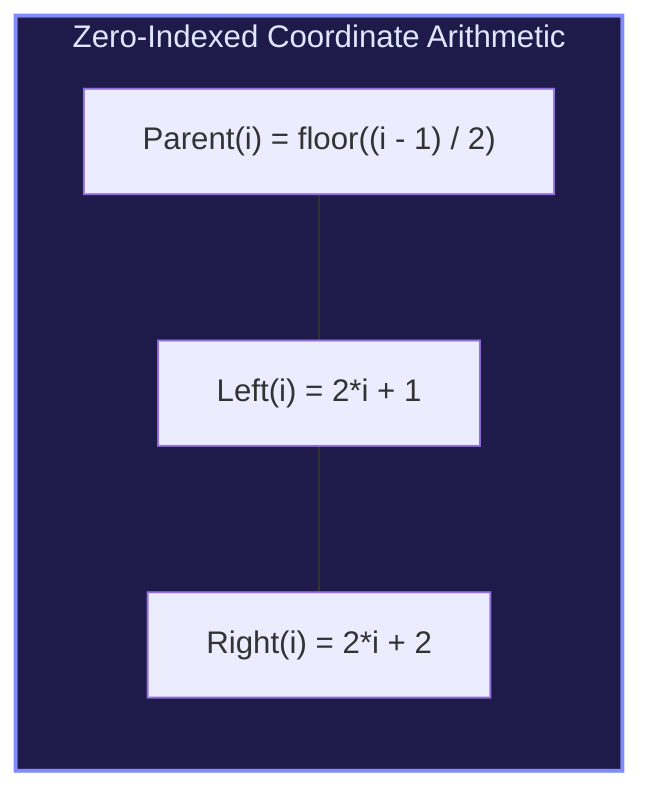
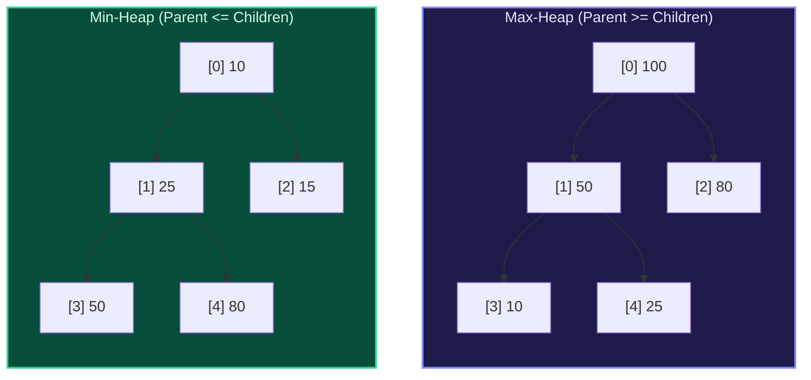

import { Callout } from "fumadocs-ui/components/callout";
import { Tabs, Tab } from "fumadocs-ui/components/tabs";
import { Steps, Step } from "fumadocs-ui/components/steps";
import { Cards, Card } from "fumadocs-ui/components/card";

## The Contiguous Tree Mapping

A **Binary Heap** is a complete binary tree represented directly inside a contiguous 0-indexed array. Because every level is strictly packed from left to right, we can navigate the tree hierarchy without pointers:



---

## Heap Invariants: Min-Heap vs. Max-Heap

1. **Max-Heap Invariant**: For every node $i$ other than the root, $\text{val}(\text{parent}(i)) \ge \text{val}(i)$. The global maximum element resides at index $0$.
2. **Min-Heap Invariant**: For every node $i$ other than the root, $\text{val}(\text{parent}(i)) \le \text{val}(i)$. The global minimum element resides at index $0$.



---

## The Two Foundational Protocols: Sift-Up & Sift-Down

### 1. Sift-Up (Insertion: $\mathcal{O}(\log N)$)

When a new element is appended to the end of the array (at index $N$):

1. Compare the new element with its parent at $\lfloor (i - 1) / 2 \rfloor$.
2. If the heap invariant is violated, swap the element with its parent.
3. Repeat upwards until the invariant holds or the element reaches the root ($i = 0$).

### 2. Sift-Down (Extract Root: $\mathcal{O}(\log N)$)

When removing the root (index 0):

1. Swap the root with the last element of the array.
2. Remove (pop) the last element.
3. Compare the new root with its children ($2i+1$ and $2i+2$).
4. Swap with the largest child (for max-heap) or smallest child (for min-heap).
5. Repeat downwards until the invariant holds or reaching a leaf node.

---

## Multi-Language Implementations

<Tabs items={["Python", "TypeScript", "C++"]}>
<Tab value="Python">
```python
from typing import List

class MinHeap:
def **init**(self):
self.heap: List[int] = []

    def push(self, val: int) -> None:
        self.heap.append(val)
        self._sift_up(len(self.heap) - 1)

    def pop(self) -> int:
        if not self.heap:
            raise IndexError("pop from empty heap")
        if len(self.heap) == 1:
            return self.heap.pop()

        root_val = self.heap[0]
        self.heap[0] = self.heap.pop()
        self._sift_down(0)
        return root_val

    def peek(self) -> int:
        if not self.heap:
            raise IndexError("peek from empty heap")
        return self.heap[0]

    def _sift_up(self, idx: int) -> None:
        while idx > 0:
            parent_idx = (idx - 1) // 2
            if self.heap[idx] < self.heap[parent_idx]:
                self.heap[idx], self.heap[parent_idx] = self.heap[parent_idx], self.heap[idx]
                idx = parent_idx
            else:
                break

    def _sift_down(self, idx: int) -> None:
        n = len(self.heap)
        while True:
            smallest = idx
            left = 2 * idx + 1
            right = 2 * idx + 2

            if left < n and self.heap[left] < self.heap[smallest]:
                smallest = left
            if right < n and self.heap[right] < self.heap[smallest]:
                smallest = right

            if smallest != idx:
                self.heap[idx], self.heap[smallest] = self.heap[smallest], self.heap[idx]
                idx = smallest
            else:
                break

````
</Tab>
<Tab value="TypeScript">
```typescript
export class MinHeap {
  private heap: number[] = [];

  push(val: number): void {
    this.heap.push(val);
    this.siftUp(this.heap.length - 1);
  }

  pop(): number {
    if (this.heap.length === 0) throw new Error("Heap is empty");
    if (this.heap.length === 1) return this.heap.pop()!;

    const rootVal = this.heap[0];
    this.heap[0] = this.heap.pop()!;
    this.siftDown(0);
    return rootVal;
  }

  peek(): number {
    if (this.heap.length === 0) throw new Error("Heap is empty");
    return this.heap[0];
  }

  private siftUp(idx: number): void {
    while (idx > 0) {
      const parentIdx = Math.floor((idx - 1) / 2);
      if (this.heap[idx] < this.heap[parentIdx]) {
        [this.heap[idx], this.heap[parentIdx]] = [this.heap[parentIdx], this.heap[idx]];
        idx = parentIdx;
      } else {
        break;
      }
    }
  }

  private siftDown(idx: number): void {
    const n = this.heap.length;
    while (true) {
      let smallest = idx;
      const left = 2 * idx + 1;
      const right = 2 * idx + 2;

      if (left < n && this.heap[left] < this.heap[smallest]) smallest = left;
      if (right < n && this.heap[right] < this.heap[smallest]) smallest = right;

      if (smallest !== idx) {
        [this.heap[idx], this.heap[smallest]] = [this.heap[smallest], this.heap[idx]];
        idx = smallest;
      } else {
        break;
      }
    }
  }
}
````

</Tab>
<Tab value="C++">
```cpp
#include <vector>
#include <stdexcept>
#include <utility>

class MinHeap {
private:
std::vector<int> heap;

    void siftUp(size_t idx) {
        while (idx > 0) {
            size_t parentIdx = (idx - 1) / 2;
            if (heap[idx] < heap[parentIdx]) {
                std::swap(heap[idx], heap[parentIdx]);
                idx = parentIdx;
            } else {
                break;
            }
        }
    }

    void siftDown(size_t idx) {
        size_t n = heap.size();
        while (true) {
            size_t smallest = idx;
            size_t left = 2 * idx + 1;
            size_t right = 2 * idx + 2;

            if (left < n && heap[left] < heap[smallest]) smallest = left;
            if (right < n && heap[right] < heap[smallest]) smallest = right;

            if (smallest != idx) {
                std::swap(heap[idx], heap[smallest]);
                idx = smallest;
            } else {
                break;
            }
        }
    }

public:
void push(int val) {
heap.push_back(val);
siftUp(heap.size() - 1);
}

    int pop() {
        if (heap.empty()) throw std::out_of_range("Heap is empty");
        int rootVal = heap[0];
        heap[0] = heap.back();
        heap.pop_back();
        if (!heap.empty()) siftDown(0);
        return rootVal;
    }

    int peek() const {
        if (heap.empty()) throw std::out_of_range("Heap is empty");
        return heap[0];
    }

};

```
</Tab>
</Tabs>
```
