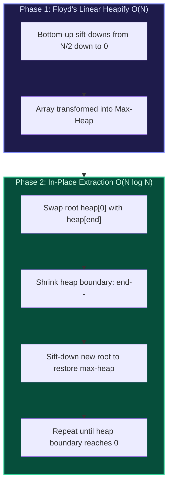

import { Callout } from "fumadocs-ui/components/callout";
import { Tabs, Tab } from "fumadocs-ui/components/tabs";
import { Steps, Step } from "fumadocs-ui/components/steps";
import { Cards, Card } from "fumadocs-ui/components/card";

## The In-Place Sorting Paradigm

**Heap Sort** is a comparison-based sorting algorithm that combines the $\mathcal{O}(N \log N)$ worst-case time guarantee of merge sort with the $\mathcal{O}(1)$ auxiliary space footprint of insertion sort.



---

## Floyd's Linear Heapify Algorithm: $\mathcal{O}(N)$ Proof

A naive approach to build a heap inserts $N$ elements one by one via `push()`, each taking $\mathcal{O}(\log N)$ time, totaling $\mathcal{O}(N \log N)$.

**Robert Floyd (1964)** demonstrated that sifting **down** from the bottom-most internal nodes ($i = \lfloor N / 2 \rfloor - 1$ down to $0$) constructs a heap in strictly **$\mathcal{O}(N)$ linear time**.

### Why Sifting Down Takes $\mathcal{O}(N)$

- In a complete binary tree of height $h$, level $k$ contains at most $\lceil N / 2^{k+1} \rceil$ nodes.
- Each node at height $k$ can sift down at most $k$ steps.
- The total operations equal:
  $$S = \sum_{k=0}^{\lfloor \log_2 N \rfloor} \frac{N}{2^{k+1}} \cdot k = \frac{N}{2} \sum_{k=0}^{\infty} \frac{k}{2^k}$$
  Using the Taylor series identity $\sum_{k=0}^{\infty} k x^k = \frac{x}{(1-x)^2}$ with $x = 1/2$:
  $$\sum_{k=0}^{\infty} \frac{k}{2^k} = \frac{1/2}{(1 - 1/2)^2} = 2$$
  Therefore:
  $$S = \frac{N}{2} \cdot 2 = N = \mathcal{O}(N)$$

---

## Multi-Language Implementations

<Tabs items={["Python", "TypeScript", "C++"]}>
<Tab value="Python">
```python
from typing import List

def heap_sort(arr: List[int]) -> None:
"""In-place Heap Sort using Floyd's linear heapify."""
n = len(arr)

    def sift_down(start: int, end: int) -> None:
        root = start
        while 2 * root + 1 <= end:
            child = 2 * root + 1
            if child + 1 <= end and arr[child] < arr[child + 1]:
                child += 1
            if arr[root] < arr[child]:
                arr[root], arr[child] = arr[child], arr[root]
                root = child
            else:
                break

    # Phase 1: Floyd's O(N) bottom-up heap construction
    for i in range((n - 2) // 2, -1, -1):
        sift_down(i, n - 1)

    # Phase 2: In-place extraction
    for end in range(n - 1, 0, -1):
        arr[0], arr[end] = arr[end], arr[0]
        sift_down(0, end - 1)

````
</Tab>
<Tab value="TypeScript">
```typescript
export function heapSort(arr: number[]): void {
  const n = arr.length;

  const siftDown = (start: number, end: number): void => {
    let root = start;
    while (2 * root + 1 <= end) {
      let child = 2 * root + 1;
      if (child + 1 <= end && arr[child] < arr[child + 1]) {
        child += 1;
      }
      if (arr[root] < arr[child]) {
        [arr[root], arr[child]] = [arr[child], arr[root]];
        root = child;
      } else {
        break;
      }
    }
  };

  // Phase 1: Floyd's linear heapify
  for (let i = Math.floor((n - 2) / 2); i >= 0; i--) {
    siftDown(i, n - 1);
  }

  // Phase 2: Successive extraction
  for (let end = n - 1; end > 0; end--) {
    [arr[0], arr[end]] = [arr[end], arr[0]];
    siftDown(0, end - 1);
  }
}
````

</Tab>
<Tab value="C++">
```cpp
#include <vector>
#include <utility>

void siftDown(std::vector<int>& arr, int start, int end) {
int root = start;
while (2 _ root + 1 <= end) {
int child = 2 _ root + 1;
if (child + 1 <= end && arr[child] < arr[child + 1]) {
child += 1;
}
if (arr[root] < arr[child]) {
std::swap(arr[root], arr[child]);
root = child;
} else {
break;
}
}
}

void heapSort(std::vector<int>& arr) {
int n = arr.size();
if (n <= 1) return;

    // Phase 1: Floyd's O(N) build heap
    for (int i = (n - 2) / 2; i >= 0; --i) {
        siftDown(arr, i, n - 1);
    }

    // Phase 2: In-place extraction
    for (int end = n - 1; end > 0; --end) {
        std::swap(arr[0], arr[end]);
        siftDown(arr, 0, end - 1);
    }

}

```
</Tab>
</Tabs>
```
