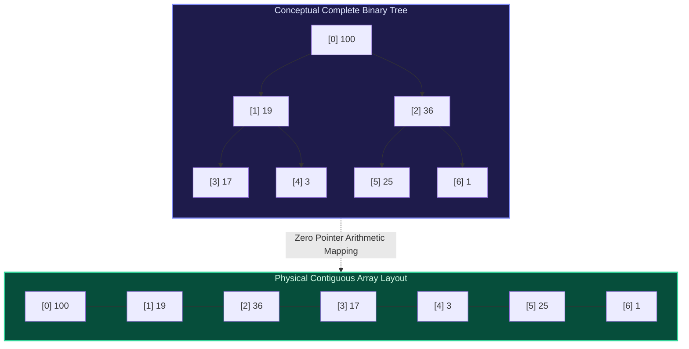

import { Callout } from "fumadocs-ui/components/callout";
import { Tabs, Tab } from "fumadocs-ui/components/tabs";
import { Steps, Step } from "fumadocs-ui/components/steps";
import { Cards, Card } from "fumadocs-ui/components/card";

## The Architectural Miracle: Hierarchies in Contiguous Arrays

Standard binary search trees require pointer links (`left`, `right`) and dynamic heap allocations, incurring substantial memory overhead and pointer-chasing CPU cache misses. In 1964, J. W. J. Williams engineered the **Binary Heap**: a complete binary tree packed seamlessly into a flat, contiguous array without storing a single pointer.

By enforcing the **Complete Binary Tree** structural invariant—where all levels are fully packed except possibly the deepest, which fills from left to right—any node at index $i$ calculates its relationships via direct integer arithmetic:

- **Parent**: $\lfloor (i - 1) / 2 \rfloor$
- **Left Child**: $2i + 1$
- **Right Child**: $2i + 2$

---

## Category Curriculum Map

<Cards>
  <Card
    title="2.2.1. Binary Heaps"
    href="/docs/dsa/02-intermediate/heaps-and-priority-queues/binary-heaps"
  >
    Array index formulas, Min-Heap and Max-Heap invariants, Sift-Up, and
    Sift-Down protocols.
  </Card>
  <Card
    title="2.2.2. Priority Queues"
    href="/docs/dsa/02-intermediate/heaps-and-priority-queues/priority-queues"
  >
    Abstract data type specifications, custom comparator mechanics, and
    event-driven timer queues.
  </Card>
  <Card
    title="2.2.3. Heap Sort"
    href="/docs/dsa/02-intermediate/heaps-and-priority-queues/heap-sort"
  >
    In-place O(N log N) sorting, Floyd's linear O(N) heap construction proof,
    and memory comparisons.
  </Card>
  <Card
    title="2.2.4. Top-K Elements & Two-Heap Maintenance"
    href="/docs/dsa/02-intermediate/heaps-and-priority-queues/top-k-elements-and-two-heap-maintenance"
  >
    Streaming bounded min-heaps, running median tracking with dual balancing
    heaps, and sliding window top-k.
  </Card>
</Cards>
