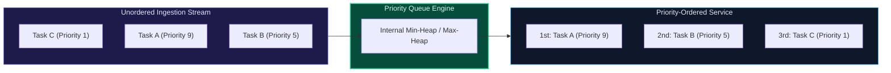

import { Callout } from "fumadocs-ui/components/callout";
import { Tabs, Tab } from "fumadocs-ui/components/tabs";
import { Steps, Step } from "fumadocs-ui/components/steps";
import { Cards, Card } from "fumadocs-ui/components/card";

## The Abstract Data Type (ADT) Specification

A **Priority Queue** is an abstract data type where each element has an associated priority key. Unlike a FIFO queue where elements exit in order of arrival, elements in a priority queue are served in order of **highest (or lowest) priority**.



---

## Core Operations & Time Guarantees

1. **`push(val, priority)`**: Insert an element into the priority queue in $\mathcal{O}(\log N)$ time using sift-up.
2. **`pop()`**: Remove and return the highest priority element in $\mathcal{O}(\log N)$ time using sift-down.
3. **`peek()` / `top()`**: Inspect the highest priority element in $\mathcal{O}(1)$ time without modifying the queue.
4. **`decrease_key(node, new_priority)`**: Update an element's priority and restore invariants in $\mathcal{O}(\log N)$ (requires index mapping in Indexed Priority Queues).

---

## Production Multi-Language Implementations

<Tabs items={["Python", "TypeScript", "C++"]}>
<Tab value="Python">
```python
import heapq
from typing import List, Tuple, Any

class PriorityQueue:
def **init**(self, is_min_heap: bool = True):
self.heap: List[Tuple[Any, Any]] = []
self.is_min_heap = is_min_heap
self.\_index = 0 # Tie-breaker for stable ordering

    def push(self, item: Any, priority: float) -> None:
        p = priority if self.is_min_heap else -priority
        # Tuple comparison: (effective_priority, arrival_index, payload)
        heapq.heappush(self.heap, (p, self._index, item))
        self._index += 1

    def pop(self) -> Any:
        if not self.heap:
            raise IndexError("pop from empty priority queue")
        _, _, item = heapq.heappop(self.heap)
        return item

    def peek(self) -> Any:
        if not self.heap:
            raise IndexError("peek from empty priority queue")
        return self.heap[0][2]

    def __len__(self) -> int:
        return len(self.heap)

````
</Tab>
<Tab value="TypeScript">
```typescript
type Comparator<T> = (a: T, b: T) => number;

export class PriorityQueue<T> {
  private heap: T[] = [];
  private comparator: Comparator<T>;

  constructor(comparator: Comparator<T>) {
    this.comparator = comparator;
  }

  push(item: T): void {
    this.heap.push(item);
    this.siftUp(this.heap.length - 1);
  }

  pop(): T {
    if (this.heap.length === 0) throw new Error("Empty queue");
    if (this.heap.length === 1) return this.heap.pop()!;

    const top = this.heap[0];
    this.heap[0] = this.heap.pop()!;
    this.siftDown(0);
    return top;
  }

  peek(): T {
    if (this.heap.length === 0) throw new Error("Empty queue");
    return this.heap[0];
  }

  get length(): number {
    return this.heap.length;
  }

  private siftUp(idx: number): void {
    while (idx > 0) {
      const parent = Math.floor((idx - 1) / 2);
      if (this.comparator(this.heap[idx], this.heap[parent]) < 0) {
        [this.heap[idx], this.heap[parent]] = [this.heap[parent], this.heap[idx]];
        idx = parent;
      } else break;
    }
  }

  private siftDown(idx: number): void {
    const n = this.heap.length;
    while (true) {
      let candidate = idx;
      const left = 2 * idx + 1;
      const right = 2 * idx + 2;

      if (left < n && this.comparator(this.heap[left], this.heap[candidate]) < 0) candidate = left;
      if (right < n && this.comparator(this.heap[right], this.heap[candidate]) < 0) candidate = right;

      if (candidate !== idx) {
        [this.heap[idx], this.heap[candidate]] = [this.heap[candidate], this.heap[idx]];
        idx = candidate;
      } else break;
    }
  }
}
````

</Tab>
<Tab value="C++">
```cpp
#include <queue>
#include <vector>
#include <iostream>

struct Task {
int priority;
std::string name;

    // Custom comparator for std::priority_queue (Max-Heap by default)
    bool operator<(const Task& other) const {
        return priority < other.priority; // Larger priority served first
    }

};

void runPriorityScheduler() {
std::priority_queue<Task> pq;

    pq.push({10, "Critical Database Backup"});
    pq.push({2, "Log Rotation"});
    pq.push({15, "Security Patch Deployment"});

    while (!pq.empty()) {
        Task t = pq.top();
        pq.pop();
        std::cout << "Executing: " << t.name << " (Priority: " << t.priority << ")\n";
    }

}

```
</Tab>
</Tabs>
```
