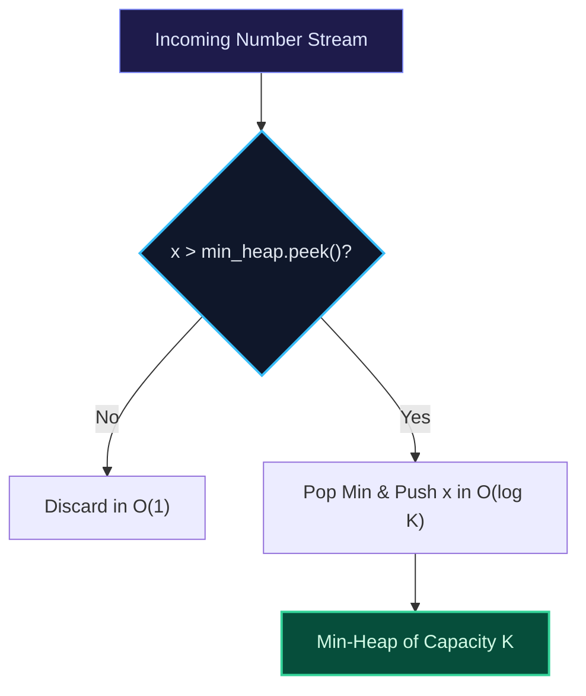
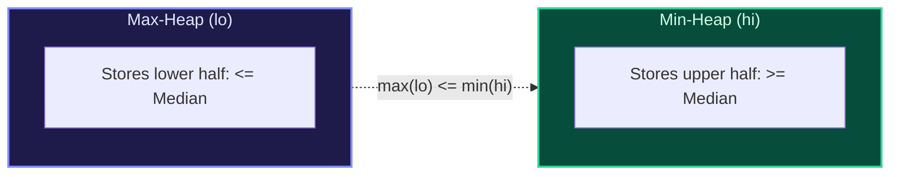

import { Callout } from "fumadocs-ui/components/callout";
import { Tabs, Tab } from "fumadocs-ui/components/tabs";
import { Steps, Step } from "fumadocs-ui/components/steps";
import { Cards, Card } from "fumadocs-ui/components/card";

## Pattern 1: Bounded Min-Heap for Streaming Top-K

When processing an unbounded streaming dataset of $N$ numbers to maintain the **$K$ largest elements**, maintaining a sorted array takes $\mathcal{O}(N \cdot K)$ time.

**The Bounded Min-Heap Optimization**:

- Maintain a **Min-Heap** of fixed maximum size $K$.
- For each incoming number $x$:
  - If the heap has fewer than $K$ items, push $x$.
  - Else if $x > \text{heap.peek()}$, pop the minimum item and push $x$.
- The root of the min-heap always acts as the **gatekeeper**: any incoming number smaller than the smallest of the top-$K$ is instantly discarded in $\mathcal{O}(1)$ time.
- **Time Complexity**: $\mathcal{O}(N \log K)$ time, $\mathcal{O}(K)$ auxiliary space.



---

## Pattern 2: Dual-Heap Continuous Running Median

In live financial analytics and latency telemetry, calculating the median of an incoming data stream must execute with minimal latency. Sorting on every insertion takes $\mathcal{O}(N \log N)$ time.

**The Dual-Heap Balancing Architecture**:
Divide the numbers into two equal halves using two complementary heaps:

1. **Lower Half (Max-Heap `lo`)**: Stores the smaller half of all numbers seen so far.
2. **Upper Half (Min-Heap `hi`)**: Stores the larger half of all numbers seen so far.



### Balancing Invariants

1. `max(lo) <= min(hi)`
2. `len(lo) == len(hi)` (even total elements) or `len(lo) == len(hi) + 1` (odd total elements).

### Median Extraction ($\mathcal{O}(1)$)

- If total count is odd: $\text{median} = \text{lo.peek()}$.
- If total count is even: $\text{median} = (\text{lo.peek()} + \text{hi.peek()}) / 2.0$.

---

## Multi-Language Implementations

<Tabs items={["Python", "TypeScript", "C++"]}>
<Tab value="Python">
```python
import heapq

class MedianFinder:
def **init**(self):
self.lo = [] # Max-heap (stored as negative values)
self.hi = [] # Min-heap

    def add_num(self, num: int) -> None:
        # Step 1: Push to max-heap
        heapq.heappush(self.lo, -num)

        # Step 2: Ensure order invariant max(lo) <= min(hi)
        heapq.heappush(self.hi, -heapq.heappop(self.lo))

        # Step 3: Ensure size invariant len(lo) >= len(hi)
        if len(self.hi) > len(self.lo):
            heapq.heappush(self.lo, -heapq.heappop(self.hi))

    def find_median(self) -> float:
        if len(self.lo) > len(self.hi):
            return float(-self.lo[0])
        return (-self.lo[0] + self.hi[0]) / 2.0

````
</Tab>
<Tab value="TypeScript">
```typescript
// Dual Heap continuous median tracker
export class MedianFinder {
  private lo: number[] = []; // Max-heap (simulated)
  private hi: number[] = []; // Min-heap (simulated)

  addNum(num: number): void {
    // Push into lower half
    this.lo.push(num);
    this.lo.sort((a, b) => b - a); // max at index 0

    // Balance to upper half
    this.hi.push(this.lo.shift()!);
    this.hi.sort((a, b) => a - b); // min at index 0

    // Maintain size invariant
    if (this.hi.length > this.lo.length) {
      this.lo.push(this.hi.shift()!);
      this.lo.sort((a, b) => b - a);
    }
  }

  findMedian(): number {
    if (this.lo.length > this.hi.length) return this.lo[0];
    return (this.lo[0] + this.hi[0]) / 2;
  }
}
````

</Tab>
<Tab value="C++">
```cpp
#include <queue>
#include <vector>

class MedianFinder {
private:
std::priority_queue<int> lo; // Max-heap
std::priority_queue<int, std::vector<int>, std::greater<int>> hi; // Min-heap

public:
void addNum(int num) {
lo.push(num);
hi.push(lo.top());
lo.pop();

        if (hi.size() > lo.size()) {
            lo.push(hi.top());
            hi.pop();
        }
    }

    double findMedian() {
        if (lo.size() > hi.size()) return lo.top();
        return (lo.top() + hi.top()) / 2.0;
    }

};

```
</Tab>
</Tabs>
```
