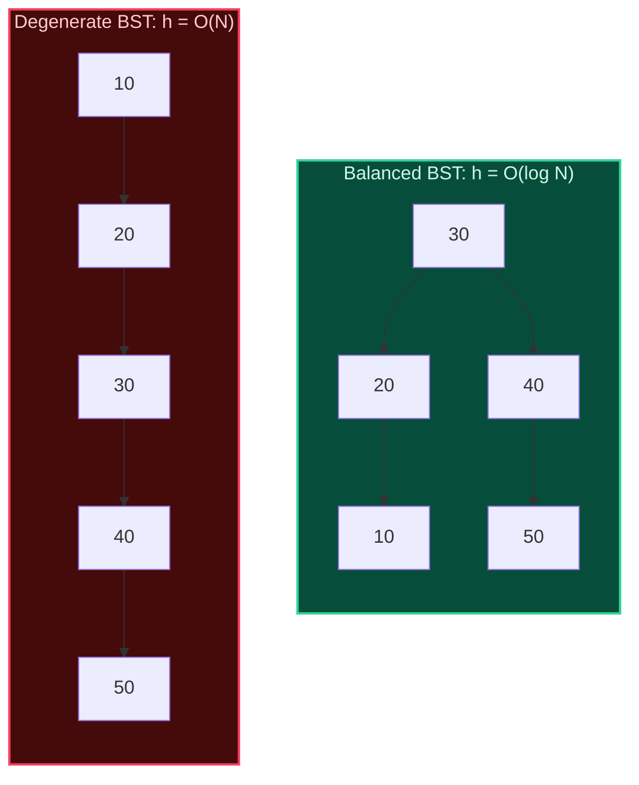
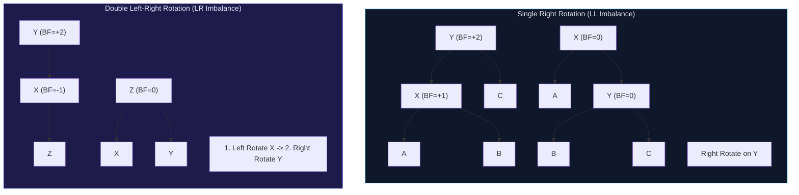
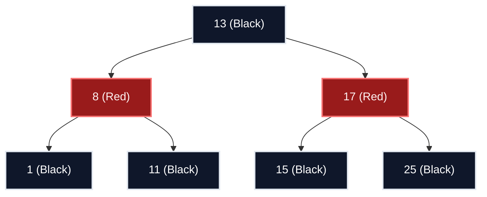

import { Callout } from "fumadocs-ui/components/callout";
import { Tabs, Tab } from "fumadocs-ui/components/tabs";
import { Steps, Step } from "fumadocs-ui/components/steps";
import { Cards, Card } from "fumadocs-ui/components/card";

## The Degenerate Tree Collapse

In an ideal binary search tree, the height satisfies $h = \lfloor \log_2 N \rfloor$. Every comparison eliminates half of the remaining keys. However, when insertions arrive in sorted or nearly sorted order (e.g., `[10, 20, 30, 40, 50]`), the standard BST degrades into a linear linked list:



To prevent this catastrophic performance collapse from $\mathcal{O}(\log N)$ to $\mathcal{O}(N)$, computer scientists engineered **Self-Balancing Binary Search Trees** that maintain geometric balance invariants through tree rotations.

---

## AVL Trees: Strict Balance via Rotations

Invented in 1962 by Georgy Adelson-Velsky and Evgenii Landis, the **AVL Tree** enforces the strictest balance condition:

> **The AVL Invariant**: For every node $X$, the absolute difference between the heights of its left and right subtrees (the **Balance Factor**) must not exceed 1:
> $$\text{BF}(X) = \text{height}(X.\text{left}) - \text{height}(X.\text{right}) \in \{-1, 0, 1\}$$

### The Four Rebalancing Rotations

When an insertion or deletion pushes $|\text{BF}| > 1$, rebalancing restores the invariant using constant-time pointer rotations:



1. **Left-Left (LL)**: Unbalance caused by insertion into left child of left subtree $\implies$ **Single Right Rotation**.
2. **Right-Right (RR)**: Unbalance caused by insertion into right child of right subtree $\implies$ **Single Left Rotation**.
3. **Left-Right (LR)**: Unbalance caused by insertion into right child of left subtree $\implies$ **Left Rotate on Child, then Right Rotate on Node**.
4. **Right-Left (RL)**: Unbalance caused by insertion into left child of right subtree $\implies$ **Right Rotate on Child, then Left Rotate on Node**.

---

## Red-Black Trees: Relaxed Balance in Production

While AVL trees offer faster lookups due to strict balance ($h \le 1.44 \log_2 N$), they require more rotations during insertions and deletions. **Red-Black Trees** relax this constraint ($h \le 2 \log_2(N + 1)$), resulting in faster write operations.

### The Five Red-Black Invariants:

1. Every node is colored either **Red** or **Black**.
2. The root node is always **Black**.
3. All leaf nodes (`NIL` sentinels) are **Black**.
4. If a node is **Red**, both of its children must be **Black** (no two consecutive red nodes on any path).
5. For every node, all paths from that node to descendant `NIL` leaves contain the exact same number of black nodes (**Black-Height invariant**).



---

## Production Systems Comparison: AVL vs. Red-Black

| Metric                   | AVL Tree                                | Red-Black Tree                                                 |
| :----------------------- | :-------------------------------------- | :------------------------------------------------------------- |
| **Max Tree Height**      | $\approx 1.44 \log_2 N$                 | $\approx 2.00 \log_2 N$                                        |
| **Search Performance**   | **Faster** (Flatter, more compact tree) | Slightly slower (~15-20% more levels)                          |
| **Insertion Rotations**  | At most 2 rotations                     | **At most 2 rotations**                                        |
| **Deletion Rotations**   | Up to $\mathcal{O}(\log N)$ rotations   | **At most 3 rotations**                                        |
| **Production Use Cases** | Read-heavy databases, spatial indexes   | C++ `std::map`/`std::set`, Java `TreeMap`, Linux CFS scheduler |

---

## Multi-Language Implementations (AVL Tree)

<Tabs items={["Python", "TypeScript", "C++"]}>
<Tab value="Python">
```python
class AVLNode:
    def __init__(self, key: int):
        self.key = key
        self.left = None
        self.right = None
        self.height = 1

class AVLTree:
def get_height(self, node: AVLNode) -> int:
return node.height if node else 0

    def get_balance(self, node: AVLNode) -> int:
        return self.get_height(node.left) - self.get_height(node.right) if node else 0

    def rotate_right(self, y: AVLNode) -> AVLNode:
        x = y.left
        T2 = x.right
        x.right = y
        y.left = T2
        y.height = 1 + max(self.get_height(y.left), self.get_height(y.right))
        x.height = 1 + max(self.get_height(x.left), self.get_height(x.right))
        return x

    def rotate_left(self, x: AVLNode) -> AVLNode:
        y = x.right
        T2 = y.left
        y.left = x
        x.right = T2
        x.height = 1 + max(self.get_height(x.left), self.get_height(x.right))
        y.height = 1 + max(self.get_height(y.left), self.get_height(y.right))
        return y

    def insert(self, root: AVLNode, key: int) -> AVLNode:
        if not root:
            return AVLNode(key)
        if key < root.key:
            root.left = self.insert(root.left, key)
        elif key > root.key:
            root.right = self.insert(root.right, key)
        else:
            return root

        root.height = 1 + max(self.get_height(root.left), self.get_height(root.right))
        bf = self.get_balance(root)

        # LL
        if bf > 1 and key < root.left.key:
            return self.rotate_right(root)
        # RR
        if bf < -1 and key > root.right.key:
            return self.rotate_left(root)
        # LR
        if bf > 1 and key > root.left.key:
            root.left = self.rotate_left(root.left)
            return self.rotate_right(root)
        # RL
        if bf < -1 and key < root.right.key:
            root.right = self.rotate_right(root.right)
            return self.rotate_left(root)

        return root

````
</Tab>
<Tab value="TypeScript">
```typescript
export class AVLNode {
  key: number;
  left: AVLNode | null = null;
  right: AVLNode | null = null;
  height: number = 1;
  constructor(key: number) {
    this.key = key;
  }
}

export class AVLTree {
  getHeight(node: AVLNode | null): number {
    return node ? node.height : 0;
  }

  getBalance(node: AVLNode | null): number {
    return node ? this.getHeight(node.left) - this.getHeight(node.right) : 0;
  }

  rotateRight(y: AVLNode): AVLNode {
    const x = y.left!;
    const T2 = x.right;
    x.right = y;
    y.left = T2;
    y.height = 1 + Math.max(this.getHeight(y.left), this.getHeight(y.right));
    x.height = 1 + Math.max(this.getHeight(x.left), this.getHeight(x.right));
    return x;
  }

  rotateLeft(x: AVLNode): AVLNode {
    const y = x.right!;
    const T2 = y.left;
    y.left = x;
    x.right = T2;
    x.height = 1 + Math.max(this.getHeight(x.left), this.getHeight(x.right));
    y.height = 1 + Math.max(this.getHeight(y.left), this.getHeight(y.right));
    return y;
  }

  insert(node: AVLNode | null, key: number): AVLNode {
    if (!node) return new AVLNode(key);
    if (key < node.key) node.left = this.insert(node.left, key);
    else if (key > node.key) node.right = this.insert(node.right, key);
    else return node;

    node.height = 1 + Math.max(this.getHeight(node.left), this.getHeight(node.right));
    const bf = this.getBalance(node);

    if (bf > 1 && key < node.left!.key) return this.rotateRight(node);
    if (bf < -1 && key > node.right!.key) return this.rotateLeft(node);
    if (bf > 1 && key > node.left!.key) {
      node.left = this.rotateLeft(node.left!);
      return this.rotateRight(node);
    }
    if (bf < -1 && key < node.right!.key) {
      node.right = this.rotateRight(node.right!);
      return this.rotateLeft(node);
    }

    return node;
  }
}
````

</Tab>
<Tab value="C++">
```cpp
#include <algorithm>

struct AVLNode {
int key;
AVLNode* left;
AVLNode* right;
int height;
explicit AVLNode(int k) : key(k), left(nullptr), right(nullptr), height(1) {}
};

class AVLTree {
public:
int getHeight(AVLNode\* node) {
return node ? node->height : 0;
}

    int getBalance(AVLNode* node) {
        return node ? getHeight(node->left) - getHeight(node->right) : 0;
    }

    AVLNode* rotateRight(AVLNode* y) {
        AVLNode* x = y->left;
        AVLNode* T2 = x->right;
        x->right = y;
        y->left = T2;
        y->height = 1 + std::max(getHeight(y->left), getHeight(y->right));
        x->height = 1 + std::max(getHeight(x->left), getHeight(x->right));
        return x;
    }

    AVLNode* rotateLeft(AVLNode* x) {
        AVLNode* y = x->right;
        AVLNode* T2 = y->left;
        y->left = x;
        x->right = T2;
        x->height = 1 + std::max(getHeight(x->left), getHeight(x->right));
        y->height = 1 + std::max(getHeight(y->left), getHeight(y->right));
        return y;
    }

    AVLNode* insert(AVLNode* node, int key) {
        if (!node) return new AVLNode(key);
        if (key < node->key) node->left = insert(node->left, key);
        else if (key > node->key) node->right = insert(node->right, key);
        else return node;

        node->height = 1 + std::max(getHeight(node->left), getHeight(node->right));
        int bf = getBalance(node);

        if (bf > 1 && key < node->left->key) return rotateRight(node);
        if (bf < -1 && key > node->right->key) return rotateLeft(node);
        if (bf > 1 && key > node->left->key) {
            node->left = rotateLeft(node->left);
            return rotateRight(node);
        }
        if (bf < -1 && key < node->right->key) {
            node->right = rotateRight(node->right);
            return rotateLeft(node);
        }

        return node;
    }

};

```
</Tab>
</Tabs>
```
