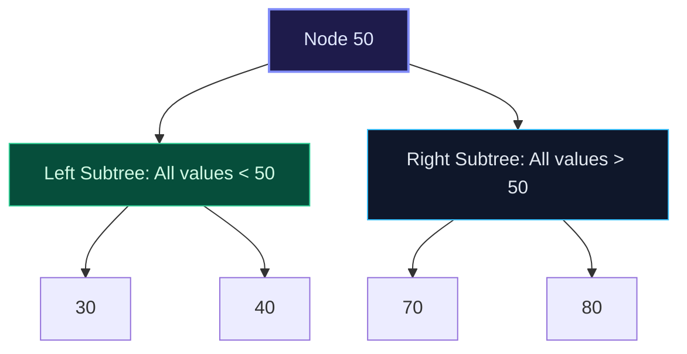
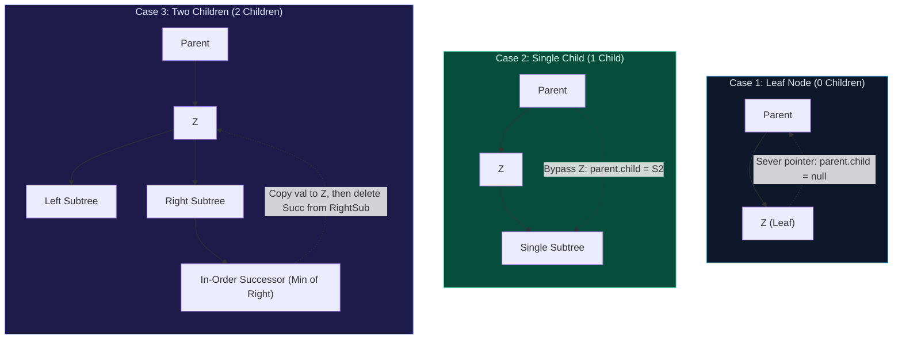

import { Callout } from "fumadocs-ui/components/callout";
import { Tabs, Tab } from "fumadocs-ui/components/tabs";
import { Steps, Step } from "fumadocs-ui/components/steps";
import { Cards, Card } from "fumadocs-ui/components/card";

## The Binary Search Tree Invariant

A **Binary Search Tree (BST)** is an ordered binary tree structured so that for any node $X$:

1. Every node $L$ in the **left subtree** satisfies $L.\text{val} < X.\text{val}$.
2. Every node $R$ in the **right subtree** satisfies $R.\text{val} > X.\text{val}$.
3. Both left and right subtrees must themselves be valid binary search trees.



> [!IMPORTANT]
> The invariant is **global, not local**. It is insufficient for a node's left child to merely be smaller than itself; _every_ descendant in the entire left subtree must be smaller than that ancestor.

---

## Core BST Operations

### 1. Search ($\mathcal{O}(h)$)

Compare the target value $K$ with the current node:

- If $K == \text{node.val}$, return the node.
- If $K < \text{node.val}$, recurse into `node.left`.
- If $K > \text{node.val}$, recurse into `node.right`.
- If reaching `null`, target does not exist.

### 2. Insertion ($\mathcal{O}(h)$)

Trace the search path until encountering `null`. Attach the new node as a leaf at that vacant position.

### 3. Deletion ($\mathcal{O}(h)$) — The Three Cases

Deleting a node $Z$ requires maintaining the invariant across three distinct structural cases:



---

## Validating a Binary Search Tree

A common interview mistake is checking only local parent-child relations (`node.left.val < node.val`). This passes on trees like `[10, 5, 15, null, null, 6, 20]`, where `6` is in the right subtree of `10` but smaller than `10`!

**The Robust Solution**: Pass valid range boundaries $(\text{low}, \text{high})$ down the recursion:

- Root starts with $(-\infty, +\infty)$.
- For `node.left`, the range shrinks to $(\text{low}, \text{node.val})$.
- For `node.right`, the range shrinks to $(\text{node.val}, \text{high})$.

---

## Multi-Language Implementations

<Tabs items={["Python", "TypeScript", "C++"]}>
<Tab value="Python">
```python
from typing import Optional

class TreeNode:
def **init**(self, val: int = 0, left: Optional['TreeNode'] = None, right: Optional['TreeNode'] = None):
self.val = val
self.left = left
self.right = right

class BST:
def search(self, root: Optional[TreeNode], val: int) -> Optional[TreeNode]:
curr = root
while curr and curr.val != val:
if val < curr.val:
curr = curr.left
else:
curr = curr.right
return curr

    def insert(self, root: Optional[TreeNode], val: int) -> TreeNode:
        if not root:
            return TreeNode(val)
        if val < root.val:
            root.left = self.insert(root.left, val)
        elif val > root.val:
            root.right = self.insert(root.right, val)
        return root

    def delete_node(self, root: Optional[TreeNode], key: int) -> Optional[TreeNode]:
        if not root:
            return None

        if key < root.val:
            root.left = self.delete_node(root.left, key)
        elif key > root.val:
            root.right = self.delete_node(root.right, key)
        else:
            # Case 1 & 2: 0 or 1 child
            if not root.left:
                return root.right
            elif not root.right:
                return root.left

            # Case 3: 2 children - replace with in-order successor
            min_node = root.right
            while min_node.left:
                min_node = min_node.left
            root.val = min_node.val
            root.right = self.delete_node(root.right, min_node.val)

        return root

    def is_valid_bst(self, root: Optional[TreeNode]) -> bool:
        def validate(node: Optional[TreeNode], low: float, high: float) -> bool:
            if not node:
                return True
            if not (low < node.val < high):
                return False
            return validate(node.left, low, node.val) and validate(node.right, node.val, high)

        return validate(root, float('-inf'), float('inf'))

````
</Tab>
<Tab value="TypeScript">
```typescript
export class TreeNode {
  val: number;
  left: TreeNode | null;
  right: TreeNode | null;
  constructor(val: number = 0, left: TreeNode | null = null, right: TreeNode | null = null) {
    this.val = val;
    this.left = left;
    this.right = right;
  }
}

export class BST {
  search(root: TreeNode | null, val: number): TreeNode | null {
    let curr = root;
    while (curr !== null && curr.val !== val) {
      curr = val < curr.val ? curr.left : curr.right;
    }
    return curr;
  }

  insert(root: TreeNode | null, val: number): TreeNode {
    if (!root) return new TreeNode(val);
    if (val < root.val) root.left = this.insert(root.left, val);
    else if (val > root.val) root.right = this.insert(root.right, val);
    return root;
  }

  deleteNode(root: TreeNode | null, key: number): TreeNode | null {
    if (!root) return null;

    if (key < root.val) {
      root.left = this.deleteNode(root.left, key);
    } else if (key > root.val) {
      root.right = this.deleteNode(root.right, key);
    } else {
      if (!root.left) return root.right;
      if (!root.right) return root.left;

      let minNode = root.right;
      while (minNode.left) minNode = minNode.left;
      root.val = minNode.val;
      root.right = this.deleteNode(root.right, minNode.val);
    }
    return root;
  }

  isValidBST(root: TreeNode | null): boolean {
    const validate = (node: TreeNode | null, low: number, high: number): boolean => {
      if (!node) return true;
      if (node.val <= low || node.val >= high) return false;
      return validate(node.left, low, node.val) && validate(node.right, node.val, high);
    };
    return validate(root, -Infinity, Infinity);
  }
}
````

</Tab>
<Tab value="C++">
```cpp
#include <limits>
#include <algorithm>

struct TreeNode {
int val;
TreeNode* left;
TreeNode* right;
explicit TreeNode(int x) : val(x), left(nullptr), right(nullptr) {}
};

class BST {
public:
TreeNode* search(TreeNode* root, int val) {
TreeNode\* curr = root;
while (curr != nullptr && curr->val != val) {
curr = (val < curr->val) ? curr->left : curr->right;
}
return curr;
}

    TreeNode* insert(TreeNode* root, int val) {
        if (!root) return new TreeNode(val);
        if (val < root->val) root->left = insert(root->left, val);
        else if (val > root->val) root->right = insert(root->right, val);
        return root;
    }

    TreeNode* deleteNode(TreeNode* root, int key) {
        if (!root) return nullptr;

        if (key < root->val) {
            root->left = deleteNode(root->left, key);
        } else if (key > root->val) {
            root->right = deleteNode(root->right, key);
        } else {
            if (!root->left) {
                TreeNode* temp = root->right;
                delete root;
                return temp;
            } else if (!root->right) {
                TreeNode* temp = root->left;
                delete root;
                return temp;
            }

            TreeNode* minNode = root->right;
            while (minNode->left) minNode = minNode->left;
            root->val = minNode->val;
            root->right = deleteNode(root->right, minNode->val);
        }
        return root;
    }

    bool isValidBST(TreeNode* root) {
        return validate(root, std::numeric_limits<long long>::min(), std::numeric_limits<long long>::max());
    }

private:
bool validate(TreeNode\* node, long long low, long long high) {
if (!node) return true;
if (node->val <= low || node->val >= high) return false;
return validate(node->left, low, node->val) && validate(node->right, node->val, high);
}
};

```
</Tab>
</Tabs>

---

## Complexity & Operational Profile

| Operation | Balanced BST Time | Degenerate BST Time | Auxiliary Space Complexity |
| :--- | :--- | :--- | :--- |
| **Search** | $\mathcal{O}(\log N)$ | $\mathcal{O}(N)$ | $\mathcal{O}(1)$ iterative / $\mathcal{O}(h)$ recursive |
| **Insert** | $\mathcal{O}(\log N)$ | $\mathcal{O}(N)$ | $\mathcal{O}(1)$ iterative / $\mathcal{O}(h)$ recursive |
| **Delete** | $\mathcal{O}(\log N)$ | $\mathcal{O}(N)$ | $\mathcal{O}(h)$ recursive |
| **In-Order Traversal** | $\mathcal{O}(N)$ | $\mathcal{O}(N)$ | Yields strictly sorted output in-place |
```
