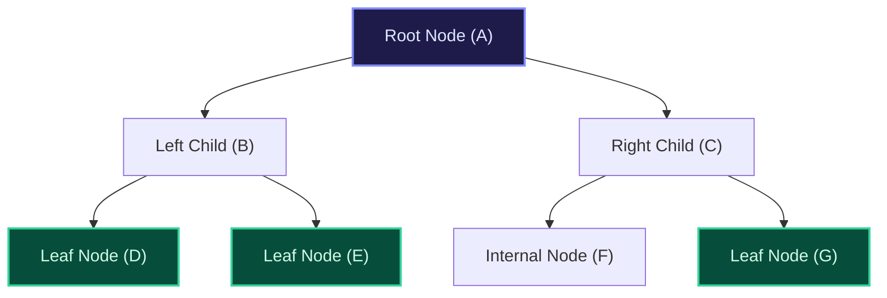
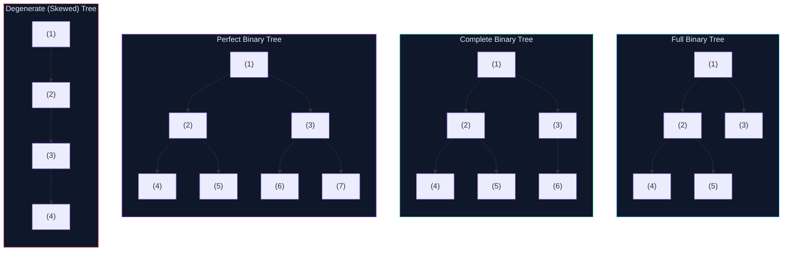
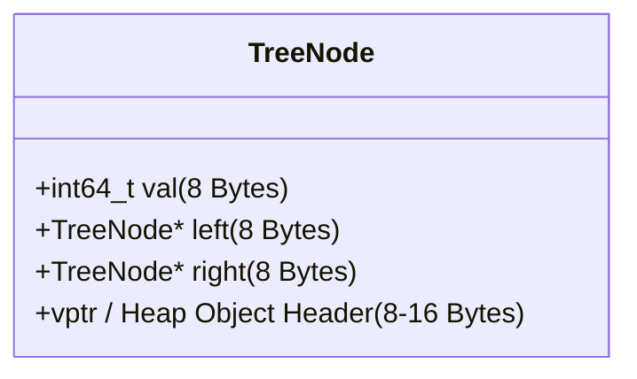
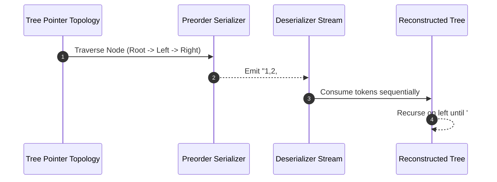

import { Callout } from "fumadocs-ui/components/callout";
import { Tabs, Tab } from "fumadocs-ui/components/tabs";
import { Steps, Step } from "fumadocs-ui/components/steps";
import { Cards, Card } from "fumadocs-ui/components/card";

## The Non-Linear Hierarchy

In foundational computer science, linear collections—arrays, linked lists, stacks, and queues—enforce a strict sequential relationship where each element has at most one predecessor and one successor. A **Binary Tree** is a non-linear, hierarchical data structure composed of nodes, where each node contains a value and references to at most two child nodes, designated as the **left child** and the **right child**.



---

## Core Anatomy and Terminology

Understanding binary trees requires precise formal definitions:

1. **Root**: The topmost node of the tree with no parent (Node $A$). Every non-empty tree has exactly one root.
2. **Edge**: The directed link connecting a parent node to its child. A tree with $N$ nodes always has exactly $N - 1$ edges.
3. **Leaf Node**: A node with zero children (`left == null` and `right == null`).
4. **Internal Node**: A non-leaf node that possesses at least one child.
5. **Depth of a Node**: The length of the unique path from the root to that node. The root resides at $\text{depth} = 0$.
6. **Height of a Node**: The number of edges on the longest downward path from that node to a leaf. A leaf has $\text{height} = 0$.
7. **Height of a Tree**: The height of the root node (i.e., the maximum depth among all nodes in the tree).
8. **Subtree**: A tree consisting of a node and all of its descendants.

---

## Structural Classifications

The geometric distribution of nodes across levels defines the structural properties and efficiency bounds of tree operations.



### 1. Full Binary Tree

Every node has either **0 or 2 children**. No node has exactly one child. If a full tree has $L$ leaves and $I$ internal nodes, then $L = I + 1$.

### 2. Complete Binary Tree

All levels are completely filled except possibly the last level, and all nodes in the last level are packed as far left as possible.

> Complete binary trees can be packed contiguously into a flat array without pointer overhead, serving as the basis for **Binary Heaps**.

### 3. Perfect Binary Tree

All interior nodes have two children, and all leaf nodes reside at the exact same depth. A perfect binary tree of height $h$ has:

- Exactly $2^{h+1} - 1$ total nodes.
- Exactly $2^h$ leaf nodes.
- Exactly $2^h - 1$ internal nodes.

### 4. Degenerate (Pathological) Tree

Every internal node has only one child. The tree structurally degenerates into a singly linked list with height $h = N - 1$, collapsing algorithmic lookups from $\mathcal{O}(\log N)$ to $\mathcal{O}(N)$.

---

## Physical Node Memory Layout (64-Bit Architecture)

A binary tree node instantiated on the heap incurs significant memory overhead compared to contiguous array storage. Consider a standard tree node containing a 64-bit integer payload:



On a 64-bit runtime:

- **Payload (`val`)**: 8 bytes.
- **Left Pointer (`left`)**: 8 bytes.
- **Right Pointer (`right`)**: 8 bytes.
- **Heap Allocator Metadata / Object Header**: 8 to 16 bytes (glibc malloc chunk header / JVM object header).
- **Structure Alignment / Padding**: 0 to 8 bytes.

**Total Consumption**: 32 to 40 bytes per node just to store 8 bytes of raw user payload! Furthermore, since nodes are dynamically allocated across the heap over time, traversing tree pointers induces L1/L2 cache misses due to pointer chasing across disjoint memory pages.

---

## Tree Serialization & Deserialization

To transmit a tree across a network socket or persist it to disk, it must be linearized into a serialized stream of bytes or tokens and subsequently reconstructed into an identical pointer topology.

### The Pre-Order Sentinel Codec

By recording nodes in pre-order traversal (Root $\to$ Left $\to$ Right) and marking null children with a sentinel token (such as `#`), a binary tree can be uniquely reconstructed without needing secondary traversal arrays.



---

## Production Multi-Language Implementations

<Tabs items={["Python", "TypeScript", "C++"]}>
<Tab value="Python">
```python
from typing import Optional, List
from collections import deque

class TreeNode:
def **init**(self, val: int = 0, left: Optional['TreeNode'] = None, right: Optional['TreeNode'] = None):
self.val = val
self.left = left
self.right = right

class Codec:
def serialize(self, root: Optional[TreeNode]) -> str:
"""Encodes a tree to a single string using preorder traversal with sentinel tokens."""
tokens: List[str] = []

        def dfs(node: Optional[TreeNode]) -> None:
            if not node:
                tokens.append("#")
                return
            tokens.append(str(node.val))
            dfs(node.left)
            dfs(node.right)

        dfs(root)
        return ",".join(tokens)

    def deserialize(self, data: str) -> Optional[TreeNode]:
        """Decodes your encoded data to tree."""
        if not data:
            return None
        token_iter = iter(data.split(","))

        def build() -> Optional[TreeNode]:
            val_str = next(token_iter)
            if val_str == "#":
                return None
            node = TreeNode(int(val_str))
            node.left = build()
            node.right = build()
            return node

        return build()

````
</Tab>
<Tab value="TypeScript">
```typescript
export class TreeNode {
  val: number;
  left: TreeNode | null;
  right: TreeNode | null;

  constructor(val: number = 0, left: TreeNode | null = null, right: TreeNode | null = null) {
    this.val = val;
    this.left = left;
    this.right = right;
  }
}

export class Codec {
  // Serializes a tree to a single string.
  serialize(root: TreeNode | null): string {
    const tokens: string[] = [];

    const dfs = (node: TreeNode | null): void => {
      if (!node) {
        tokens.push("#");
        return;
      }
      tokens.push(node.val.toString());
      dfs(node.left);
      dfs(node.right);
    };

    dfs(root);
    return tokens.join(",");
  }

  // Deserializes your encoded data to tree.
  deserialize(data: string): TreeNode | null {
    if (!data) return null;
    const tokens = data.split(",");
    let index = 0;

    const build = (): TreeNode | null => {
      if (index >= tokens.length) return null;
      const valStr = tokens[index++];
      if (valStr === "#") return null;

      const node = new TreeNode(parseInt(valStr, 10));
      node.left = build();
      node.right = build();
      return node;
    };

    return build();
  }
}
````

</Tab>
<Tab value="C++">
```cpp
#include <iostream>
#include <string>
#include <sstream>
#include <vector>

struct TreeNode {
int val;
TreeNode* left;
TreeNode* right;
explicit TreeNode(int x) : val(x), left(nullptr), right(nullptr) {}
};

class Codec {
public:
// Serializes a tree to a single string.
std::string serialize(TreeNode\* root) {
std::ostringstream out;
serializeHelper(root, out);
return out.str();
}

    // Deserializes your encoded data to tree.
    TreeNode* deserialize(const std::string& data) {
        std::istringstream in(data);
        return deserializeHelper(in);
    }

private:
void serializeHelper(TreeNode\* node, std::ostringstream& out) {
if (!node) {
out << "# ";
return;
}
out << node->val << " ";
serializeHelper(node->left, out);
serializeHelper(node->right, out);
}

    TreeNode* deserializeHelper(std::istringstream& in) {
        std::string valStr;
        if (!(in >> valStr)) return nullptr;
        if (valStr == "#") return nullptr;

        TreeNode* node = new TreeNode(std::stoi(valStr));
        node->left = deserializeHelper(in);
        node->right = deserializeHelper(in);
        return node;
    }

};

```
</Tab>
</Tabs>

---

## Complexity & Properties Analysis

| Operation | Time Complexity | Auxiliary Space Complexity | Architectural Details |
| :--- | :--- | :--- | :--- |
| **Preorder Serialization** | $\mathcal{O}(N)$ | $\mathcal{O}(h)$ call stack | Visits every node once; produces $2N + 1$ total tokens (including sentinels). |
| **Sentinel Deserialization** | $\mathcal{O}(N)$ | $\mathcal{O}(h)$ call stack | Reconstructs tree in a single linear pass over the token stream. |
| **Space Overhead Ratio** | — | — | 3-4x payload size due to pointers and heap metadata. |
```
