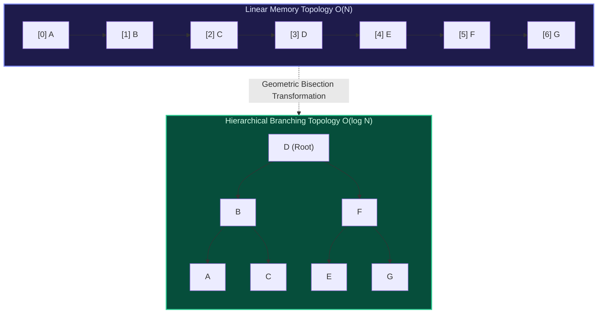

import { Callout } from "fumadocs-ui/components/callout";
import { Tabs, Tab } from "fumadocs-ui/components/tabs";
import { Steps, Step } from "fumadocs-ui/components/steps";
import { Cards, Card } from "fumadocs-ui/components/card";

## The Architectural Transition: From Contiguous Memory to Non-Linear Topology

In foundational computing, data structures exist predominantly along a single dimension. Arrays and linked lists allocate memory linearly: every element has at most one immediate predecessor and one immediate successor. While contiguous arrays guarantee $\mathcal{O}(1)$ random indexing through arithmetic memory offsets, inserting or deleting items into arbitrary locations incurs an unavoidable $\mathcal{O}(N)$ penalty due to bulk memory shifts. Conversely, linked lists decouple nodes via pointer links to permit $\mathcal{O}(1)$ mutations, but sacrifice random access, demanding linear $\mathcal{O}(N)$ sequential scans to locate values.

**Hierarchical data structures resolve this fundamental trade-off.** By introducing non-linear branching—where a single parent node references multiple children—trees partition the search space exponentially at each step. In a balanced binary tree, traversing from the root to any leaf discards half of the remaining subproblem at every link, collapsing worst-case search, insertion, and deletion complexity from linear $\mathcal{O}(N)$ to logarithmic $\mathcal{O}(\log N)$.

---

## The 7 Computational Domains of Hierarchical Structures

This module provides exhaustive theoretical rigor, spatial memory topologies, mathematical proofs, and industrial multi-language implementations across the seven core hierarchical domains:

<Cards>
  <Card
    title="2.1.1. Binary Trees"
    href="/docs/dsa/02-intermediate/hierarchical-data-structures/binary-trees"
  >
    Anatomy, structural classifications (full, complete, perfect, degenerate),
    64-bit node memory topology, and tree serialization/deserialization.
  </Card>
  <Card
    title="2.1.2. Tree Traversals"
    href="/docs/dsa/02-intermediate/hierarchical-data-structures/preorder-inorder-postorder-traversals"
  >
    Recursive depth-first walks, explicit heap stack simulations, and Morris
    in-order traversal using threaded pointers in O(1) auxiliary space.
  </Card>
  <Card
    title="2.1.3. Level-Order Traversal"
    href="/docs/dsa/02-intermediate/hierarchical-data-structures/level-order-traversal"
  >
    Queue-driven breadth-first exploration, tree width calculation, zig-zag
    traversals, and vertical coordinate column projections.
  </Card>
  <Card
    title="2.1.4. Binary Search Trees"
    href="/docs/dsa/02-intermediate/hierarchical-data-structures/binary-search-trees"
  >
    The BST invariant (L &lt; P &lt; R), logarithmic search/insert, 3-case node
    deletion with in-order successors, and range verification.
  </Card>
  <Card
    title="2.1.5. Balanced Search Trees"
    href="/docs/dsa/02-intermediate/hierarchical-data-structures/balanced-binary-search-trees"
  >
    Preventing degenerate collapse: AVL trees (balance factors and rotations)
    and Red-Black trees (5 invariants, recoloring, and amortized efficiency).
  </Card>
  <Card
    title="2.1.6. Ordered Sets & Maps"
    href="/docs/dsa/02-intermediate/hierarchical-data-structures/ordered-sets-and-ordered-maps"
  >
    Tree-backed associative containers, logarithmic lower/upper bound lookups,
    predecessor/successor extraction, and range iteration.
  </Card>
  <Card
    title="2.1.7. Diameter & Subtrees"
    href="/docs/dsa/02-intermediate/hierarchical-data-structures/tree-diameter-and-subtree-properties"
  >
    Longest path metrics via post-order dynamic programming, subtree size
    aggregation, and tree centroid discovery.
  </Card>
</Cards>

---

## Architectural Comparison Matrix

| Data Structure / Strategy     | Search Time                                     | Insertion Time                                                 | Deletion Time                               | Memory Layout                 | Cache Friendliness                     |
| :---------------------------- | :---------------------------------------------- | :------------------------------------------------------------- | :------------------------------------------ | :---------------------------- | :------------------------------------- |
| **Array / Dynamic Array**     | $\mathcal{O}(1)$ random / $\mathcal{O}(N)$ scan | $\mathcal{O}(1)$ amortized append / $\mathcal{O}(N)$ arbitrary | $\mathcal{O}(N)$ shift                      | Contiguous buffer             | Exceptional (L1/L2 spatial locality)   |
| **Singly Linked List**        | $\mathcal{O}(N)$ sequential                     | $\mathcal{O}(1)$ with pointer                                  | $\mathcal{O}(1)$ with pointer               | Dispersed heap nodes          | Poor (pointer-chasing cache misses)    |
| **Unbalanced BST**            | $\mathcal{O}(h) \to \mathcal{O}(N)$ worst       | $\mathcal{O}(h) \to \mathcal{O}(N)$ worst                      | $\mathcal{O}(h) \to \mathcal{O}(N)$ worst   | Dispersed tree nodes          | Poor (unpredictable pointer jumps)     |
| **AVL Tree (Self-Balancing)** | $\mathcal{O}(\log N)$ guaranteed                | $\mathcal{O}(\log N)$ guaranteed                               | $\mathcal{O}(\log N)$ guaranteed            | Dispersed nodes + height byte | Moderate (strict balance bounds depth) |
| **Red-Black Tree**            | $\mathcal{O}(\log N)$ guaranteed                | $\mathcal{O}(\log N)$ (at most 2 rotations)                    | $\mathcal{O}(\log N)$ (at most 3 rotations) | Dispersed nodes + 1 bit color | Moderate (industry standard for maps)  |
| **B-Tree (External Storage)** | $\mathcal{O}(\log_B N)$                         | $\mathcal{O}(\log_B N)$                                        | $\mathcal{O}(\log_B N)$                     | Block-allocated array nodes   | Optimal for disk pages and SSD blocks  |
