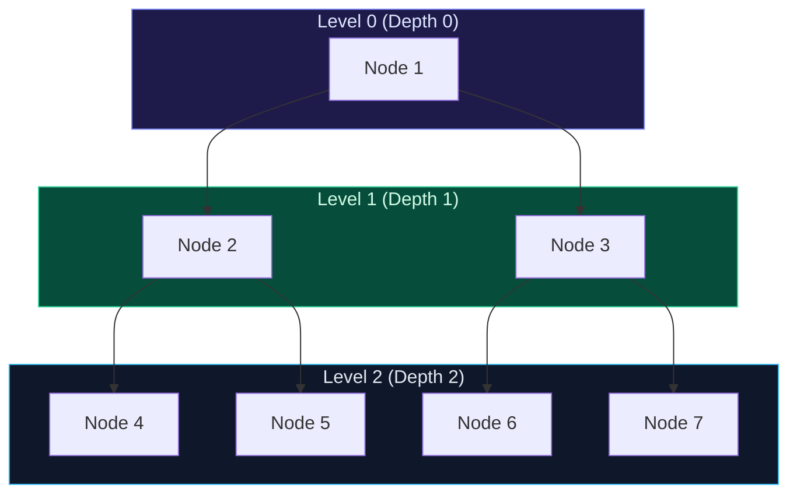
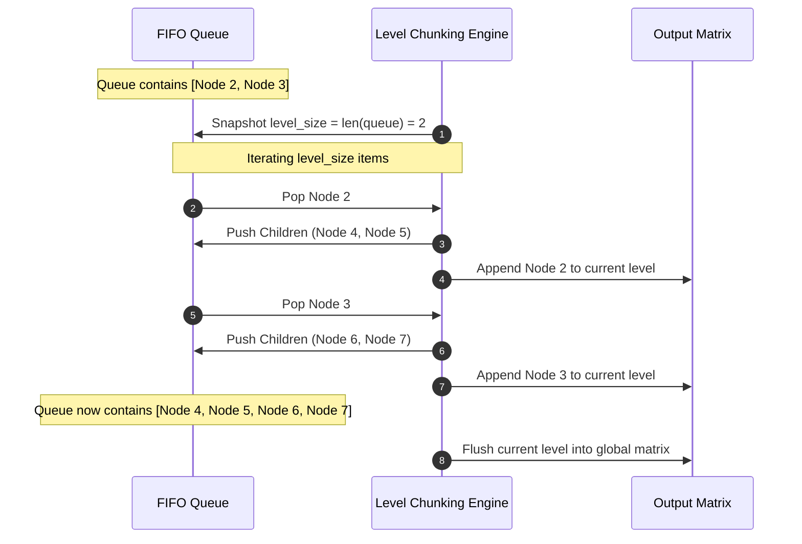

import { Callout } from "fumadocs-ui/components/callout";
import { Tabs, Tab } from "fumadocs-ui/components/tabs";
import { Steps, Step } from "fumadocs-ui/components/steps";
import { Cards, Card } from "fumadocs-ui/components/card";

## The Wavefront Mental Model

While Depth-First Search dives down a single branch until it hits a leaf, **Breadth-First Search (BFS)** or **Level-Order Traversal** explores the tree layer by layer. Picture a stone dropped into calm water: ripples radiate outward in concentric circles. In a tree, the root represents depth 0. The ripple expands to all nodes at depth 1, then depth 2, and continues downward uniformly.



---

## The Invariant Level-Size Snapshot Pattern

A naive BFS pops one node from a FIFO queue, processes it, and pushes its children. While this visits nodes in level order, it loses all information about **which level a node belongs to**.

To partition nodes into discrete level arrays or compute level-specific metrics (such as level averages or maximum width), we take a **snapshot of the queue's length** at the start of each wave:



---

## Advanced Level-Order Variations

### 1. Zig-Zag Level Order Traversal

Alternate the traversal direction between left-to-right and right-to-left across consecutive levels.

- Even levels: Read left $\to$ right.
- Odd levels: Read right $\to$ left (using a double-ended queue or reversing the level buffer before output).

### 2. Maximum Width of Binary Tree

The width of a level is the distance between the leftmost and rightmost non-null nodes, including hypothetical null nodes between them.

- Assign each node an index $i$:
  - Left child: $2i + 1$
  - Right child: $2i + 2$
- Width of level $= \text{index}_{\text{rightmost}} - \text{index}_{\text{leftmost}} + 1$.
- _Integer Overflow Protection_: Subtract the leftmost index of the level from all node indices at that level before pushing children.

### 3. Vertical Order Column Traversal

Project the tree onto a 2D Cartesian plane where the root resides at coordinates $(r=0, c=0)$.

- Left child moves to $(r + 1, c - 1)$.
- Right child moves to $(r + 1, c + 1)$.
- Group nodes by column index $c$, sorting ties by row $r$ and node value.

---

## Multi-Language Implementations

<Tabs items={["Python", "TypeScript", "C++"]}>
<Tab value="Python">
```python
from typing import Optional, List
from collections import deque

class TreeNode:
def **init**(self, val: int = 0, left: Optional['TreeNode'] = None, right: Optional['TreeNode'] = None):
self.val = val
self.left = left
self.right = right

def level_order(root: Optional[TreeNode]) -> List[List[int]]:
"""Standard level-by-level BFS traversal."""
if not root:
return []

    result: List[List[int]] = []
    queue = deque([root])

    while queue:
        level_size = len(queue)
        current_level: List[int] = []

        for _ in range(level_size):
            node = queue.popleft()
            current_level.append(node.val)
            if node.left:
                queue.append(node.left)
            if node.right:
                queue.append(node.right)

        result.append(current_level)

    return result

def zigzag_level_order(root: Optional[TreeNode]) -> List[List[int]]:
"""Zig-zag alternating level order traversal."""
if not root:
return []

    result: List[List[int]] = []
    queue = deque([root])
    left_to_right = True

    while queue:
        level_size = len(queue)
        current_level = deque()

        for _ in range(level_size):
            node = queue.popleft()
            if left_to_right:
                current_level.append(node.val)
            else:
                current_level.appendleft(node.val)

            if node.left:
                queue.append(node.left)
            if node.right:
                queue.append(node.right)

        result.append(list(current_level))
        left_to_right = not left_to_right

    return result

````
</Tab>
<Tab value="TypeScript">
```typescript
export class TreeNode {
  val: number;
  left: TreeNode | null;
  right: TreeNode | null;
  constructor(val: number = 0, left: TreeNode | null = null, right: TreeNode | null = null) {
    this.val = val;
    this.left = left;
    this.right = right;
  }
}

export function levelOrder(root: TreeNode | null): number[][] {
  if (!root) return [];

  const result: number[][] = [];
  const queue: TreeNode[] = [root];

  while (queue.length > 0) {
    const levelSize = queue.length;
    const currentLevel: number[] = [];

    for (let i = 0; i < levelSize; i++) {
      const node = queue.shift()!;
      currentLevel.push(node.val);

      if (node.left) queue.push(node.left);
      if (node.right) queue.push(node.right);
    }

    result.push(currentLevel);
  }

  return result;
}

export function zigzagLevelOrder(root: TreeNode | null): number[][] {
  if (!root) return [];

  const result: number[][] = [];
  const queue: TreeNode[] = [root];
  let leftToRight = true;

  while (queue.length > 0) {
    const levelSize = queue.length;
    const currentLevel: number[] = new Array(levelSize);

    for (let i = 0; i < levelSize; i++) {
      const node = queue.shift()!;
      const index = leftToRight ? i : levelSize - 1 - i;
      currentLevel[index] = node.val;

      if (node.left) queue.push(node.left);
      if (node.right) queue.push(node.right);
    }

    result.push(currentLevel);
    leftToRight = !leftToRight;
  }

  return result;
}
````

</Tab>
<Tab value="C++">
```cpp
#include <vector>
#include <queue>

struct TreeNode {
int val;
TreeNode* left;
TreeNode* right;
explicit TreeNode(int x) : val(x), left(nullptr), right(nullptr) {}
};

std::vector<std::vector<int>> levelOrder(TreeNode\* root) {
if (!root) return {};

    std::vector<std::vector<int>> result;
    std::queue<TreeNode*> q;
    q.push(root);

    while (!q.empty()) {
        int levelSize = q.size();
        std::vector<int> currentLevel;
        currentLevel.reserve(levelSize);

        for (int i = 0; i < levelSize; ++i) {
            TreeNode* node = q.front();
            q.pop();
            currentLevel.push_back(node->val);

            if (node->left) q.push(node->left);
            if (node->right) q.push(node->right);
        }

        result.push_back(currentLevel);
    }

    return result;

}

```
</Tab>
</Tabs>

---

## Complexity & Queue Footprint Analysis

| Metric | Time Complexity | Auxiliary Space | Maximum Queue Memory Peak |
| :--- | :--- | :--- | :--- |
| **Standard Level-Order** | $\mathcal{O}(N)$ | $\mathcal{O}(W)$ | Peak occurs at tree width $W = \lceil N/2 \rceil$ for perfect trees |
| **Zig-Zag Traversal** | $\mathcal{O}(N)$ | $\mathcal{O}(W)$ | Deque maintains level elements with $\mathcal{O}(1)$ push operations |
| **Vertical Order** | $\mathcal{O}(N \log N)$ | $\mathcal{O}(N)$ | Column map sorting overhead adds $\mathcal{O}(N \log N)$ |
```
