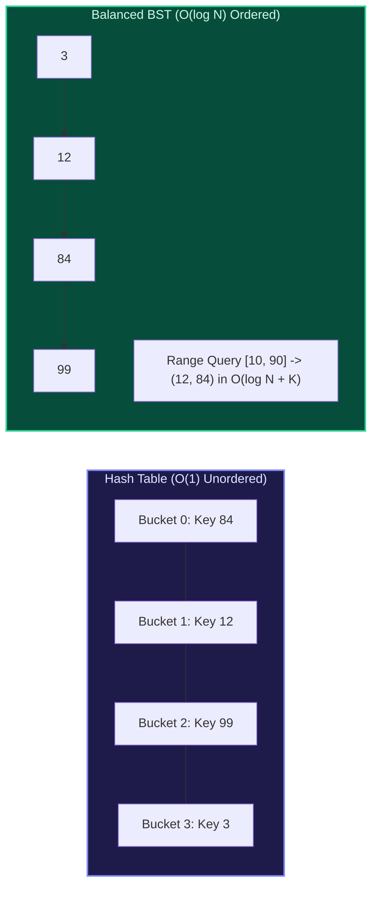

import { Callout } from "fumadocs-ui/components/callout";
import { Tabs, Tab } from "fumadocs-ui/components/tabs";
import { Steps, Step } from "fumadocs-ui/components/steps";
import { Cards, Card } from "fumadocs-ui/components/card";

## The Associative Container Divide: Hash Tables vs. Balanced Trees

In modern software development, associative data structures store key-value pairs or unique sets of elements. The standard library provides two distinct paradigms:

1. **Unordered Containers (Hash Tables)**: `std::unordered_map`, Python `dict`, JavaScript `Map`.
   - $\mathcal{O}(1)$ average lookup, insert, and delete.
   - Keys are scattered arbitrarily across buckets via a hash function.
   - **Flaw**: Cannot efficiently query relative order, nearest neighbors, or ranges ($[L, R]$).
2. **Ordered Containers (Self-Balancing BSTs)**: `std::map` / `std::set`, Java `TreeMap` / `TreeSet`.
   - $\mathcal{O}(\log N)$ guaranteed worst-case operations backed by Red-Black trees.
   - Keys are continuously maintained in strict sorted order.
   - **Advantage**: Supports instantaneous predecessor, successor, and range iteration.



---

## Logarithmic Order Queries

Ordered maps unlock three fundamental queries that are impossible to execute efficiently on hash tables:

1. **Lower Bound (`lower_bound(k)`)**:
   Returns an iterator to the first element whose key is **greater than or equal to** $k$ (i.e., $\text{key} \ge k$).
2. **Upper Bound (`upper_bound(k)`)**:
   Returns an iterator to the first element whose key is **strictly greater than** $k$ (i.e., $\text{key} > k$).
3. **Predecessor & Successor**:
   - Predecessor: The largest key smaller than $k$.
   - Successor: The smallest key greater than $k$.
     Both can be retrieved in $\mathcal{O}(\log N)$ time.
4. **Range Query $[L, R]$**:
   Locate $\text{lower\_bound}(L)$ in $\mathcal{O}(\log N)$ time, then sequentially advance the in-order iterator until reaching $R$. The total time complexity is $\mathcal{O}(\log N + K)$, where $K$ is the number of elements within the range.

---

## Multi-Language Implementations

<Tabs items={["Python", "TypeScript", "C++"]}>
<Tab value="Python">
```python
# In standard Python, bisect on sorted lists or the third-party `sortedcontainers`
# library provides Red-Black tree performance characteristics.
from bisect import bisect_left, bisect_right
from typing import List, Optional

class OrderedSetArray: # Simulated Ordered Set using dynamic sorted array + bisection
def **init**(self):
self.data: List[int] = []

    def insert(self, val: int) -> None:
        idx = bisect_left(self.data, val)
        if idx == len(self.data) or self.data[idx] != val:
            self.data.insert(idx, val)

    def lower_bound(self, val: int) -> Optional[int]:
        # First element >= val
        idx = bisect_left(self.data, val)
        return self.data[idx] if idx < len(self.data) else None

    def upper_bound(self, val: int) -> Optional[int]:
        # First element > val
        idx = bisect_right(self.data, val)
        return self.data[idx] if idx < len(self.data) else None

    def range_query(self, low: int, high: int) -> List[int]:
        left_idx = bisect_left(self.data, low)
        right_idx = bisect_right(self.data, high)
        return self.data[left_idx:right_idx]

````
</Tab>
<Tab value="TypeScript">
```typescript
// Custom BST-backed Ordered Map node
class MapNode<K, V> {
  key: K;
  value: V;
  left: MapNode<K, V> | null = null;
  right: MapNode<K, V> | null = null;
  constructor(key: K, value: V) {
    this.key = key;
    this.value = value;
  }
}

export class OrderedMap<K, V> {
  private root: MapNode<K, V> | null = null;

  insert(key: K, value: V): void {
    const insertHelper = (node: MapNode<K, V> | null): MapNode<K, V> => {
      if (!node) return new MapNode(key, value);
      if (key < node.key) node.left = insertHelper(node.left);
      else if (key > node.key) node.right = insertHelper(node.right);
      else node.value = value;
      return node;
    };
    this.root = insertHelper(this.root);
  }

  // Returns smallest key >= targetKey
  lowerBound(targetKey: K): K | null {
    let curr = this.root;
    let candidate: K | null = null;
    while (curr) {
      if (curr.key >= targetKey) {
        candidate = curr.key;
        curr = curr.left; // Try finding a smaller candidate
      } else {
        curr = curr.right;
      }
    }
    return candidate;
  }
}
````

</Tab>
<Tab value="C++">
```cpp
#include <iostream>
#include <map>
#include <set>
#include <vector>

void demonstrateOrderedContainers() {
// std::map and std::set are backed by Red-Black Trees
std::map<int, std::string> employeeMap;
employeeMap[101] = "Alice";
employeeMap[205] = "Bob";
employeeMap[340] = "Charlie";
employeeMap[490] = "Diana";

    // 1. Lower Bound (First key >= 200)
    auto itLow = employeeMap.lower_bound(200);
    if (itLow != employeeMap.end()) {
        std::cout << "Lower Bound (>= 200): " << itLow->first << " -> " << itLow->second << "\n";
    }

    // 2. Upper Bound (First key > 205)
    auto itUp = employeeMap.upper_bound(205);
    if (itUp != employeeMap.end()) {
        std::cout << "Upper Bound (> 205): " << itUp->first << " -> " << itUp->second << "\n";
    }

    // 3. Range Query [150, 400]
    std::cout << "Range [150, 400]:\n";
    for (auto it = employeeMap.lower_bound(150); it != employeeMap.upper_bound(400); ++it) {
        std::cout << "  " << it->first << ": " << it->second << "\n";
    }

}

```
</Tab>
</Tabs>

---

## Architectural Decision Matrix

| Requirement | Unordered Map (`std::unordered_map`) | Ordered Map (`std::map`) |
| :--- | :--- | :--- |
| **Lookup Time Guarantee** | Average $\mathcal{O}(1)$, Worst $\mathcal{O}(N)$ (hash collision attack) | Guaranteed $\mathcal{O}(\log N)$ worst-case |
| **Memory Consumption** | High (bucket pointers, load factor headroom) | Moderate (3 pointers + 1 color bit per node) |
| **Iteration Order** | Pseudo-random / bucket order | Strictly sorted key order |
| **Range Queries $[L, R]$** | Requires full table scan $\mathcal{O}(N)$ | Fast range scan $\mathcal{O}(\log N + K)$ |
| **Key Requirements** | Must provide `Hash` and `Equality` | Must provide `Strict Weak Ordering` (`<`) |
```
