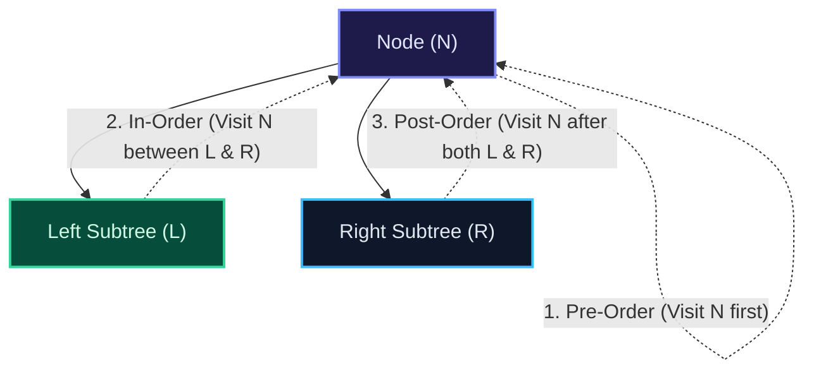
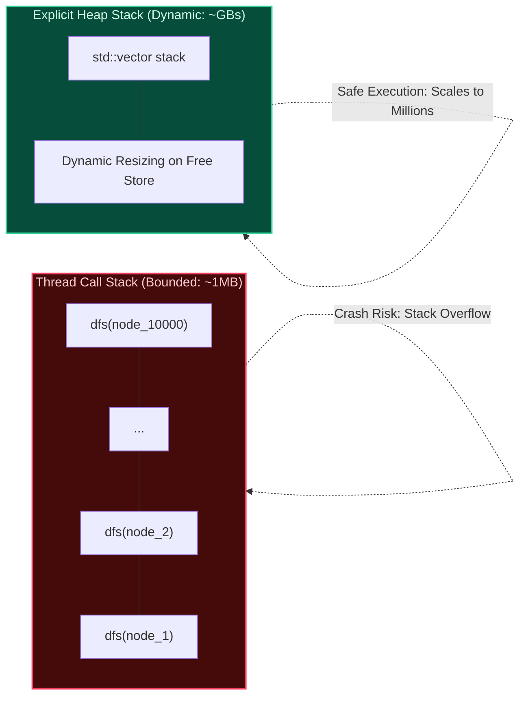
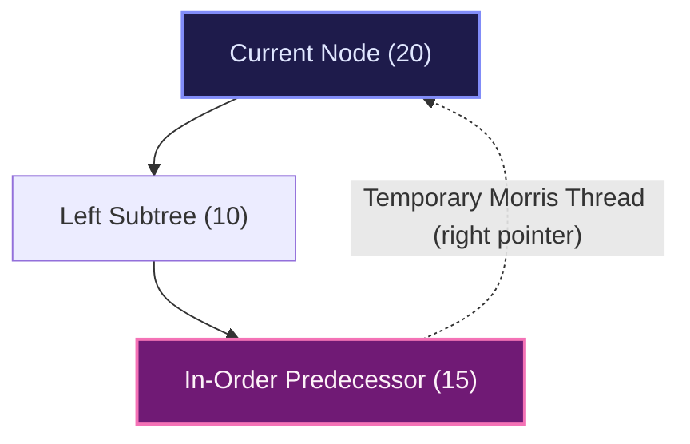

import { Callout } from "fumadocs-ui/components/callout";
import { Tabs, Tab } from "fumadocs-ui/components/tabs";
import { Steps, Step } from "fumadocs-ui/components/steps";
import { Cards, Card } from "fumadocs-ui/components/card";

## Three Perspectives on Depth-First Tree Walks

Depth-First Search (DFS) on binary trees systematically explores as deep as possible along each branch before backtracking. Because a binary node has three critical lifecycle phases—when it is first encountered, between visiting its left and right subtrees, and after both subtrees have been completely evaluated—there are three canonical DFS traversal orders:



1. **Pre-Order Traversal ($N \to L \to R$)**:
   - The node is processed **before** descending into either child.
   - Ideal for cloning trees, serializing tree topologies, and prefix arithmetic expressions.
2. **In-Order Traversal ($L \to N \to R$)**:
   - The node is processed **after** completely exploring its left subtree and **before** entering its right subtree.
   - For Binary Search Trees (BST), in-order traversal visits elements in **strictly non-decreasing sorted order**.
3. **Post-Order Traversal ($L \to R \to N$)**:
   - The node is processed **after** both children have been completely evaluated.
   - Essential for bottom-up property aggregation (height calculation, tree diameter, subtree size calculation) and memory deallocation (freeing children before the parent).

---

## The Call Stack Hazard & Explicit Stack Iteration

While recursive traversals are elegant, each recursive call consumes a call stack frame containing return addresses, function arguments, and register spills (typically 32 to 64 bytes per frame). On deeply skewed or degenerate trees where $h = \mathcal{O}(N)$, processing $N = 100{,}000$ nodes exhausts the standard thread stack (defaulting to 1MB or 8MB), triggering an unrecoverable **Stack Overflow (SIGSEGV)**.

Production runtime engines mitigate this by translating recursion into **explicit iterative loops utilizing heap-allocated stacks**.



### Iterative In-Order Traversal Logic

1. Push the current node and continually advance left (`curr = curr.left`), pushing each node onto the stack, until reaching `null`.
2. Pop the top node from the stack. Process its value.
3. Advance to its right child (`curr = node.right`) and repeat the loop.

---

## Morris In-Order Traversal: $\mathcal{O}(1)$ Auxiliary Space

Can we perform an in-order traversal without consuming any auxiliary stack memory—neither on the OS call stack nor on the heap? **J. H. Morris (1979)** answered affirmatively by utilizing **Threaded Binary Trees**.

In a standard binary tree, roughly half of all child pointers are `null`. Morris traversal temporarily transforms these `null` right pointers in the in-order predecessor into temporary back-pointers ("threads") leading back to the parent. Once the left subtree is fully traversed and we return to the parent via the thread, we sever the thread to restore the tree's original topology.



### The 4-Step Morris Protocol

For each step where `curr` is not `null`:

1. **If `curr.left` is `null`**: Visit `curr`, then move right (`curr = curr.right`).
2. **If `curr.left` exists**: Find `curr`'s in-order predecessor (`pred = curr.left`, then walk right until `pred.right == null` or `pred.right == curr`).
   - **Case A (`pred.right == null`)**: Establish the thread (`pred.right = curr`) and advance left (`curr = curr.left`).
   - **Case B (`pred.right == curr`)**: Thread already exists! Sever the thread (`pred.right = null`), visit `curr`, and advance right (`curr = curr.right`).

---

## Multi-Language Implementations

<Tabs items={["Python", "TypeScript", "C++"]}>
<Tab value="Python">
```python
from typing import Optional, List

class TreeNode:
def **init**(self, val: int = 0, left: Optional['TreeNode'] = None, right: Optional['TreeNode'] = None):
self.val = val
self.left = left
self.right = right

def inorder_iterative(root: Optional[TreeNode]) -> List[int]:
"""Iterative in-order traversal using an explicit heap stack."""
result: List[int] = []
stack: List[TreeNode] = []
curr = root

    while curr or stack:
        while curr:
            stack.append(curr)
            curr = curr.left
        curr = stack.pop()
        result.append(curr.val)
        curr = curr.right

    return result

def morris_inorder(root: Optional[TreeNode]) -> List[int]:
"""Morris in-order traversal in O(N) time and O(1) auxiliary space."""
result: List[int] = []
curr = root

    while curr:
        if not curr.left:
            result.append(curr.val)
            curr = curr.right
        else:
            # Find in-order predecessor
            pred = curr.left
            while pred.right and pred.right != curr:
                pred = pred.right

            if not pred.right:
                # Establish thread
                pred.right = curr
                curr = curr.left
            else:
                # Sever thread and visit current
                pred.right = None
                result.append(curr.val)
                curr = curr.right

    return result

````
</Tab>
<Tab value="TypeScript">
```typescript
export class TreeNode {
  val: number;
  left: TreeNode | null;
  right: TreeNode | null;
  constructor(val: number = 0, left: TreeNode | null = null, right: TreeNode | null = null) {
    this.val = val;
    this.left = left;
    this.right = right;
  }
}

export function inorderIterative(root: TreeNode | null): number[] {
  const result: number[] = [];
  const stack: TreeNode[] = [];
  let curr = root;

  while (curr !== null || stack.length > 0) {
    while (curr !== null) {
      stack.push(curr);
      curr = curr.left;
    }
    curr = stack.pop()!;
    result.push(curr.val);
    curr = curr.right;
  }

  return result;
}

export function morrisInorder(root: TreeNode | null): number[] {
  const result: number[] = [];
  let curr = root;

  while (curr !== null) {
    if (curr.left === null) {
      result.push(curr.val);
      curr = curr.right;
    } else {
      let pred = curr.left;
      while (pred.right !== null && pred.right !== curr) {
        pred = pred.right;
      }

      if (pred.right === null) {
        pred.right = curr;
        curr = curr.left;
      } else {
        pred.right = null;
        result.push(curr.val);
        curr = curr.right;
      }
    }
  }

  return result;
}
````

</Tab>
<Tab value="C++">
```cpp
#include <vector>
#include <stack>

struct TreeNode {
int val;
TreeNode* left;
TreeNode* right;
explicit TreeNode(int x) : val(x), left(nullptr), right(nullptr) {}
};

std::vector<int> inorderIterative(TreeNode* root) {
std::vector<int> result;
std::stack<TreeNode*> st;
TreeNode\* curr = root;

    while (curr != nullptr || !st.empty()) {
        while (curr != nullptr) {
            st.push(curr);
            curr = curr->left;
        }
        curr = st.top();
        st.pop();
        result.push_back(curr->val);
        curr = curr->right;
    }

    return result;

}

std::vector<int> morrisInorder(TreeNode* root) {
std::vector<int> result;
TreeNode* curr = root;

    while (curr != nullptr) {
        if (curr->left == nullptr) {
            result.push_back(curr->val);
            curr = curr->right;
        } else {
            TreeNode* pred = curr->left;
            while (pred->right != nullptr && pred->right != curr) {
                pred = pred->right;
            }

            if (pred->right == nullptr) {
                pred->right = curr; // Establish thread
                curr = curr->left;
            } else {
                pred->right = nullptr; // Sever thread
                result.push_back(curr->val);
                curr = curr->right;
            }
        }
    }

    return result;

}

```
</Tab>
</Tabs>

---

## Complexity & Invariant Analysis

| Algorithm | Time Complexity | Auxiliary Space | Call Stack Bounds | Tree Mutability |
| :--- | :--- | :--- | :--- | :--- |
| **Recursive In-Order** | $\mathcal{O}(N)$ | $\mathcal{O}(h)$ | $h \in [\log N, N]$ frames | Read-only |
| **Iterative Stack** | $\mathcal{O}(N)$ | $\mathcal{O}(h)$ | $\mathcal{O}(1)$ thread stack | Read-only |
| **Morris In-Order** | $\mathcal{O}(N)$ amortized | $\mathcal{O}(1)$ | $\mathcal{O}(1)$ thread stack | Temporarily alters and fully restores tree |
```
