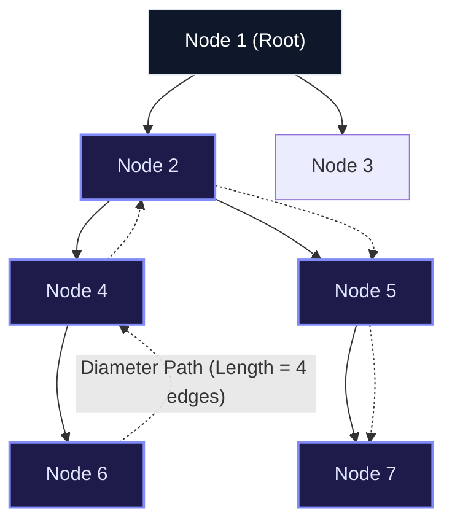
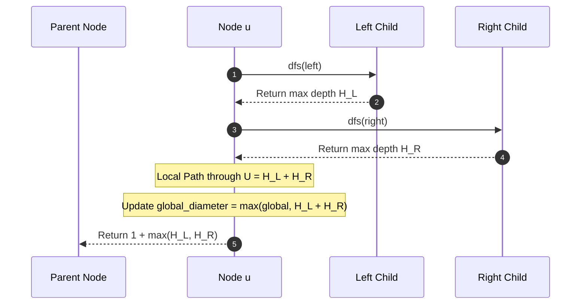

import { Callout } from "fumadocs-ui/components/callout";
import { Tabs, Tab } from "fumadocs-ui/components/tabs";
import { Steps, Step } from "fumadocs-ui/components/steps";
import { Cards, Card } from "fumadocs-ui/components/card";

## The Tree Diameter Problem

The **Diameter of a Binary Tree** (also known as the longest path) is the length of the longest simple path between any two nodes in the tree. This path may or may not pass through the root node.



> [!NOTE]
> In the diagram above, the diameter is 4 (path $6 \leftrightarrow 4 \leftrightarrow 2 \leftrightarrow 5 \leftrightarrow 7$). Notice that it does **not** pass through the root node $1$.

---

## Single-Pass Post-Order Dynamic Programming

Calculating the diameter naively by computing tree heights at every node takes $\mathcal{O}(N^2)$ time. Instead, we can solve it in a single $\mathcal{O}(N)$ bottom-up DFS:

For any node $u$:

1. Recursively compute the maximum height of its left subtree ($H_L$) and right subtree ($H_R$).
2. The longest path having node $u$ as its highest turning point is $H_L + H_R$.
3. Update global maximum: $\text{diameter} = \max(\text{diameter}, H_L + H_R)$.
4. Return the maximum height of node $u$ upward to its parent: $1 + \max(H_L, H_R)$.



---

## Subtree Properties: Size and Centroid

### 1. Subtree Size Calculation

By definition, the subtree size at node $u$ satisfies the post-order recurrence:
$$\text{size}(u) = 1 + \text{size}(u.\text{left}) + \text{size}(u.\text{right})$$
Base case: $\text{size}(\text{null}) = 0$.

### 2. Tree Centroid

A **Centroid** of a tree of $N$ nodes is a node whose removal divides the tree into a set of disconnected components, none of which has size exceeding $\lfloor N / 2 \rfloor$.

- Every tree has at least one and at most two centroids.
- If there are two centroids, they are adjacent.
- **Finding the Centroid**:
  1. Compute all subtree sizes in post-order.
  2. Start at the root. If any child has subtree size $> \lfloor N/2 \rfloor$, move to that child.
  3. The first node where all children have size $\le \lfloor N/2 \rfloor$ is the centroid.
- Centroids serve as the foundation for **Centroid Decomposition** in advanced competitive programming.

---

## Multi-Language Implementations

<Tabs items={["Python", "TypeScript", "C++"]}>
<Tab value="Python">
```python
from typing import Optional, Tuple

class TreeNode:
def **init**(self, val: int = 0, left: Optional['TreeNode'] = None, right: Optional['TreeNode'] = None):
self.val = val
self.left = left
self.right = right

class TreeProperties:
def diameter_of_binary_tree(self, root: Optional[TreeNode]) -> int:
\"\"\"Calculates tree diameter in O(N) time and O(h) space.\"\"\"
max_diameter = 0

        def dfs(node: Optional[TreeNode]) -> int:
            nonlocal max_diameter
            if not node:
                return 0

            left_height = dfs(node.left)
            right_height = dfs(node.right)

            # Update global diameter
            max_diameter = max(max_diameter, left_height + right_height)

            # Return height of current node
            return 1 + max(left_height, right_height)

        dfs(root)
        return max_diameter

    def compute_subtree_sizes(self, root: Optional[TreeNode]) -> dict:
        \"\"\"Aggregates subtree sizes for all nodes.\"\"\"
        sizes = {}

        def dfs(node: Optional[TreeNode]) -> int:
            if not node:
                return 0
            size = 1 + dfs(node.left) + dfs(node.right)
            sizes[node] = size
            return size

        dfs(root)
        return sizes

````
</Tab>
<Tab value="TypeScript">
```typescript
export class TreeNode {
  val: number;
  left: TreeNode | null;
  right: TreeNode | null;
  constructor(val: number = 0, left: TreeNode | null = null, right: TreeNode | null = null) {
    this.val = val;
    this.left = left;
    this.right = right;
  }
}

export class TreeProperties {
  diameterOfBinaryTree(root: TreeNode | null): number {
    let maxDiameter = 0;

    const dfs = (node: TreeNode | null): number => {
      if (!node) return 0;

      const leftHeight = dfs(node.left);
      const rightHeight = dfs(node.right);

      maxDiameter = Math.max(maxDiameter, leftHeight + rightHeight);
      return 1 + Math.max(leftHeight, rightHeight);
    };

    dfs(root);
    return maxDiameter;
  }
}
````

</Tab>
<Tab value="C++">
```cpp
#include <algorithm>

struct TreeNode {
int val;
TreeNode* left;
TreeNode* right;
explicit TreeNode(int x) : val(x), left(nullptr), right(nullptr) {}
};

class TreeProperties {
public:
int diameterOfBinaryTree(TreeNode\* root) {
int maxDiameter = 0;
dfs(root, maxDiameter);
return maxDiameter;
}

private:
int dfs(TreeNode\* node, int& maxDiameter) {
if (!node) return 0;

        int leftHeight = dfs(node->left, maxDiameter);
        int rightHeight = dfs(node->right, maxDiameter);

        maxDiameter = std::max(maxDiameter, leftHeight + rightHeight);
        return 1 + std::max(leftHeight, rightHeight);
    }

};

```
</Tab>
</Tabs>

---

## Complexity Matrix

| Property / Algorithm | Time Complexity | Auxiliary Space Complexity | Architectural Key Point |
| :--- | :--- | :--- | :--- |
| **Tree Diameter** | $\mathcal{O}(N)$ | $\mathcal{O}(h)$ call stack | Bottom-up recurrence prevents re-evaluating node depths |
| **Subtree Size Aggregation** | $\mathcal{O}(N)$ | $\mathcal{O}(h)$ call stack | Aggregates child weights into parent state |
| **Centroid Finding** | $\mathcal{O}(N)$ | $\mathcal{O}(h)$ call stack | Walks down greedy child branch of maximum weight |
```
