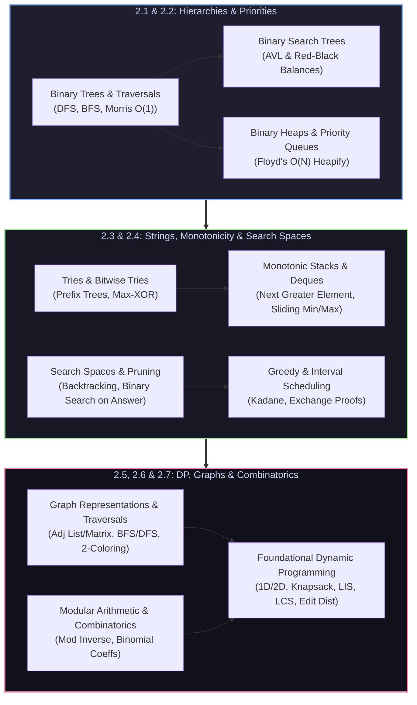

import { Callout } from "fumadocs-ui/components/callout";
import { Tabs, Tab } from "fumadocs-ui/components/tabs";
import { Steps, Step } from "fumadocs-ui/components/steps";
import { Cards, Card } from "fumadocs-ui/components/card";

## The Architectural Transition: Beyond Linear Memory

In **Stage 1 (Beginner)**, we explored contiguous and sequential structures—arrays, linked lists, stacks, queues, and Swiss Table hash maps. While linear memory delivers excellent CPU cache line efficiency ($64\text{ bytes}$ prefetched into L1), it imposes fundamental mathematical trade-offs:

1. **The Search-Insert Paradox**: An unsorted array allows $\mathcal{O}(1)$ push operations but degrades to $\mathcal{O}(N)$ sequential search. A sorted array enables $\mathcal{O}(\log N)$ binary search but costs $\mathcal{O}(N)$ element shifts on insertion.
2. **Topological Limitations**: Real-world software systems cannot model relationships like organizational hierarchies, lexical prefix routing, recursive state spaces, or dependency networks using flat sequences alone.

**Stage 2 (Intermediate)** breaks through these physical and mathematical bounds. By structuring memory into **hierarchical trees**, **priority invariants**, **directed state-space graphs**, and **overlapping subproblem DAGs**, we unlock sub-linear search, instantaneous priority extraction, and polynomial-time solutions to combinatorial challenges.

---

## Stage Curriculum Modules

Explore the dedicated modules in Stage 2 below:

<Cards>
  <Card
    title="2.1. Hierarchical Data Structures"
    href="/docs/dsa/02-intermediate/hierarchical-data-structures"
    description="Binary tree topologies, DFS/BFS/Morris traversals, BST invariants, AVL and Red-Black tree rebalancing, ordered containers, and tree diameter."
  />
  <Card
    title="2.2. Heaps and Priority Queues"
    href="/docs/dsa/02-intermediate/heaps-and-priority-queues"
    description="Array-backed complete binary trees, sift-up/down invariants, priority queue ADTs, Floyd's O(N) heapify proof, and dual-heap continuous stream median tracking."
  />
  <Card
    title="2.3. String & Monotonic Structures"
    href="/docs/dsa/02-intermediate/string-data-structures-and-monotonic-structures"
    description="Character prefix trees (Tries), 32-bit binary tries for maximum XOR pairs, monotonic stacks for Next Greater Element, and monotonic deques for sliding window extrema."
  />
  <Card
    title="2.4. Search Space & Greedy Paradigms"
    href="/docs/dsa/02-intermediate/search-space-and-greedy-paradigms"
    description="Exhaustive backtracking decision trees, branch-and-bound pruning, binary search on monotonic answer spaces, unimodal ternary search, interval merging, and Kadane's algorithm."
  />
  <Card
    title="2.5. Foundational Dynamic Programming"
    href="/docs/dsa/02-intermediate/foundational-dynamic-programming"
    description="Top-down memoization, bottom-up tabulation, rolling space compression, 1D/2D grid DP, 0/1 and unbounded knapsack, subset sum, LIS (O(N log N)), LCS, and edit distance."
  />
  <Card
    title="2.6. Graph Representations & Traversals"
    href="/docs/dsa/02-intermediate/graph-representations-and-traversals"
    description="Adjacency list/matrix and CSR representations, implicit grid graphs and flood fill, DFS edge classifications, BFS wave expansions, cycle detection, bipartite checks, and unweighted shortest paths."
  />
  <Card
    title="2.7. Modular & Combinatorial Mathematics"
    href="/docs/dsa/02-intermediate/intermediate-modular-and-combinatorial-mathematics"
    description="Modular arithmetic algebra, logarithmic binary exponentiation, Fermat modular multiplicative inverses, factorial precomputations, and combinatorial counting."
  />
  <Card
    title="Engineering Lab: Capstone Project"
    href="/docs/dsa/02-intermediate/capstone-task-scheduler-and-autocomplete"
    description="Build an asynchronous Priority Queue task scheduler with deadline aging alongside a high-throughput Trie prefix autocomplete engine."
  />
  <Card
    title="Quick Reference & Cheat Sheet"
    href="/docs/dsa/02-intermediate/quick-reference"
    description="At-a-glance heap index formulas, tree traversal invariants, two-pointer decision flowcharts, and master sorting comparison tables."
  />
</Cards>

---

## The 7 Intermediate Computational Domains

Stage 2 curriculum establishes full command across the seven foundational pillars of intermediate computer science:

### 2.1. Hierarchical Data Structures

Hierarchical data structures replace linear single-predecessor relationships with branching parent-child relationships, enabling logarithmic divide-and-conquer search.

- **Binary Trees**: Classifications including full, complete, perfect, and degenerate trees. Structural properties: height $h \in [\lfloor \log_2 N \rfloor, N-1]$ and maximum node capacity $2^{h+1} - 1$.
- **Preorder, Inorder, and Postorder Traversals**: Recursive depth-first tree walks, explicit call-stack simulations avoiding stack overflow, and **Morris In-Order Traversal** establishing temporary threaded pointers to achieve strictly $\mathcal{O}(1)$ auxiliary space.
- **Level-Order Traversal (BFS)**: FIFO queue exploration evaluating tree breadth, horizontal level boundaries, zig-zag traversals, and vertical column projections.
- **Binary Search Trees (BST)**: The fundamental invariant $\forall u, \text{left}(u) < u < \text{right}(u)$. Search, insertion, and Hibbard deletion using in-order predecessors or successors.
- **Balanced Binary Search Trees**: Preserving $\mathcal{O}(\log N)$ worst-case bounds through self-rebalancing invariants:
  - **AVL Trees**: Strict height balancing with balance factors $\text{BF}(u) = h(\text{left}) - h(\text{right}) \in \{-1, 0, 1\}$. Correcting violations via Left-Left (LL), Right-Right (RR), Left-Right (LR), and Right-Left (RL) rotations.
  - **Red-Black Trees**: Relaxed height balancing via node coloring invariants (root is black, no consecutive red nodes, equal black-height along all root-to-leaf paths). Minimizes rebalancing writes; deployed in the **Linux kernel Completely Fair Scheduler (CFS)** and C++ `std::map`.
- **Ordered Sets and Ordered Maps**: Tree-backed associative containers supporting $\mathcal{O}(\log N)$ predecessor (`lower_bound`), successor (`upper_bound`), and range queries.
- **Tree Diameter and Subtree Properties**: Calculating maximum path distances between arbitrary nodes via two-pass DFS or bottom-up dynamic programming.

---

### 2.2. Heaps and Priority Queues

Binary heaps provide array-backed representations of complete binary trees, avoiding all pointer overhead while providing instant access to extreme values.

- **Binary Heaps**: Array layout mapping tree relationships via arithmetic:
  $$
  \text{left}(i) = 2i + 1, \quad \text{right}(i) = 2i + 2, \quad \text{parent}(i) = \left\lfloor \frac{i - 1}{2} \right\rfloor
  $$
- **Heap Invariants**: Min-Heap ($\text{val}(\text{parent}(i)) \le \text{val}(i)$) and Max-Heap ($\text{val}(\text{parent}(i)) \ge \text{val}(i)$). Restoring invariants via logarithmic $\text{sift-up}$ on insertion and $\text{sift-down}$ on extraction.
- **Priority Queue Abstract Data Type**: Priority-ordered processing with $\mathcal{O}(1)$ peek and $\mathcal{O}(\log N)$ push/pop. Essential for task schedulers, timer wheels, and event-driven simulations.
- **Heap Sort and Floyd's $\mathcal{O}(N)$ Heapify**: In-place comparison sorting with guaranteed $\mathcal{O}(N \log N)$ worst-case time and $\mathcal{O}(1)$ auxiliary space. Linear-time heap construction proof:
  $$
  \sum_{h=0}^{\lfloor \log_2 N \rfloor} \frac{N}{2^{h+1}} \mathcal{O}(h) = \mathcal{O}\left(N \sum_{h=0}^{\infty} \frac{h}{2^h}\right) = \mathcal{O}(N)
  $$
- **Top-K Elements and Dual-Heap Median Tracking**: Continuous streaming percentile evaluation using a bounded Min-Heap alongside paired Min-Heap and Max-Heap structures for $\mathcal{O}(1)$ median retrieval.

---

### 2.3. String Data Structures and Monotonic Structures

Advanced linear and tree-based structures optimized for string prefix queries and monotonic invariant maintenance.

- **Prefix Trees (Tries)**: Multi-way tree structures where edges represent alphabet symbols. Provides string insertion, key search, and prefix matching in strictly $\mathcal{O}(L)$ time, where $L$ is the string length, independent of the total dictionary size $N$.
- **Bitwise Tries**: Binary alphabet $\{0, 1\}$ tries indexing 32-bit or 64-bit integers by their binary representation. Solves the canonical Maximum XOR Pair problem in $\mathcal{O}(B)$ time per query where $B$ is the bit width.
- **Monotonic Stacks**: Stacks maintaining strictly increasing or decreasing elements. Resolves Next Greater Element (NGE), Stock Span, and the Largest Rectangle in Histogram problem in amortized $\mathcal{O}(N)$ time.
- **Monotonic Queues (Deques)**: Double-ended queues maintaining sorted value order by evicting smaller/larger elements from the tail. Computes sliding window minimum and maximum across an array in amortized $\mathcal{O}(1)$ per window transition.

---

### 2.4. Search Space and Greedy Paradigms

Systematic exploration, pruning, and optimization across discrete mathematical decision spaces.

- **Backtracking and State-Space Search**: Depth-first exhaustive traversal of decision trees utilizing the canonical `Choose -> Explore -> Unchoose` state restoration protocol.
- **Pruning Techniques**: Eliminating non-viable search branches using bounding functions, forward checking, symmetry breaking, and branch-and-bound strategies.
- **Binary Search on the Answer Space**: Transforming search problems into decision problems. Given a monotonic boolean predicate $P(x) \in \{\text{false}, \text{true}\}$, bisection identifies the minimum or maximum feasible solution in $\mathcal{O}(\log(\text{range}) \cdot T_{\text{check}})$.
- **Ternary Search on Unimodal Functions**: Locating local extrema on convex or unimodal functions by trisecting the search interval with dual midpoints ($m_1, m_2$).
- **Greedy Paradigms & Exchange Arguments**: Constructing optimal solutions via locally optimal choices. Formal proof techniques: the **Greedy Stays Ahead** method and **Exchange Arguments**.
- **Interval Scheduling & Merging**: Optimal non-overlapping activity selection (Earliest Deadline First), interval union merging, and sweep-line minimum resource allocation.
- **Kadane's Algorithm**: Dynamic programming and greedy synthesis computing maximum contiguous subarray sum in $\mathcal{O}(N)$ time and $\mathcal{O}(1)$ space.

---

### 2.5. Foundational Dynamic Programming

Dynamic programming solves complex optimization problems by decomposing them into overlapping subproblems with optimal substructure.

- **Top-Down Memoization**: Recursive formulations augmented with lookup tables (hash maps or arrays) caching subproblem results, executing in $\mathcal{O}(\text{States} \cdot \text{Transitions})$.
- **Bottom-Up Tabulation**: Iterative table filling following the topological sort order of the underlying subproblem Directed Acyclic Graph (DAG). Eliminates recursion call stack overhead.
- **Space Optimization**: Utilizing rolling arrays and variable state reduction (e.g., $dp[i \bmod 2]$ or reverse inner loops) to drop spatial complexity from $\mathcal{O}(N)$ or $\mathcal{O}(N \times W)$ to $\mathcal{O}(1)$ or $\mathcal{O}(W)$.
- **One-Dimensional Dynamic Programming**: Linear recurrences including Fibonacci sequences, Climbing Stairs, House Robber, and Coin Change (minimum coins vs. count of combinations).
- **Multi-Dimensional Grid Dynamic Programming**: Path counting on matrices, obstacle avoidance, minimum path cost, and subgrid bounding box optimizations.
- **Classical Knapsack Variations**:
  - **Zero-One (0/1) Knapsack**: Binary item inclusion/exclusion under a capacity constraint $W$. Solved in $\mathcal{O}(NW)$ time with single-array space optimization via reverse-order capacity iteration.
  - **Unbounded Knapsack**: Multiple item instances allowed; solved with forward-order capacity iteration.
  - **Subset Sum**: Determining whether a subset exists with target sum $S$ via boolean reachability bitsets.
- **Longest Increasing Subsequence (LIS)**: Standard $\mathcal{O}(N^2)$ dynamic programming formulation optimized to $\mathcal{O}(N \log N)$ using **Patience Sorting** with binary search.
- **Sequence Alignments**: Longest Common Subsequence (LCS) 2D matching recurrences and **Levenshtein Edit Distance** evaluating minimum insertions, deletions, and substitutions.

---

### 2.6. Graph Representations and Traversals

Graphs model arbitrary pairwise relationships between entities. Understanding representations and fundamental traversals is critical for all networked systems.

- **Graph Representations**:
  - **Adjacency Lists**: Memory bound $\mathcal{O}(V + E)$. Optimal for sparse graphs ($E \ll V^2$) and neighborhood iteration.
  - **Adjacency Matrices**: Memory bound $\mathcal{O}(V^2)$. Enables $\mathcal{O}(1)$ edge existence lookups; cache-efficient on dense graphs.
  - **Compressed Sparse Row (CSR)**: Contiguous memory storage of adjacency lists for low-level cache line performance in graph processing frameworks.
- **Implicit Grid Graphs & Flood Fill**: Treating 2D grid cells as graph vertices with 4-directional or 8-directional edge transitions. Connected component coloring and boundary validation.
- **Depth-First Search (DFS)**: Recursive and stack-based exploration. Edge classification into **Tree**, **Back**, **Forward**, and **Cross** edges via entry and exit discovery timestamps.
- **Breadth-First Search (BFS)**: Queue-based level-order traversal. Solves Single-Source Shortest Paths (SSSP) on unweighted graphs in strictly $\mathcal{O}(V + E)$ time. Multi-source BFS for simultaneous wave propagation.
- **Connected Components**: Discovering and labeling disjoint subgraphs in undirected graphs via iterative BFS/DFS traversals.
- **Cycle Detection**:
  - **Undirected Graphs**: Tracking visited nodes and parent pointers.
  - **Directed Graphs**: Three-color DFS state tracking (**White** = Unvisited, **Gray** = Currently on recursion stack, **Black** = Fully explored). A back-edge to a Gray vertex proves a directed cycle.
- **Bipartite Graph Verification (Two-Coloring)**: Determining if vertices can be partitioned into two independent sets using alternating BFS/DFS coloring; proving the absence of odd-length cycles.

---

### 2.7. Intermediate Modular and Combinatorial Mathematics

Essential computational mathematics underpinning cryptography, hashing, randomized algorithms, and competitive programming.

- **Modular Arithmetic**: Operational axioms for addition, subtraction, and multiplication modulo $M$. Correct handling of negative numbers:
  $$
  (a - b) \pmod M = ((a \pmod M - b \pmod M) + M) \pmod M
  $$
- **Binary Exponentiation (Modular Exponentiation)**: Computing $a^b \pmod M$ in $\mathcal{O}(\log b)$ time by decomposing the exponent $b$ into powers of two via repeated squaring.
- **Modular Multiplicative Inverse**:
  - **Fermat's Little Theorem**: When modulus $M$ is prime and $\gcd(a, M) = 1$, the modular inverse is $a^{-1} \equiv a^{M-2} \pmod M$.
  - **Extended Euclidean Algorithm**: Computing integers $x, y$ such that $ax + My = \gcd(a, M) = 1$ when $M$ is not prime.
- **Binomial Coefficients and Combinatorics**:
  - Precomputing factorials and modular inverse factorials in $\mathcal{O}(N)$ time to answer combinations queries $\binom{n}{k} = \frac{n!}{k!(n-k)!} \pmod M$ in $\mathcal{O}(1)$ time.
  - **Pascal's Identity**: $\binom{n}{k} = \binom{n-1}{k-1} + \binom{n-1}{k}$ for iterative DP table generation.
  - **Stars and Bars Theorem**: Distributing $n$ indistinguishable items into $k$ distinguishable bins in $\binom{n + k - 1}{k - 1}$ ways.

---

## Hardware Latency & Architectural Realities

As algorithms advance from linear scans to tree and graph traversals, understanding the physical CPU cache hierarchy becomes paramount:

| Memory Operation              | Typical Hardware Latency | Scaled Human Time (1 cycle = 1 sec) | Architectural Impact                           |
| :---------------------------- | :----------------------- | :---------------------------------- | :--------------------------------------------- |
| **1 CPU Cycle (Instruction)** | 0.3 ns                   | 1 second                            | Fast arithmetic, bitwise shifts                |
| **L1 Cache Hit**              | 1 ns                     | 3 seconds                           | Contiguous arrays, hot loop variables          |
| **L2 Cache Hit**              | 4 ns                     | 12 seconds                          | Small heap buffers, tight tree nodes           |
| **L3 Cache Hit (Shared)**     | 12 – 40 ns               | ~1 minute                           | Sift operations in binary heaps                |
| **Main Memory (DRAM)**        | 60 – 100 ns              | ~4 minutes                          | **Pointer-chasing cache miss** in trees/graphs |
| **Branch Misprediction**      | 5 – 20 ns                | ~30 seconds                         | Unpredictable binary search branch paths       |

<Callout type="warning" title="The Pointer-Chasing Penalty">
  A self-balancing tree (AVL or Red-Black) requires dynamically allocated nodes
  linked by pointers. Traversing a tree of depth $20$ can trigger **up to 20
  separate DRAM cache misses**, costing thousands of CPU cycles. In contrast, a
  **Binary Heap** stores nodes contiguously in an array. Its parent-child
  indexing arithmetic ($\text{left} = 2i + 1$) runs in a single CPU cycle with
  high cache-line hit rates, explaining why priority queues consistently outpace
  pointer-heavy tree structures in practice.
</Callout>

---

## Recommended Learning Path

<Steps>
  <Step>
    #### Step 1: Master Trees and Self-Balancing Invariants
    Begin with **01-binary-trees-and-traversals** to master recursive, explicit-stack, and Morris traversals. Move to **02-binary-search-trees-and-self-balancing** to internalize AVL rotations and Red-Black tree coloring rules.
  </Step>
  <Step>
    #### Step 2: Exploit Array-Backed Heaps & Top-K Streams
    Study **03-heaps-and-priority-queues**. Understand parent-child arithmetic, sift operations, Floyd's $\mathcal{O}(N)$ build-heap proof, and dual-heap running median architectures.
  </Step>
  <Step>
    #### Step 3: Master Two Pointers, Sliding Windows & Monotonic Stacks
    Work through **04-two-pointers-and-sliding-window**, **searching-algorithms**, and **sorting-algorithms**. Learn how to construct monotonic queues and stacks for sliding window extrema and next-greater-element queries.
  </Step>
  <Step>
    #### Step 4: Internalize Backtracking & State-Space Search
    Tackle **05-recursion-and-backtracking**. Master the `Choose -> Explore -> Unchoose` framework, bounding functions, and symmetry breaking for combinatorial constraint satisfaction.
  </Step>
  <Step>
    #### Step 5: Conquer Foundational DP & Graph Traversals
    Formulate optimal substructure equations for 1D/2D Dynamic Programming, 0/1 Knapsack, LIS, and LCS. Master BFS shortest paths and DFS cycle detection across adjacency lists and implicit grid graphs.
  </Step>
  <Step>
    #### Step 6: Build the Production Capstone Systems Lab
    Synthesize your hierarchical and priority queue mastery in **capstone-task-scheduler-and-autocomplete** by designing a production-grade asynchronous priority task executor with deadline aging alongside a high-throughput Trie prefix typeahead engine.
  </Step>
</Steps>
