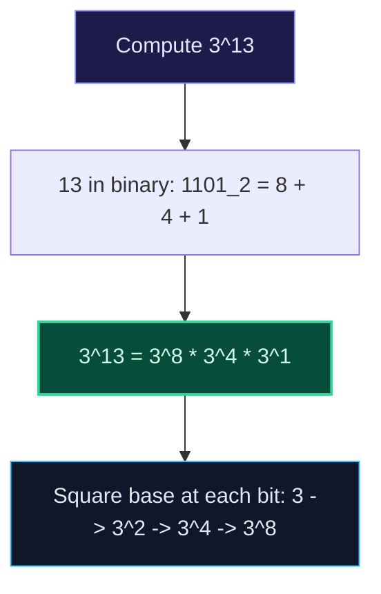

import { Callout } from "fumadocs-ui/components/callout";
import { Tabs, Tab } from "fumadocs-ui/components/tabs";
import { Steps, Step } from "fumadocs-ui/components/steps";
import { Cards, Card } from "fumadocs-ui/components/card";

## The Power of Repeated Squaring

Computing $a^b$ naively multiplies $a$ by itself $b$ times, taking $\mathcal{O}(b)$ time. For $b = 10^9$, this requires $10^9$ operations ($pprox 1$ second).

**Binary Exponentiation** computes $a^b \pmod M$ in strictly **$\mathcal{O}(\log_2 b)$ steps** (at most 30 multiplications for $b = 10^9$) using the algebraic identity:
$$a^b = \begin{cases} 1 & \text{if } b = 0 \\ (a^{b/2})^2 & \text{if } b \text{ is even} \\ a \cdot (a^{(b-1)/2})^2 & \text{if } b \text{ is odd} \end{cases}$$



---

## Multi-Language Implementations

<Tabs items={["Python", "TypeScript", "C++"]}>
<Tab value="Python">
```python
def power(base: int, exp: int, mod: int = 1_000_000_007) -> int:
    """Iterative binary exponentiation in O(log exp) time."""
    res = 1
    base %= mod

    while exp > 0:
        if exp & 1:  # If lowest bit is 1, multiply into result
            res = (res * base) % mod
        base = (base * base) % mod
        exp >>= 1

    return res

````
</Tab>
<Tab value="TypeScript">
```typescript
export function power(base: bigint, exp: bigint, mod: bigint = 1000000007n): bigint {
  let res = 1n;
  base %= mod;

  while (exp > 0n) {
    if ((exp & 1n) === 1n) {
      res = (res * base) % mod;
    }
    base = (base * base) % mod;
    exp >>= 1n;
  }

  return res;
}
````

</Tab>
<Tab value="C++">
```cpp
#include <cstdint>

int64_t power(int64_t base, int64_t exp, int64_t mod = 1000000007LL) {
int64_t res = 1;
base %= mod;

    while (exp > 0) {
        if (exp & 1) {
            res = (res * base) % mod;
        }
        base = (base * base) % mod;
        exp >>= 1;
    }

    return res;

}

```
</Tab>
</Tabs>
```
