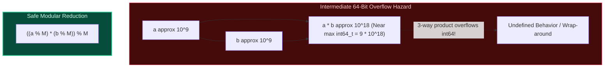

import { Callout } from "fumadocs-ui/components/callout";
import { Tabs, Tab } from "fumadocs-ui/components/tabs";
import { Steps, Step } from "fumadocs-ui/components/steps";
import { Cards, Card } from "fumadocs-ui/components/card";

## The Modular Equivalence Ring $\mathbb{Z} / M\mathbb{Z}$

Two integers $a$ and $b$ are congruent modulo $M$ (written $a \equiv b \pmod M$) if their difference $a - b$ is an integer multiple of $M$.

### The Fundamental Algebraic Properties

1. **Addition**:
   $$(a + b) \pmod M = ((a \pmod M) + (b \pmod M)) \pmod M$$
2. **Subtraction**:
   $$(a - b) \pmod M = ((a \pmod M) - (b \pmod M) + M) \pmod M$$
   _(Adding $M$ before the final modulo operation prevents negative results in languages like C++, Java, and JavaScript where `-5 % 3 == -2`)_.
3. **Multiplication**:
   $$(a \cdot b) \pmod M = ((a \pmod M) \cdot (b \pmod M)) \pmod M$$



---

## Multi-Language Implementations

<Tabs items={["Python", "TypeScript", "C++"]}>
<Tab value="Python">
```python
# In Python, integers possess arbitrary precision, so overflow is handled automatically,
# and the % operator always returns a non-negative remainder.
MOD = 1_000_000_007

def mod_add(a: int, b: int, m: int = MOD) -> int:
return (a % m + b % m) % m

def mod_sub(a: int, b: int, m: int = MOD) -> int:
return (a % m - b % m + m) % m

def mod_mul(a: int, b: int, m: int = MOD) -> int:
return ((a % m) \* (b % m)) % m

````
</Tab>
<Tab value="TypeScript">
```typescript
const MOD = 1000000007n;

export function modAdd(a: bigint, b: bigint, m: bigint = MOD): bigint {
  return ((a % m) + (b % m)) % m;
}

export function modSub(a: bigint, b: bigint, m: bigint = MOD): bigint {
  return (((a % m) - (b % m) + m) % m);
}

export function modMul(a: bigint, b: bigint, m: bigint = MOD): bigint {
  return ((a % m) * (b % m)) % m;
}
````

</Tab>
<Tab value="C++">
```cpp
#include <cstdint>

constexpr int64_t MOD = 1000000007LL;

inline int64_t modAdd(int64_t a, int64_t b, int64_t m = MOD) {
return ((a % m) + (b % m)) % m;
}

inline int64_t modSub(int64_t a, int64_t b, int64_t m = MOD) {
return ((a % m) - (b % m) + m) % m;
}

inline int64_t modMul(int64_t a, int64_t b, int64_t m = MOD) {
return (static_cast<\_\_int128_t>(a % m) \* (b % m)) % m;
}

```
</Tab>
</Tabs>
```
