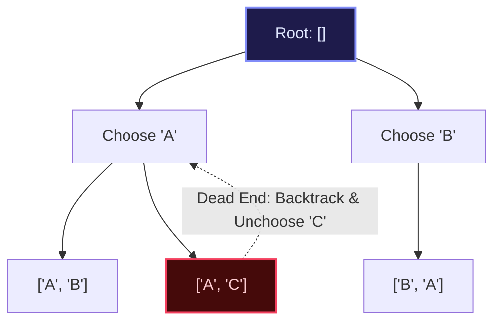

import { Callout } from "fumadocs-ui/components/callout";
import { Tabs, Tab } from "fumadocs-ui/components/tabs";
import { Steps, Step } from "fumadocs-ui/components/steps";
import { Cards, Card } from "fumadocs-ui/components/card";

## The Mental Model: State-Space Decision Trees

Backtracking is a systematic method for exploring all possible configurations of a search space. Think of it as walking through a maze: at every junction, you choose a path, explore it to its conclusion, and if you hit a dead end, you **backtrack** to the junction, undo your previous step, and try the next alternate path.



---

## The Golden Backtracking Template: Choose, Explore, Unchoose

Every backtracking algorithm follows this canonical invariant:

```python
def backtrack(state):
    if is_solution(state):
        record_solution(state)
        return

    for choice in candidate_choices(state):
        if is_valid(choice, state):
            # 1. CHOOSE: Mutate state
            apply_choice(choice, state)

            # 2. EXPLORE: Recurse into deeper state
            backtrack(state)

            # 3. UNCHOOSE: Backtrack and restore state
            revert_choice(choice, state)
```

---

## Canonical Archetype: The N-Queens Solver

Place $N$ chess queens on an $N \times N$ board such that no two queens attack each other (no two queens share the same row, column, or diagonal).

**Diagonal Invariant**:

- Major Diagonal (top-left to bottom-right): $r - c$ is constant.
- Minor Diagonal (top-right to bottom-left): $r + c$ is constant.
  By tracking occupied columns and diagonals using sets or bitmasks, validation executes in $\mathcal{O}(1)$ time per cell!

---

## Multi-Language Implementations

<Tabs items={["Python", "TypeScript", "C++"]}>
<Tab value="Python">
```python
from typing import List

def solve*n_queens(n: int) -> List[List[str]]:
"""Solves N-Queens problem using backtracking with O(1) diagonal checks."""
solutions = []
cols = set()
diag1 = set() # r - c
diag2 = set() # r + c
board = [["." for * in range(n)] for \_ in range(n)]

    def backtrack(r: int) -> None:
        if r == n:
            solutions.append(["".join(row) for row in board])
            return

        for c in range(n):
            if c in cols or (r - c) in diag1 or (r + c) in diag2:
                continue

            # 1. CHOOSE
            board[r][c] = "Q"
            cols.add(c)
            diag1.add(r - c)
            diag2.add(r + c)

            # 2. EXPLORE
            backtrack(r + 1)

            # 3. UNCHOOSE
            board[r][c] = "."
            cols.remove(c)
            diag1.remove(r - c)
            diag2.remove(r + c)

    backtrack(0)
    return solutions

````
</Tab>
<Tab value="TypeScript">
```typescript
export function solveNQueens(n: number): string[][] {
  const solutions: string[][] = [];
  const cols = new Set<number>();
  const diag1 = new Set<number>(); // r - c
  const diag2 = new Set<number>(); // r + c
  const board: string[][] = Array.from({ length: n }, () => Array(n).fill("."));

  function backtrack(r: number): void {
    if (r === n) {
      solutions.push(board.map((row) => row.join("")));
      return;
    }

    for (let c = 0; c < n; c++) {
      if (cols.has(c) || diag1.has(r - c) || diag2.has(r + c)) continue;

      // 1. CHOOSE
      board[r][c] = "Q";
      cols.add(c);
      diag1.add(r - c);
      diag2.add(r + c);

      // 2. EXPLORE
      backtrack(r + 1);

      // 3. UNCHOOSE
      board[r][c] = ".";
      cols.delete(c);
      diag1.delete(r - c);
      diag2.delete(r + c);
    }
  }

  backtrack(0);
  return solutions;
}
````

</Tab>
<Tab value="C++">
```cpp
#include <vector>
#include <string>
#include <unordered_set>

class NQueensSolver {
public:
std::vector<std::vector<std::string>> solveNQueens(int n) {
std::vector<std::vector<std::string>> solutions;
std::vector<std::string> board(n, std::string(n, '.'));
std::unordered_set<int> cols, diag1, diag2;

        backtrack(0, n, board, solutions, cols, diag1, diag2);
        return solutions;
    }

private:
void backtrack(int r, int n, std::vector<std::string>& board,
std::vector<std::vector<std::string>>& solutions,
std::unordered_set<int>& cols,
std::unordered_set<int>& diag1,
std::unordered_set<int>& diag2) {
if (r == n) {
solutions.push_back(board);
return;
}

        for (int c = 0; c < n; ++c) {
            if (cols.count(c) || diag1.count(r - c) || diag2.count(r + c)) continue;

            // 1. CHOOSE
            board[r][c] = 'Q';
            cols.insert(c);
            diag1.insert(r - c);
            diag2.insert(r + c);

            // 2. EXPLORE
            backtrack(r + 1, n, board, solutions, cols, diag1, diag2);

            // 3. UNCHOOSE
            board[r][c] = '.';
            cols.erase(c);
            diag1.erase(r - c);
            diag2.erase(r + c);
        }
    }

};

```
</Tab>
</Tabs>
```
