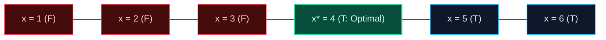

import { Callout } from "fumadocs-ui/components/callout";
import { Tabs, Tab } from "fumadocs-ui/components/tabs";
import { Steps, Step } from "fumadocs-ui/components/steps";
import { Cards, Card } from "fumadocs-ui/components/card";

## The Monotonic Feasibility Predicate $P(x)$

Standard binary search operates on sorted arrays to locate an item in $\mathcal{O}(\log N)$ time. **Binary Search on the Answer** generalizes this principle to optimization problems where the answer domain is bounded within $[\text{low}, \text{high}]$, and a condition function satisfies **monotonicity**:

$$P(x) = \begin{cases} \text{False} & \text{if } x < x^* \\ \text{True} & \text{if } x \ge x^* \end{cases}$$



Once monotonicity is verified, finding the minimal $x$ such that $P(x) == \text{True}$ requires only $\mathcal{O}(\log(\text{high} - \text{low}) \cdot \text{Cost}(P))$ operations!

---

## Canonical Archetype: Koko Eating Bananas

Koko loves bananas. There are $N$ piles of bananas, where the $i$-th pile has `piles[i]` bananas. The guards leave for $H$ hours. Koko wants to choose an eating speed $K$ (bananas/hour) such that she eats all bananas within $H$ hours while minimizing $K$.

### Feasibility Function

For speed $k$, the hours needed is:
$$\text{hours}(k) = \sum_{i=1}^N \lceil \text{piles}[i] / k \rceil$$

- If $\text{hours}(k) \le H$, speed $k$ is feasible $\implies$ try smaller speed ($R = k$).
- If $\text{hours}(k) > H$, speed $k$ is too slow $\implies$ must increase speed ($L = k + 1$).

---

## Multi-Language Implementations

<Tabs items={["Python", "TypeScript", "C++"]}>
<Tab value="Python">
```python
from typing import List
import math

def min_eating_speed(piles: List[int], h: int) -> int:
"""Binary search on the answer space [1, max(piles)]."""
low = 1
high = max(piles)
ans = high

    def can_finish(speed: int) -> bool:
        # Sum of ceil(pile / speed)
        hours = sum((p + speed - 1) // speed for p in piles)
        return hours <= h

    while low <= high:
        mid = low + (high - low) // 2
        if can_finish(mid):
            ans = mid
            high = mid - 1  # Seek smaller feasible speed
        else:
            low = mid + 1   # Too slow, increase speed

    return ans

````
</Tab>
<Tab value="TypeScript">
```typescript
export function minEatingSpeed(piles: number[], h: number): number {
  let low = 1;
  let high = Math.max(...piles);
  let ans = high;

  const canFinish = (speed: number): boolean => {
    let hours = 0;
    for (const p of piles) {
      hours += Math.ceil(p / speed);
    }
    return hours <= h;
  };

  while (low <= high) {
    const mid = low + Math.floor((high - low) / 2);
    if (canFinish(mid)) {
      ans = mid;
      high = mid - 1;
    } else {
      low = mid + 1;
    }
  }

  return ans;
}
````

</Tab>
<Tab value="C++">
```cpp
#include <vector>
#include <algorithm>
#include <numeric>

class KokoEatingBananas {
public:
int minEatingSpeed(const std::vector<int>& piles, int h) {
long long low = 1;
long long high = \*std::max_element(piles.begin(), piles.end());
long long ans = high;

        auto canFinish = [&](long long speed) -> bool {
            long long hours = 0;
            for (int p : piles) {
                hours += (p + speed - 1) / speed;
            }
            return hours <= h;
        };

        while (low <= high) {
            long long mid = low + (high - low) / 2;
            if (canFinish(mid)) {
                ans = mid;
                high = mid - 1;
            } else {
                low = mid + 1;
            }
        }

        return static_cast<int>(ans);
    }

};

```
</Tab>
</Tabs>
```
