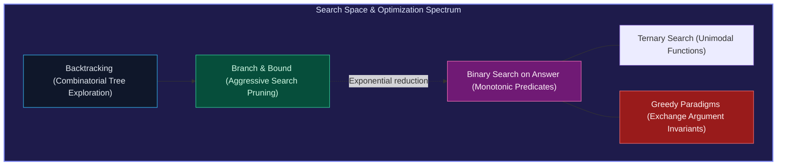

import { Callout } from "fumadocs-ui/components/callout";
import { Tabs, Tab } from "fumadocs-ui/components/tabs";
import { Steps, Step } from "fumadocs-ui/components/steps";
import { Cards, Card } from "fumadocs-ui/components/card";

## Navigating Exponential State Spaces

Algorithmic problem solving frequently demands finding an optimal configuration or verifying existence within an astronomical state space. When an explicit formula is unavailable, algorithms systematically traverse or prune decision trees:

1. **Exhaustive & Pruned State Space**: Backtracking explores decision paths via `Choose -> Explore -> Unchoose`, while intelligent bounding functions and symmetry breaking sever entire subtrees that cannot yield valid solutions.
2. **Monotonic Answer Spaces**: When a feasibility predicate $P(x)$ exhibits monotonicity ($P(x) = \text{True} \implies P(x+1) = \text{True}$), binary search on the answer space converges onto optimal parameters in logarithmic time.
3. **Unimodal Surfaces**: Ternary search bisects intervals into thirds to locate peaks or valleys without computing mathematical derivatives.
4. **Locally Optimal Greedy Decisions**: When problems exhibit optimal substructure and the greedy choice property, locally optimal steps (proven via exchange arguments) achieve global optimality without backtracking.

---

## Domain Modules

<Cards>
  <Card
    title="2.4.1. Backtracking & State Space"
    href="/docs/dsa/02-intermediate/search-space-and-greedy-paradigms/backtracking-and-state-space-search"
  >
    Depth-first decision trees, the Choose-Explore-Unchoose template, N-Queens,
    and Sudoku solvers.
  </Card>
  <Card
    title="2.4.2. Pruning Techniques"
    href="/docs/dsa/02-intermediate/search-space-and-greedy-paradigms/pruning-techniques"
  >
    Feasibility bounding, symmetry breaking, forward checking, and
    branch-and-bound pruning.
  </Card>
  <Card
    title="2.4.3. Binary Search on Answer"
    href="/docs/dsa/02-intermediate/search-space-and-greedy-paradigms/binary-search-on-the-answer"
  >
    Monotonic boolean feasibility functions, minimizing or maximizing parameters
    (Koko Eating Bananas).
  </Card>
  <Card
    title="2.4.4. Ternary Search"
    href="/docs/dsa/02-intermediate/search-space-and-greedy-paradigms/ternary-search-on-unimodal-functions"
  >
    Locating extrema on unimodal or convex functions by trisecting search
    intervals.
  </Card>
  <Card
    title="2.4.5. Greedy with Sorting"
    href="/docs/dsa/02-intermediate/search-space-and-greedy-paradigms/greedy-algorithms-with-sorting"
  >
    Greedy choice property, optimal substructure, and formal exchange argument
    proofs.
  </Card>
  <Card
    title="2.4.6. Interval Scheduling & Merging"
    href="/docs/dsa/02-intermediate/search-space-and-greedy-paradigms/interval-scheduling-and-merging"
  >
    Merging intervals, maximum non-overlapping scheduling, and meeting room
    allocations.
  </Card>
  <Card
    title="2.4.7. Kadane's Algorithm"
    href="/docs/dsa/02-intermediate/search-space-and-greedy-paradigms/kadanes-algorithm"
  >
    Linear time maximum subarray sum, index recovery, and circular subarray
    variations.
  </Card>
</Cards>
