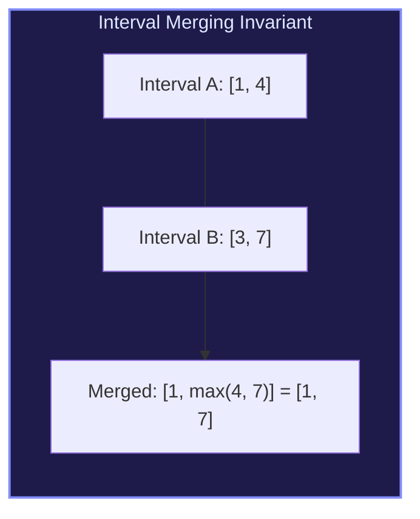

import { Callout } from "fumadocs-ui/components/callout";
import { Tabs, Tab } from "fumadocs-ui/components/tabs";
import { Steps, Step } from "fumadocs-ui/components/steps";
import { Cards, Card } from "fumadocs-ui/components/card";

## The Geometry of Intervals

An interval is represented as a contiguous range $[\text{start}, \text{end}]$. Problems operating on collections of intervals are solved by sorting the intervals by start time or end time, reducing complex $2D$ overlap checks into linear sweep-line scans.



---

## Pattern 1: Merge Overlapping Intervals

Given an array of intervals, merge all overlapping intervals.

1. Sort intervals by **start time** in ascending order.
2. Initialize `merged = [intervals[0]]`.
3. For each interval $[s, e]$ from 1 to $N-1$:
   - If $s \le \text{merged.last.end}$, an overlap exists $\implies$ update $\text{merged.last.end} = \max(\text{merged.last.end}, e)$.
   - Otherwise, no overlap $\implies$ append $[s, e]$ to `merged`.

- **Time Complexity**: $\mathcal{O}(N \log N)$ due to sorting.

---

## Pattern 2: Maximum Non-Overlapping Intervals (Interval Scheduling)

Find the maximum number of mutually compatible, non-overlapping intervals.

**The Earliest End-Time Greedy Rule**:
Always pick the interval that finishes **first** (sort by `end` time).
_Proof_: Finishing earliest leaves the maximum remaining time available for subsequent intervals.

---

## Pattern 3: Minimum Meeting Rooms Required

Find the minimum number of conference rooms required to host all scheduled meetings.

- **Sweep-Line Min-Heap Approach**:
  1. Sort meetings by `start` time.
  2. Maintain a Min-Heap of meeting `end` times.
  3. For each meeting, if its start time $\ge \text{heap.peek()}$, reuse that room (pop from heap).
  4. Push current meeting's end time to heap.
  5. The heap size at the end represents the peak concurrent rooms needed.

---

## Multi-Language Implementations

<Tabs items={["Python", "TypeScript", "C++"]}>
<Tab value="Python">
```python
from typing import List
import heapq

def merge_intervals(intervals: List[List[int]]) -> List[List[int]]:
"""Merges overlapping intervals in O(N log N) time."""
if not intervals:
return []

    # Sort ascending by start time
    intervals.sort(key=lambda x: x[0])
    merged = [intervals[0]]

    for start, end in intervals[1:]:
        last_end = merged[-1][1]
        if start <= last_end:
            merged[-1][1] = max(last_end, end)
        else:
            merged.append([start, end])

    return merged

def min_meeting_rooms(intervals: List[List[int]]) -> int:
"""Computes minimum meeting rooms via Min-Heap."""
if not intervals:
return 0

    intervals.sort(key=lambda x: x[0])
    rooms = []  # Min-heap of end times

    for start, end in intervals:
        if rooms and rooms[0] <= start:
            heapq.heappop(rooms)  # Room is free, reuse it
        heapq.heappush(rooms, end)

    return len(rooms)

````
</Tab>
<Tab value="TypeScript">
```typescript
export function mergeIntervals(intervals: number[][]): number[][] {
  if (intervals.length === 0) return [];

  intervals.sort((a, b) => a[0] - b[0]);
  const merged: number[][] = [intervals[0]];

  for (let i = 1; i < intervals.length; i++) {
    const [start, end] = intervals[i];
    const last = merged[merged.length - 1];

    if (start <= last[1]) {
      last[1] = Math.max(last[1], end);
    } else {
      merged.push([start, end]);
    }
  }

  return merged;
}
````

</Tab>
<Tab value="C++">
```cpp
#include <vector>
#include <algorithm>
#include <queue>

std::vector<std::vector<int>> mergeIntervals(std::vector<std::vector<int>>& intervals) {
if (intervals.empty()) return {};

    std::sort(intervals.begin(), intervals.end(), [](const auto& a, const auto& b) {
        return a[0] < b[0];
    });

    std::vector<std::vector<int>> merged;
    merged.push_back(intervals[0]);

    for (size_t i = 1; i < intervals.size(); ++i) {
        if (intervals[i][0] <= merged.back()[1]) {
            merged.back()[1] = std::max(merged.back()[1], intervals[i][1]);
        } else {
            merged.push_back(intervals[i]);
        }
    }

    return merged;

}

```
</Tab>
</Tabs>
```
