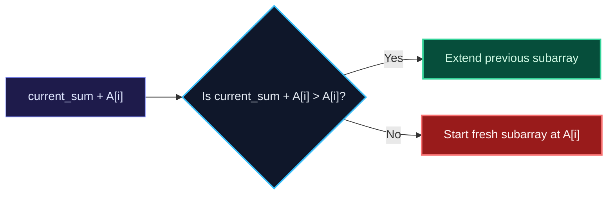

import { Callout } from "fumadocs-ui/components/callout";
import { Tabs, Tab } from "fumadocs-ui/components/tabs";
import { Steps, Step } from "fumadocs-ui/components/steps";
import { Cards, Card } from "fumadocs-ui/components/card";

## The Maximum Subarray Dilemma

Given an integer array $A$ containing both positive and negative values, find the contiguous subarray that has the largest sum.

- Checking all pairs $(i, j)$ takes $\mathcal{O}(N^2)$ time.
- Joseph Kadane (1984) formulated an optimal **$\mathcal{O}(N)$ time and $\mathcal{O}(1)$ space** dynamic programming algorithm.



---

## The Dynamic Programming Recurrence

Let $DP[i]$ be the maximum subarray sum ending strictly at index $i$:
$$DP[i] = \max(A[i], DP[i-1] + A[i])$$
Notice that $DP[i]$ depends only on $DP[i-1]$. We can eliminate the array entirely and track the running maximum in a single variable `current_max`:
$$\text{current\_max} = \max(A[i], \text{current\_max} + A[i])$$
$$\text{global\_max} = \max(\text{global\_max}, \text{current\_max})$$

---

## Extension: Maximum Circular Subarray Sum

What if the array wraps around cyclically? The maximum subarray is either:

1. **Linear**: Contained entirely within the array without wrap-around $\implies \text{KadaneMax}(A)$.
2. **Circular (Wraps around edges)**: The elements left out in the middle form the **Minimum Subarray Sum**!
   $$\text{CircularMax} = \text{TotalSum} - \text{KadaneMin}(A)$$

_Edge Case_: If all elements are negative, $\text{TotalSum} - \text{KadaneMin} = 0$ (an empty subarray). In that case, return $\text{KadaneMax}(A)$.

---

## Multi-Language Implementations

<Tabs items={["Python", "TypeScript", "C++"]}>
<Tab value="Python">
```python
from typing import List, Tuple

def max_subarray(nums: List[int]) -> int:
"""Standard Kadane's algorithm in O(N) time and O(1) space."""
curr_max = nums[0]
global_max = nums[0]

    for x in nums[1:]:
        curr_max = max(x, curr_max + x)
        global_max = max(global_max, curr_max)

    return global_max

def max_subarray_with_indices(nums: List[int]) -> Tuple[int, int, int]:
"""Returns (max_sum, start_idx, end_idx)."""
curr_max = nums[0]
global_max = nums[0]
start = end = temp_start = 0

    for i in range(1, len(nums)):
        if nums[i] > curr_max + nums[i]:
            curr_max = nums[i]
            temp_start = i
        else:
            curr_max += nums[i]

        if curr_max > global_max:
            global_max = curr_max
            start = temp_start
            end = i

    return global_max, start, end

````
</Tab>
<Tab value="TypeScript">
```typescript
export function maxSubArray(nums: number[]): number {
  let currMax = nums[0];
  let globalMax = nums[0];

  for (let i = 1; i < nums.length; i++) {
    currMax = Math.max(nums[i], currMax + nums[i]);
    globalMax = Math.max(globalMax, currMax);
  }

  return globalMax;
}
````

</Tab>
<Tab value="C++">
```cpp
#include <vector>
#include <algorithm>

int maxSubArray(const std::vector<int>& nums) {
int currMax = nums[0];
int globalMax = nums[0];

    for (size_t i = 1; i < nums.size(); ++i) {
        currMax = std::max(nums[i], currMax + nums[i]);
        globalMax = std::max(globalMax, currMax);
    }

    return globalMax;

}

```
</Tab>
</Tabs>
```
