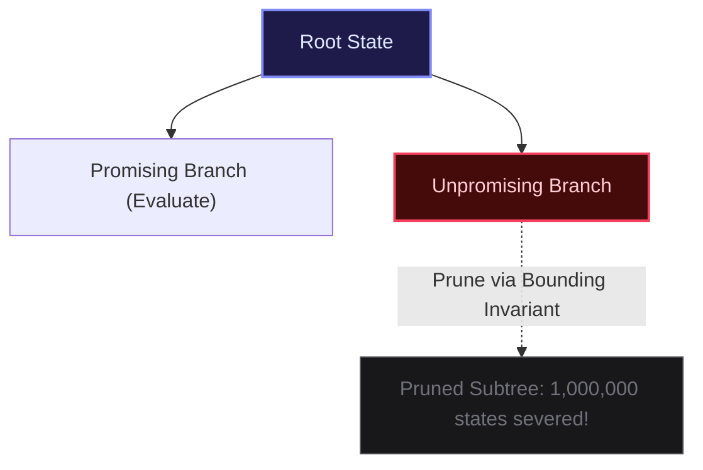

import { Callout } from "fumadocs-ui/components/callout";
import { Tabs, Tab } from "fumadocs-ui/components/tabs";
import { Steps, Step } from "fumadocs-ui/components/steps";
import { Cards, Card } from "fumadocs-ui/components/card";

## The Necessity of Search Pruning

A brute-force backtracking search across an unpruned state space grows exponentially ($\mathcal{O}(B^D)$, where $B$ is the branching factor and $D$ is the depth). For $B = 4$ and $D = 30$, the search space comprises $4^{30} pprox 10^{18}$ states, requiring centuries of computation.

**Pruning** is the mathematical art of proving that an entire subtree of the decision space contains no valid or optimal solutions, permitting the algorithm to discard millions of states in a single constant-time check.



---

## The Four Pruning Archetypes

### 1. Feasibility Pruning (Constraint Violation)

Halt exploration immediately when a hard invariant is broken (e.g., in Sudoku, placing a duplicate number in the same $3 \times 3$ box).

### 2. Optimality Pruning (Branch-and-Bound)

In optimization problems (finding minimum cost or maximum value), maintain `best_so_far`. If the current partial cost plus an optimistic heuristic estimate of remaining cost exceeds `best_so_far`:
$$\text{cost}(\text{current}) + h(\text{remaining}) \ge \text{best\_so\_far}$$
Then abandon the branch immediately.

### 3. Symmetry Breaking

Eliminate permutations that yield geometrically or logically identical configurations. For example, in the N-Queens problem on an $8 \times 8$ board, solving for queen placements on columns $0..3$ of the first row and reflecting solutions halves the search time.

### 4. Deduplication via Sorting (Subsets II)

When searching for unique combinations in arrays containing duplicate elements, sort the array first. If `nums[i] == nums[i-1]` and the previous identical element was not chosen in the current recursion level, skip `nums[i]`.

---

## Production Implementation: Combination Sum with Pruning

<Tabs items={["Python", "TypeScript", "C++"]}>
<Tab value="Python">
```python
from typing import List

def combination_sum_pruned(candidates: List[int], target: int) -> List[List[int]]:
"""Pruned backtracking for Combination Sum using sorting and early bounds.""" # Sorting enables early termination pruning
candidates.sort()
result = []

    def backtrack(start_idx: int, remaining: int, path: List[int]) -> None:
        if remaining == 0:
            result.append(list(path))
            return

        for i in range(start_idx, len(candidates)):
            val = candidates[i]
            # Feasibility pruning: since array is sorted, all subsequent values exceed remaining
            if val > remaining:
                break

            path.append(val)
            backtrack(i, remaining - val, path)  # Can reuse same element
            path.pop()

    backtrack(0, target, [])
    return result

````
</Tab>
<Tab value="TypeScript">
```typescript
export function combinationSumPruned(candidates: number[], target: number): number[][] {
  candidates.sort((a, b) => a - b);
  const result: number[][] = [];

  function backtrack(startIdx: number, remaining: number, path: number[]): void {
    if (remaining === 0) {
      result.push([...path]);
      return;
    }

    for (let i = startIdx; i < candidates.length; i++) {
      const val = candidates[i];
      // Early pruning: subsequent candidates are strictly larger
      if (val > remaining) break;

      path.push(val);
      backtrack(i, remaining - val, path);
      path.pop();
    }
  }

  backtrack(0, target, []);
  return result;
}
````

</Tab>
<Tab value="C++">
```cpp
#include <vector>
#include <algorithm>

class CombinationSumPruned {
public:
std::vector<std::vector<int>> combinationSum(std::vector<int>& candidates, int target) {
std::sort(candidates.begin(), candidates.end());
std::vector<std::vector<int>> result;
std::vector<int> path;
backtrack(0, target, candidates, path, result);
return result;
}

private:
void backtrack(int startIdx, int remaining, const std::vector<int>& candidates,
std::vector<int>& path, std::vector<std::vector<int>>& result) {
if (remaining == 0) {
result.push_back(path);
return;
}

        for (int i = startIdx; i < candidates.size(); ++i) {
            int val = candidates[i];
            if (val > remaining) break; // Pruning condition

            path.push_back(val);
            backtrack(i, remaining - val, candidates, path, result);
            path.pop();
        }
    }

};

```
</Tab>
</Tabs>
```
