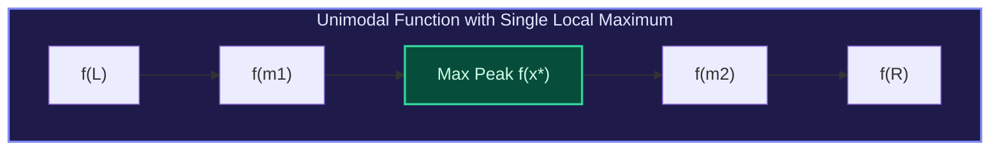

import { Callout } from "fumadocs-ui/components/callout";
import { Tabs, Tab } from "fumadocs-ui/components/tabs";
import { Steps, Step } from "fumadocs-ui/components/steps";
import { Cards, Card } from "fumadocs-ui/components/card";

## The Unimodal Function Definition

Binary search requires strict monotonicity across the entire search domain. What happens when a function increases to a single peak and then decreases (or strictly decreases to a valley and then increases)? Such a function is termed **Unimodal**.



Because the function is not monotonic, standard binary search cannot determine which half to discard. **Ternary Search** resolves this by dividing the current interval $[L, R]$ into three equal segments using two interior points:
$$m_1 = L + \frac{R - L}{3}, \quad m_2 = R - \frac{R - L}{3}$$

---

## Trisection Elimination Rules (Maximization)

Compare the function values at $m_1$ and $m_2$:

1. **If $f(m_1) < f(m_2)$**:
   The peak cannot lie in $[L, m_1]$. We can safely discard the leftmost third by updating $L = m_1$.
2. **If $f(m_1) > f(m_2)$**:
   The peak cannot lie in $[m_2, R]$. We can safely discard the rightmost third by updating $R = m_2$.
3. **If $f(m_1) == f(m_2)$**:
   The peak lies between $m_1$ and $m_2$. We can shrink both boundaries ($L = m_1, R = m_2$).

At every step, the search interval shrinks to $\frac{2}{3}$ of its previous length:
$$N \cdot \left(\frac{2}{3}\right)^k \implies \mathcal{O}(\log_{1.5} N) \text{ steps}$$

---

## Multi-Language Implementations

<Tabs items={["Python", "TypeScript", "C++"]}>
<Tab value="Python">
```python
from typing import Callable

def ternary_search_max(f: Callable[[float], float], left: float, right: float, eps: float = 1e-7) -> float:
"""Finds x in [left, right] that maximizes unimodal function f(x)."""
while right - left > eps:
m1 = left + (right - left) / 3.0
m2 = right - (right - left) / 3.0

        if f(m1) < f(m2):
            left = m1   # Peak is in [m1, right]
        else:
            right = m2  # Peak is in [left, m2]

    return (left + right) / 2.0

````
</Tab>
<Tab value="TypeScript">
```typescript
export function ternarySearchMax(
  f: (x: number) => number,
  left: number,
  right: number,
  eps: number = 1e-7
): number {
  while (right - left > eps) {
    const m1 = left + (right - left) / 3;
    const m2 = right - (right - left) / 3;

    if (f(m1) < f(m2)) {
      left = m1;
    } else {
      right = m2;
    }
  }

  return (left + right) / 2;
}
````

</Tab>
<Tab value="C++">
```cpp
#include <functional>

double ternarySearchMax(std::function<double(double)> f, double left, double right, double eps = 1e-7) {
while (right - left > eps) {
double m1 = left + (right - left) / 3.0;
double m2 = right - (right - left) / 3.0;

        if (f(m1) < f(m2)) {
            left = m1;
        } else {
            right = m2;
        }
    }
    return (left + right) / 2.0;

}

```
</Tab>
</Tabs>
```
