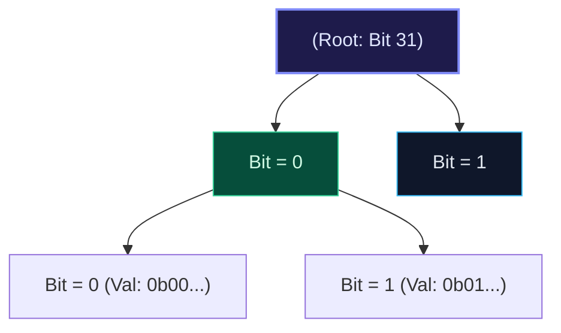

import { Callout } from "fumadocs-ui/components/callout";
import { Tabs, Tab } from "fumadocs-ui/components/tabs";
import { Steps, Step } from "fumadocs-ui/components/steps";
import { Cards, Card } from "fumadocs-ui/components/card";

## The Binary Alphabet $\{0, 1\}$ Mapping

A **Bitwise Trie** (or Binary Trie) is a prefix tree where the alphabet consists strictly of two binary digits: $\{0, 1\}$. Every non-negative 32-bit integer can be viewed as a 31-character string of binary bits ordered from the Most Significant Bit (MSB, bit 30) down to the Least Significant Bit (LSB, bit 0).



---

## The Maximum XOR Pair Problem

Given an array of $N$ integers, find the maximum value of $A[i] \oplus A[j]$. A brute-force search compares all pairs in $\mathcal{O}(N^2)$ time.

**The Bitwise Trie Greedy Solution**:
To maximize $x \oplus y$, at each bit position $b$ (from MSB down to LSB), we greedily want the bit of $y$ to be the **opposite** of the bit in $x$ (i.e., `opposite_bit = 1 - current_bit`), because $1 \oplus 0 = 1$ and $0 \oplus 1 = 1$.

1. Insert all numbers into the 31-bit binary trie.
2. For each number $x$:
   - Trace the trie from bit 30 down to 0.
   - If the opposite bit child exists, branch into it and contribute $2^b$ to the XOR sum.
   - Otherwise, take the existing bit child with zero XOR contribution.
3. Total time: $\mathcal{O}(31 \cdot N) = \mathcal{O}(N)$ linear time!

---

## Multi-Language Implementations

<Tabs items={["Python", "TypeScript", "C++"]}>
<Tab value="Python">
```python
from typing import List

class BitwiseTrieNode:
def **init**(self):
self.children = [None, None]

class BitwiseTrie:
def **init**(self):
self.root = BitwiseTrieNode()

    def insert(self, num: int) -> None:
        curr = self.root
        for b in range(30, -1, -1):
            bit = (num >> b) & 1
            if not curr.children[bit]:
                curr.children[bit] = BitwiseTrieNode()
            curr = curr.children[bit]

    def find_max_xor(self, num: int) -> int:
        curr = self.root
        max_xor = 0
        for b in range(30, -1, -1):
            bit = (num >> b) & 1
            opposite = 1 - bit
            if curr.children[opposite]:
                max_xor |= (1 << b)
                curr = curr.children[opposite]
            else:
                curr = curr.children[bit]
        return max_xor

def find_maximum_xor(nums: List[int]) -> int:
trie = BitwiseTrie()
for x in nums:
trie.insert(x)
return max(trie.find_max_xor(x) for x in nums)

````
</Tab>
<Tab value="TypeScript">
```typescript
class BitNode {
  children: (BitNode | null)[] = [null, null];
}

export class BitwiseTrie {
  root = new BitNode();

  insert(num: number): void {
    let curr = this.root;
    for (let b = 30; b >= 0; b--) {
      const bit = (num >> b) & 1;
      if (!curr.children[bit]) {
        curr.children[bit] = new BitNode();
      }
      curr = curr.children[bit]!;
    }
  }

  findMaxXor(num: number): number {
    let curr = this.root;
    let maxXor = 0;
    for (let b = 30; b >= 0; b--) {
      const bit = (num >> b) & 1;
      const opposite = 1 - bit;
      if (curr.children[opposite]) {
        maxXor |= (1 << b);
        curr = curr.children[opposite]!;
      } else {
        curr = curr.children[bit]!;
      }
    }
    return maxXor;
  }
}
````

</Tab>
<Tab value="C++">
```cpp
#include <vector>
#include <algorithm>

class BitNode {
public:
BitNode\* children[2];
BitNode() {
children[0] = nullptr;
children[1] = nullptr;
}
};

class BitwiseTrie {
private:
BitNode\* root;

public:
BitwiseTrie() : root(new BitNode()) {}

    void insert(int num) {
        BitNode* curr = root;
        for (int b = 30; b >= 0; --b) {
            int bit = (num >> b) & 1;
            if (!curr->children[bit]) {
                curr->children[bit] = new BitNode();
            }
            curr = curr->children[bit];
        }
    }

    int findMaxXor(int num) const {
        BitNode* curr = root;
        int maxXor = 0;
        for (int b = 30; b >= 0; --b) {
            int bit = (num >> b) & 1;
            int opp = 1 - bit;
            if (curr->children[opp]) {
                maxXor |= (1 << b);
                curr = curr->children[opp];
            } else {
                curr = curr->children[bit];
            }
        }
        return maxXor;
    }

};

```
</Tab>
</Tabs>
```
