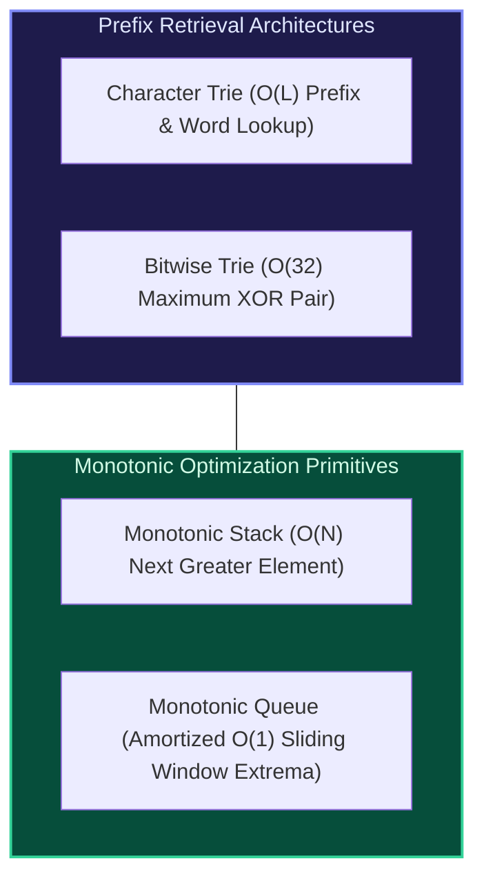

import { Callout } from "fumadocs-ui/components/callout";
import { Tabs, Tab } from "fumadocs-ui/components/tabs";
import { Steps, Step } from "fumadocs-ui/components/steps";
import { Cards, Card } from "fumadocs-ui/components/card";

## The Power of Specialized Primitives

While general-purpose trees and linear collections satisfy broad algorithmic requirements, specific domain problems—such as character prefix matching, bitwise integer maximization, nearest greater element lookups, and sliding window extrema—admit radical optimizations when using specialized data structures.

This domain unites two high-leverage algorithmic concepts:

1. **Tree-Based Prefix Retrieval**: Tries (character and bitwise) factor out common prefixes to execute string search and XOR optimization in time proportional only to the key length ($L$ characters or 32 bits), completely independent of dictionary size $N$.
2. **Monotonic Invariant Containers**: Stacks and queues that maintain strictly increasing or decreasing elements discard obsolete sub-optimal candidates, reducing quadratic $\mathcal{O}(N^2)$ brute-force window queries to amortized $\mathcal{O}(1)$ per item.

---

## Domain Modules

<Cards>
  <Card
    title="2.3.1. Prefix Trees and Tries"
    href="/docs/dsa/02-intermediate/string-data-structures-and-monotonic-structures/prefix-trees-and-tries"
  >
    Character-labeled edge trees, O(L) insert/search/startsWith, dictionary
    search, and autocomplete mechanics.
  </Card>
  <Card
    title="2.3.2. Bitwise Tries"
    href="/docs/dsa/02-intermediate/string-data-structures-and-monotonic-structures/bitwise-tries"
  >
    Binary alphabet trie over 32-bit integers, maximum XOR pair queries, and
    prefix bit routing.
  </Card>
  <Card
    title="2.3.3. Monotonic Stacks"
    href="/docs/dsa/02-intermediate/string-data-structures-and-monotonic-structures/monotonic-stacks"
  >
    Monotonically increasing/decreasing stacks, Next Greater Element, Stock
    Span, and Largest Rectangle in Histogram.
  </Card>
  <Card
    title="2.3.4. Monotonic Queues"
    href="/docs/dsa/02-intermediate/string-data-structures-and-monotonic-structures/monotonic-queues"
  >
    Double-ended queues maintaining monotonic candidates, amortized O(1) sliding
    window min/max.
  </Card>
</Cards>
