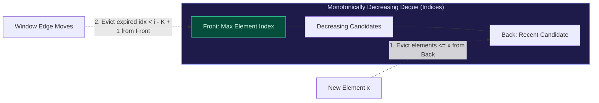

import { Callout } from "fumadocs-ui/components/callout";
import { Tabs, Tab } from "fumadocs-ui/components/tabs";
import { Steps, Step } from "fumadocs-ui/components/steps";
import { Cards, Card } from "fumadocs-ui/components/card";

## The Sliding Window Maximum Dilemma

Given an array of $N$ integers and a window of size $K$ sliding from left to right, we need to report the maximum value in the window at each position.

- Re-scanning the window takes $\mathcal{O}(K)$ per step $\implies \mathcal{O}(N \cdot K)$ total.
- A balanced BST or Heap takes $\mathcal{O}(\log K)$ per step $\implies \mathcal{O}(N \log K)$ total.

**The Monotonic Queue Breakthrough**:
A double-ended queue (**Deque**) maintaining elements in strictly descending order computes each window extremum in **amortized $\mathcal{O}(1)$ time**, totaling **$\mathcal{O}(N)$** overall.



---

## The Three Invariant Maintenance Rules

For each index $i$ with value `nums[i]`:

1. **Remove Sub-optimal Elements from Back**:
   Any element in the deque smaller than or equal to `nums[i]` can never become the maximum of any future window containing `nums[i]`, because `nums[i]` is both larger and will outlive them. Pop them from the back.
2. **Push Current Index**:
   Push index $i$ to the back of the deque.
3. **Remove Expired Elements from Front**:
   If the index at the front of the deque is $\le i - K$, it has fallen outside the current window boundary. Pop it from the front.
4. **Read Window Maximum**:
   Once $i \ge K - 1$, the front of the deque holds the maximum element of the current window.

---

## Multi-Language Implementations

<Tabs items={["Python", "TypeScript", "C++"]}>
<Tab value="Python">
```python
from collections import deque
from typing import List

def max_sliding_window(nums: List[int], k: int) -> List[int]:
"""Calculates maximum value in sliding window of size k in O(N) time."""
if not nums or k == 0:
return []

    dq = deque()  # Stores indices of candidates
    result = []

    for i, x in enumerate(nums):
        # 1. Remove expired elements from front
        while dq and dq[0] < i - k + 1:
            dq.popleft()

        # 2. Remove sub-optimal smaller elements from back
        while dq and nums[dq[-1]] <= x:
            dq.pop()

        # 3. Append current index
        dq.append(i)

        # 4. Record result once first full window is reached
        if i >= k - 1:
            result.append(nums[dq[0]])

    return result

````
</Tab>
<Tab value="TypeScript">
```typescript
export function maxSlidingWindow(nums: number[], k: number): number[] {
  if (nums.length === 0 || k === 0) return [];

  const dq: number[] = []; // Stores indices
  const result: number[] = [];

  for (let i = 0; i < nums.length; i++) {
    // 1. Remove expired elements from front
    while (dq.length > 0 && dq[0] < i - k + 1) {
      dq.shift();
    }

    // 2. Remove smaller elements from back
    while (dq.length > 0 && nums[dq[dq.length - 1]] <= nums[i]) {
      dq.pop();
    }

    // 3. Push current index
    dq.push(i);

    // 4. Record max
    if (i >= k - 1) {
      result.push(nums[dq[0]]);
    }
  }

  return result;
}
````

</Tab>
<Tab value="C++">
```cpp
#include <vector>
#include <deque>

std::vector<int> maxSlidingWindow(const std::vector<int>& nums, int k) {
if (nums.empty() || k == 0) return {};

    std::deque<int> dq; // Stores indices
    std::vector<int> result;
    result.reserve(nums.size() - k + 1);

    for (int i = 0; i < nums.size(); ++i) {
        // 1. Remove expired from front
        while (!dq.empty() && dq.front() < i - k + 1) {
            dq.pop_front();
        }

        // 2. Remove smaller elements from back
        while (!dq.empty() && nums[dq.back()] <= nums[i]) {
            dq.pop_back();
        }

        // 3. Push current index
        dq.push_back(i);

        // 4. Record result
        if (i >= k - 1) {
            result.push_back(nums[dq.front()]);
        }
    }

    return result;

}

```
</Tab>
</Tabs>
```
